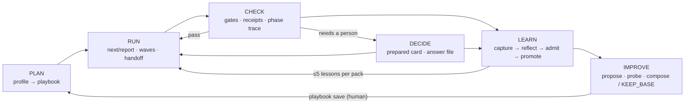

# Plan — multi-unit-playbooks

_Constitution: C-STACK-FACT, C-API-COMPAT, C-BOUNDARIES, C-REGRESSION-ORACLE_

## 1. The cycle



Every arrow is a file. Nothing is remembered in a chat, so any host, any session and any person can
pick the cycle up where it stopped.

## 2. Who decides what

| Step | Deterministic core (decides) | Model in the host (proposes) | Person (authorizes) |
|---|---|---|---|
| Profile | signals + sources | — | answers `unknown` signals |
| Plan | bands, producer-in-plan check, nearest library playbook, counts | free-text intent → keywords | `playbook save` |
| Run | next directive, waves, transitions, handoff pack, recall check | does the step's work | — |
| Check | gates C1–C7, EARS, constitution, receipts, phase trace, wave referee | — | override (recorded, never autonomous) |
| Decide | card schema, evidence lines, seeded ids, answer completeness | drafts card text and recommendation | `hil answer --by` |
| Learn | capture, admission gate, invariant/domain separation, dedupe, withdraw | reflector rows + ≤1 lesson | `memory promote --by` |
| Improve | probe by replay, metric deltas, KEEP_BASE, budget | proposes candidates | `playbook save --by` |

The rule behind the table: **a model output is never a verdict**. It becomes one only after a
deterministic check passes it, and it becomes durable only after a named person accepts it.

## 3. What each source contributes

| Need | From AWS AI-DLC | From Google Harness² | Already in open-sdd |
|---|---|---|---|
| Choose the flow per case | composer: 5 entropy components, bands, `validate-grid`, nearest stock ≤ 2 | — | `PROJECT_TYPES`, `FLOWS`, `MODULES`, rigor ladder |
| Run across hosts | engine `next` emits one typed directive, `report` commits atomically | harness as a file tree with a fixed editable surface | skills for every registered host, MCP server, prompt templates |
| Big programmes | units-of-work DAG → topological batches; stateless referee re-runs the project's own check, anti-tamper on tests | — | `waves`, `_Boundary:_`, `_Depends:_` |
| Context between steps | consumes/produces contract; fingerprint → `stale` propagation | — | `contextPack.ts`, compaction threshold 0.7 |
| Trustworthy review | hash-bound review receipts, freeze after review, artifacts-exist guard | — | gates, receipt sha256, audit bundle |
| Phase integrity | verification chain (narrated there) | — | traceability gate — **enforced here** |
| Human decisions | question files (A–E + Other, `[Answer]:`), hash-bound confirmation, revision ladder with accept-as-is at 3, override as separate decision, human-presence check | evidence-required decision notes; seeded anonymized comparison | `hitl.ts` triggers and thresholds |
| Learning | diary → verbatim candidates → human ticks; project scope by default; compile-once | reflector rows with `confounded` default; ≤1 lesson `{cue, lesson, evidence, confidence}`; `NO_ENTRY`; invariant vs domain; library facts are hypotheses | `memory.ts` provenance, quarantine, withdraw-by-origin |
| Self-improvement | in-flight recompose of pending steps only | propose–probe–compose, KEEP_BASE, budget ledger | gates as executable probes |
| Safety of learning | rules layer is additive, no override | evidence is data not instructions; no oracle leakage | constitution, G5 screening |

What we deliberately leave out: AI-DLC's model-scored composite as a router (its own docs call the weights
uncalibrated), its Stop-hook and compaction hooks (host-specific), its LLM org-conflict check; Harness²'s
LLM editor/composer/selector loop and automatic adoption. open-sdd ships no model, so these stay optional
host behaviour, never part of a verdict.

## 4. Plan: from intent to playbook

1. `playbook profile` computes signals (terrain, repos, units, tests, iac, ui, governance, aidlc, size)
   from `brownfield survey` plus file checks, each with its source; unknowns become questions (≤3).
2. The planner bands the five components (LOW <0.30, MED <0.70, HIGH). A signal sets a band; a human
   answer overrides it. A step's cost (1–5, data file) is justified only when its component band supports
   it: cost ≥4 needs > 0.4, cost 2 needs > 0.2, cost 1 needs > 0.
3. If a library playbook is within two steps of the result, it is proposed unchanged.
4. Output: step table (EXECUTE/SKIP · reason · evidence) and the two numbers people care about —
   steps and human gates.

### Playbook format

```json
{
  "name": "multi-unit",
  "extends": "base/spec-anchored",
  "lead": "aidlc",
  "profile": {
    "repos": ">=2 | units>=2"
  },
  "budget": {
    "handoff_tokens": 8000,
    "improve_probes": 6,
    "always_on_chars": 6000
  },
  "phases": [
    {
      "id": "inception",
      "steps": [
        {
          "use": "aidlc:stage/requirements-analysis",
          "checks": [
            "opensdd:ears",
            "opensdd:constitution"
          ]
        },
        {
          "use": "aidlc:stage/units-generation"
        },
        {
          "use": "aidlc:stage/contract-design",
          "when": "units >= 2"
        }
      ]
    },
    {
      "id": "construction",
      "steps": [
        {
          "use": "opensdd:command/waves"
        },
        {
          "use": "aidlc:stage/code-generation",
          "checks": [
            "opensdd:gates-c1-c3"
          ],
          "review": "human"
        }
      ]
    }
  ],
  "customize": [
    {
      "when": "governance == enterprise",
      "add": [
        {
          "phase": "inception",
          "after": "requirements-analysis",
          "use": "aidlc:stage/practices-discovery"
        }
      ]
    }
  ]
}
```

`when` is evaluated by open-sdd at plan and build time. Customizations are additive (`add`, `skip`),
so a saved playbook can never silently remove a gate from its base.

## 5. Run: one contract for every host

```
host (Claude Code · Codex · Cursor · Copilot · Windsurf · OpenCode · Gemini CLI · Antigravity · Cline/Axet · any MCP client)
   │  open-sdd next --json          → {"kind":"run-step","step":"units-generation","pack":".sdd/handoff/…"}
   │  …the host's agent does the work…
   └─ open-sdd report --step units-generation --result awaiting-approval
```

- Seven directive kinds, each with a JSON schema; unknown keys are rejected; a malformed directive exits
  non-zero. Skills, MCP tools and prompt templates are thin loops over `next`/`report`, so adding a host
  means adding a template, never logic.
- **Waves.** Units come from the AI-DLC dependency block or from `_Depends:_`; topological levels are the
  waves. The referee re-runs the project's own check command per claimed unit, compares protected test
  files against the wave baseline, and merges only if all pass. A failed unit keeps its siblings and stops
  for a person.
- **Handoff.** Head (goal, acceptance ids, principles, open decisions) · body (consumed artifacts as path +
  sha256 + ≤40-line summary, ≤5 lessons) · tail (head repeated + "restate before writing"). Recall check
  blocks on mismatch; a changed input marks the step and every completed consumer `stale`.

## 6. Check: verdicts bound to bytes

- `approved` is refused while declared outputs are missing.
- Review receipts store artifact and source-manifest hashes and pin their digest in the audit log; the
  pre-commit gate refuses edits to reviewed artifacts; a source change outside the manifest makes the
  receipt stale.
- At phase boundaries the traceability chain is a blocking gate. In AI-DLC this check is narrated by the
  conductor; here it exits 1.

## 7. Decide: the human sees one prepared question

Decision card (`.sdd/hil/<feature>/<id>.md`):

```markdown
# HIL-0007 · critical-gate-failure · unit payments · step code-generation
Question: Accept the new dependency outside the plan?
| Option | Consequence |
| A (recommended) accept and amend the plan | ADDED REQ-PAY-014; constitution amendment drafted |
| B reject; use the existing client          | 2 tasks reworked |
| C park the unit                            | wave 3 waits |
Evidence:
- kept -> amend plan -> contract names the provider (plan.md#L40); C2 failed 1/1 runs
- dropped -> option B -> rework estimate from tasks 4.2, 4.3
If unanswered in 24 h: C. Irreversible actions are never defaulted.
```

- Answers live in files (`[Answer]:`), confirmed by hash; later artifacts must carry the confirmation id.
- `approved` comes only from `hil answer … --by`. Revision 3 adds `accept-as-is`, which records open
  findings. A blocking-gate override is its own named decision and is refused in autonomous mode.
- When agents produce alternatives, they are shown under seeded shuffled ids so the reviewer judges
  content, not origin.

## 8. Learn: evidence first, then a person

```
capture (inbox, quarantined) → reflector rows (helped | hurt | no-effect | confounded)
  → ≤1 lesson {cue, lesson, evidence, confidence, kind} or NO_ENTRY
  → admission gate (fields, non-confounded evidence, no secrets/grader text, invariant/domain separation)
  → memory promote --by <name> → lessons/ + INDEX.md → injected ≤5, as hypotheses
```

- Default scope is the project; promotion to a team library is explicit; nothing writes an org layer.
- Lessons with the same cue and step type merge, keeping all evidence (Harness² lacks this; AI-DLC too).
- Withdraw by origin removes every lesson from a bad source.
- Rules compile once per run: a lesson promoted now applies to the next run.

## 9. Improve: propose, probe, compose, or keep

- Candidates come from promoted lessons, HIL statistics and threshold proposals.
- Probe = `playbook check` + replay of recorded runs → gates passed, rework, escalations, useless-escalation share.
- Compose only changes that improve ≥1 metric and degrade none; otherwise `KEEP_BASE`. One evidence line
  per decision. Probe count is capped by `budget.improve_probes`.
- Nothing changes until `playbook save --by`.

## 10. Build: one playbook, native in every host

`playbook build --target <host>` emits skills for each registered skills host, prompt templates, MCP tool
descriptions, or an AI-DLC scope + the `opensdd` plugin. Always-on text is budgeted per host; procedure goes
into on-demand skills and commands — Harness²'s ablation shows those carry most of the value (removing
skills cost 5.3 points on average, scripts 3.7, the always-on prompt group 1.5).

## 11. Simplicity budget

| Kept small on purpose | How |
|---|---|
| One verb per concern | `playbook`, `next`/`report`, `hil`, `memory` |
| Zero-config default | profile → library playbook; customizing is optional |
| Two edit operations | `add`, `skip` |
| No new runtime | TypeScript CLI only (`C-STACK-FACT`); AI-DLC runtime needed only for the AI-DLC target test |
| No model in the core | every model step is optional host behaviour |

## 12. Components

| Requirement | Component |
|---|---|
| 001–002 | `src/core/sddModes.ts`, new `src/core/profile.ts` |
| 003–005 | new `src/core/playbook.ts`, `src/core/playbookPlanner.ts`; `templates/playbooks/`; skill `sdd-playbook` |
| 006 | new `src/core/engine.ts` (directive schemas, `next`, `report`); `src/cli/commands/engine.ts`; MCP tools |
| 007 | `src/core/waves.ts` (referee) |
| 008 | new `src/core/handoff.ts` (reuses `contextPack.ts`) |
| 009–010 | `src/core/gateRunner.ts`, `src/core/receipts.ts`, pre-commit hook template |
| 011 | `templates/integrations/aidlc-plugin/opensdd/`, `src/core/importers.ts`, `src/core/status.ts` |
| 012–013 | `src/core/hitl.ts`, new `src/core/questions.ts`, `src/cli/commands/hil.ts` |
| 014–015 | `src/core/memory.ts`, `src/cli/commands/memory.ts` |
| 016–017 | new `src/core/playbookImprove.ts` |
| 018 | new `src/core/playbookBuild.ts`; agent registry |

## 13. Risks and decisions

- **Upstream drift.** AI-DLC stage slugs are a vendored snapshot tagged with its version; `doctor` warns on a newer install.
- **Two vocabularies.** The plugin returns sensor verdicts only; it never opens or closes AI-DLC gates.
- **Uncalibrated scores.** Bands route; composites are displayed with "uncalibrated", like C7.
- **Learning poisoning.** Provenance, quarantine, admission gate, human promotion, withdraw-by-origin.
- **Licences.** AI-DLC MIT-0, Harness² Apache-2.0: methods re-implemented, no code copied; both cited.

## 14. Validation

Unit tests per module and one fixture per acceptance criterion; each offline AC becomes a claim in
`docs/claims/paper-claims.yaml`. AC-10 runs only with the AI-DLC runtime and checkout and is reported
as not run otherwise.

## Decisions recorded during implementation (2026-10-23)

These change the plan explicitly; they are not retroactive edits of what was planned.

- **D-1 Playbooks are JSON** (`.playbook.json`), not YAML: the repository has no YAML parser and
  `C-STACK-FACT` forbids new dependencies. The example above is in that JSON format
  (`templates/playbooks/playbook.schema.json`); `lead` accepts `aidlc` or `opensdd`.
- **D-2 Module boundaries:** review receipts live in `core/reviewReceipts.ts` (not `receipts.ts`), the
  artifact guard and phase trace in `core/engine.ts` (not `gateRunner.ts`), the wave referee in
  `core/waveReferee.ts` (not `waves.ts`) and HIL statistics in `core/hilCards.ts` (not `hitlStats.ts`).
  `tasks.md` boundaries were updated to match.
- **D-3 CLI names that already existed:** `report` and `review` were already commands. The engine
  report is routed when `--step` is present; review receipts when the first argument is `record` or
  `freeze-check`. Existing forms are unchanged.
- **D-4 AI-DLC plugin schema not verified:** the template in `templates/integrations/aidlc-plugin/opensdd/`
  follows the plan; AC-10 is reported as not run until the AI-DLC validator is available.
- **D-5 Task 19 added:** the CLI handlers were planned inside per-module files
  (`cli/commands/engine.ts`, `memory.ts`, `hil.ts`); they live in one `cli/commands/playbook.ts`
  routed from `src/index.ts`, plus `open_sdd_next`/`open_sdd_report` in `mcp/tools.ts`. Task 19 declares
  that boundary instead of widening older tasks.
- **D-6 Release docs:** `docs/INSTALL.md` carries the release version, so task 18 now names it.
