# open-sdd

`open-sdd` es la capa que hace verificable el «hecho» de un agente de código: gates ejecutables,
specs delta para el código que ya existe y una constitución que valida cada spec.

[](https://github.com/Brujo2020/OpenSDD/blob/main/LICENSE)
[](https://github.com/Brujo2020/OpenSDD/actions/workflows/gates.yml)

[English](README.md) · **Español**

## Cinco verbos: todo lo que necesitas

> 📘 Guía visual de una página, con un ejemplo pequeño de principio a fin y el control de calidad: [docs/GUIA.md](docs/GUIA.md). Revisión experta con los 10 puntos siguientes: [docs/REVISION-EXPERTO.md](docs/REVISION-EXPERTO.md).

No necesitas los otros 50 comandos para usar open-sdd. Cinco verbos cubren todo el ciclo; la
herramienta decide todo lo que la evidencia permite decidir (agente, greenfield o brownfield, nivel,
rigor, playbook) y solo pregunta a una persona cuando la decisión es humana. Todos los demás comandos
siguen funcionando y se listan con `open-sdd help --all`.

| | Verbo | Qué hace | Qué decide por ti |
|---|---|---|---|
| 🟢 | `open-sdd` | Dónde estás: puntuación, fase y **la** siguiente acción | La siguiente acción |
| 🟢 | `open-sdd setup` | Instala en el repositorio (igual que `init`; primero el plan, `--write` aplica) | Agente y terreno |
| 🟢 | `open-sdd start "<lo que quieres>"` | Inicia cualquier trabajo, de una errata a una modernización | Nivel L0–L6, variante, rigor, playbook |
| 🔴 | `open-sdd check` | Un veredicto: toda la cadena de gates (igual que `gates run`) | Nada: solo pasa o bloquea |
| 🔵 | `open-sdd decide` | Lista las decisiones que esperan a una persona, con el comando exacto | Nada: decide una persona |

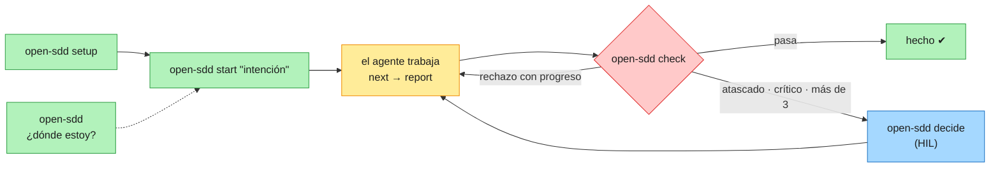

### Quién decide qué

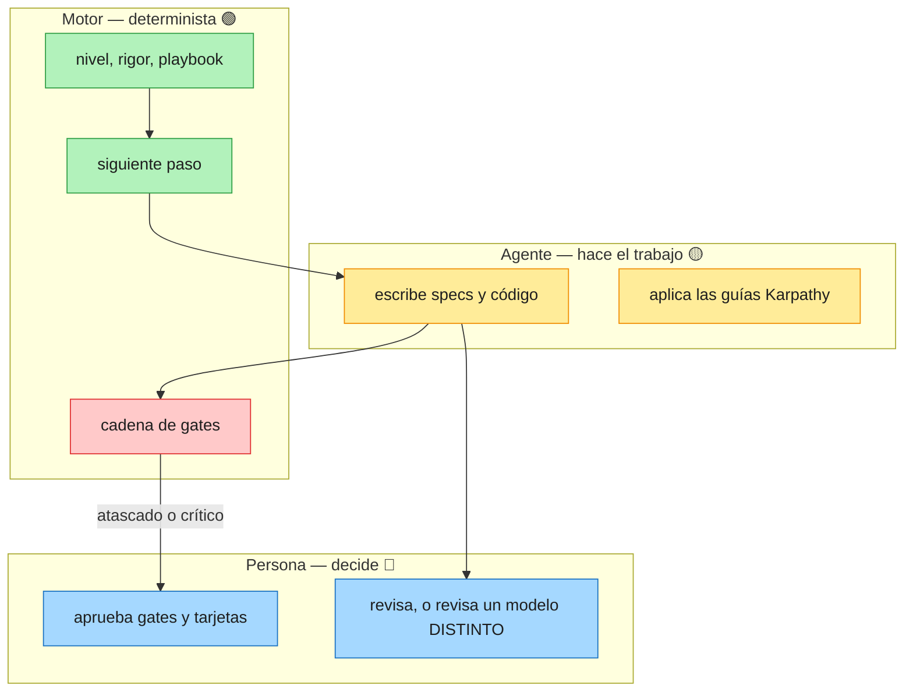

### Leyenda de colores (diagramas y consola)

| Color | Significado | Ejemplos |
|---|---|---|
| 🟢 Verde | Automático: la herramienta decide con evidencia | nivel, rigor, playbook, siguiente acción |
| 🟡 Ámbar | Consultivo: se informa, nunca bloquea | hallazgos de estándares, candidatos de reutilización, falta `C-INDEPENDENT-REVIEW` |
| 🔴 Rojo | Bloquea: exit 1 hasta corregirlo | gates C1–C3, constitución inválida, recibo de revisión caducado |
| 🔵 Azul | Decide una persona | tarjetas HIL, gates de fase, ratificar la constitución |

### Tres reglas que se aplican siempre

| Regla | Cómo se hace cumplir |
|---|---|
| Guías Karpathy (pensar, simplicidad, cambios quirúrgicos, objetivos verificables) | skill `karpathy-guidelines` instalada en cada proyecto |
| La revisión es humana, o la hace un modelo **distinto** al autor | constitución `C-INDEPENDENT-REVIEW`; una sesión de agente no puede firmar una revisión humana, y `--by-model` debe ser distinto de `--author-model` |
| Tarea atascada → decide una persona | escala al 1.er fallo crítico, al 2.º fallo idéntico (sin progreso) o tras más de 3 fallos; el motor prepara una tarjeta (reintentar · aparcar · excepción) y solo una persona reintenta o aprueba (`open-sdd decide`) |


## El problema

Los agentes de IA escriben código rápido, y su «ya está» es una afirmación que nadie comprueba.
Las herramientas spec-driven que solo usan prompts producen documentos, y un documento no rompe un
build. Esta herramienta convierte la afirmación en algo ejecutable: un gate decide pasa o no pasa, y
un control declarado pero no implementado se reporta como declarado en vez de contarse como verde.

## Instalación y los primeros 60 segundos

```bash
npx @brujo2020/open-sdd init . --write
```

Ejecútalo dentro de tu repositorio. Detecta el agente anfitrión, registra el nivel de exigencia en
`.sdd/settings/rigor.json`, instala el gate de commit (`.git/hooks/pre-commit`) y —sin MCP, sin red y
sin claves de API— las **22 plantillas de comando** como comandos propios del anfitrión. Es
plan-first: sin `--write` solo imprime el plan, y nunca sobrescribe un archivo existente. Para
instalar también las skills del anfitrión, añade `--skills`; `open-sdd integrate <host> --write`
instala las skills **y** registra el servidor MCP (`--list` muestra los 25 anfitriones, cada uno con su
registro verificado).

¿Quieres ver el flujo antes de instalarlo? `open-sdd templates` lista los 22 workflows, qué escribe
cada uno y el directorio que lee cada uno de los once anfitriones. MCP es opt-in (`--mcp`): un
anfitrión que lo bloquee, o una política de seguridad que lo restrinja, no pierde ningún workflow.

Después, la única puerta. Sin argumentos, de solo lectura: imprime un score SDD de 0–100, la fase
actual y UNA acción siguiente, con una línea de por qué.

```bash
open-sdd                 # score SDD, fase y la única acción siguiente
open-sdd status          # el mismo estado como panel completo
open-sdd --help          # todos los comandos
```

Los mensajes de consola están hoy en español; `--lang en` traduce por completo solo
`open-sdd tour` y `open-sdd context`. Los comandos de arriba funcionan desde el paquete publicado. En
este checkout, sustituye `open-sdd` por `node tools/open-sdd/dist/cli.js`.

Opcional: la demo de 60 segundos, sin red, en un directorio temporal desechable.

```bash
git clone https://github.com/Brujo2020/OpenSDD && cd opensdd
bash scripts/demo-60s.sh
```

Inyecta cuatro incoherencias reales —un requisito sin trazabilidad, una tarea completada sin
evidencia, un marcador `{{…}}` sin rellenar, un contrato declarado que no existe— y sale con código
distinto de cero si la herramienta deja pasar alguna.

## Todos los flujos de un vistazo

[](docs/diagrams/open-sdd-flows.excalidraw)

Se lee de izquierda a derecha: busca la fila de tu situación y sigue las flechas. Cada `/comando` es
una skill del chat de tu agente; `open-sdd …` se ejecuta en una terminal.

| Tu situación | Empieza con | Qué obtienes |
|---|---|---|
| Una idea difusa | `/sdd-discovery "<idea>"` | `brief.md` (no-objetivos, resultado medible, supuestos) y un roadmap; luego una spec o un lote |
| Una feature clara | `/sdd-spec-quick <feature>` o la cadena paso a paso | requisitos → diseño → tareas |
| Código existente | `/sdd-getspecs`, `open-sdd brownfield constitution . --write`, `open-sdd delta init <feature> "<cambio>"` | steering, una constitución descriptiva y una spec delta del cambio, no del sistema entero |
| Varias features | `/sdd-spec-batch` | todas las specs del roadmap, por olas de dependencia |
| Un bug | `/sdd-bugfix` | lo que pasa · lo esperado · lo que no debe cambiar, y luego el arreglo con su prueba |
| Un spike | `/sdd-tiny` y `/sdd-promote` si crece | una spec de tres líneas (objetivo · hecho cuando · fuera de alcance) |
| Un refactor o legacy sin tests | `/sdd-characterize` y luego `/sdd-refactor` | el comportamiento actual congelado en tests y un cambio que demuestra no alterarlo |
| Solo un plan | `/sdd-plan-only` | un plan; no se cambia nada |

**Paso a paso**, con aprobación humana en cada fase: `/sdd-spec-init` → `/sdd-spec-requirements`
(`/sdd-validate-gap` sobre código existente) → `/sdd-spec-design` (`/sdd-validate-design`) → `/sdd-spec-tasks`.
**Implementa** con `/sdd-impl <feature>`, que lanza un subagente por tarea con revisión independiente y
gate de verificación, o con `/sdd-impl <feature> 1,2` para solo esas tareas. **Cierra** con
`/sdd-validate-impl` → `/sdd-verify-completion` → `/sdd-audit` → `open-sdd archive <feature>`. En cualquier
momento tienes `/sdd-steering` (memoria del proyecto), `/sdd-spec-status`, `/sdd-help` y `open-sdd status`.
Funcionan solos: el commit gate (C1 · C2 · C3 sobre el índice), la cadena completa en cada pull request y,
donde el anfitrión lo permite, un hook Stop en el bucle del agente.

La fuente editable es [`docs/diagrams/open-sdd-flows.excalidraw`](docs/diagrams/open-sdd-flows.excalidraw)
(ábrela en [excalidraw.com](https://excalidraw.com) → *Open*). El mismo mapa en Mermaid, que GitHub renderiza:

<details>
<summary>Versión Mermaid</summary>

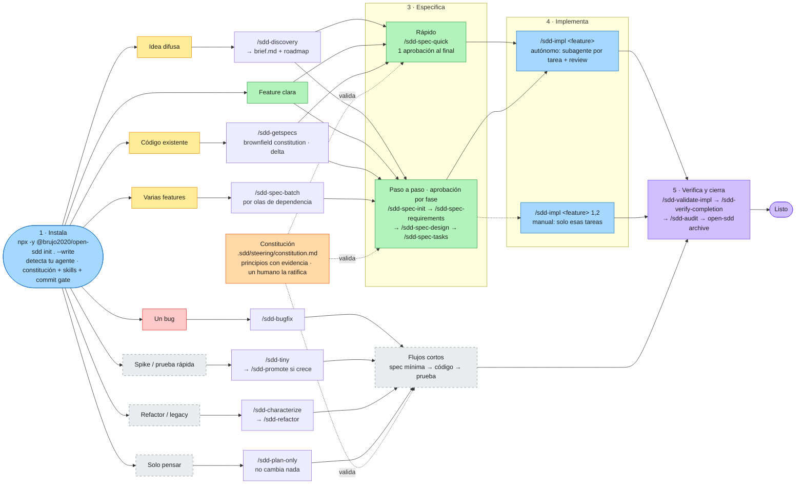

</details>

## Cómo funciona, en imágenes

Todos los diagramas se renderizan en GitHub. Los colores significan lo mismo en todas partes:
🟦 motor (determinista) · 🟨 agente (propone) · 🟪 persona (decide) · 🟩 artefacto · 🟥 parada / bloqueado.

### Quién decide qué, paso a paso

El agente propone, el motor determinista comprueba y una persona con nombre aprueba. `approved`
nunca sale de un agente.

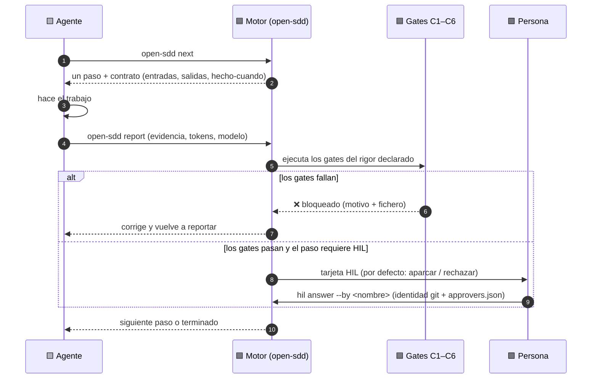

### Las dos escaleras: nivel y rigor

Elige **cuánto** trabajo es (L0–L6) y **cuán estricto** (rigor). Cada peldaño solo añade comprobaciones.

```mermaid
flowchart LR
  subgraph LEVEL["Nivel · cuánto"]
    direction LR
    L0["L0<br/>mínimo"] --> L1["L1<br/>PoC / spike"] --> L2["L2<br/>feature · bug"] --> L3["L3<br/>proyecto pequeño"] --> L4["L4<br/>multi-feature"] --> L5["L5<br/>multi-unidad"] --> L6["L6<br/>modernización"]
  end
  subgraph RIGOR["Rigor · cuán estricto"]
    direction LR
    R1["tiny-spec<br/>objetivo · hecho-cuando · fuera de alcance"] --> R2["spec-first<br/>EARS + constitución<br/>C1 + C2"] --> R3["spec-anchored<br/>+ delta · trazabilidad · deriva<br/>C1 C2 C3 C6"] --> R4["spec-as-code<br/>+ contratos · regeneración<br/>C1 … C6"]
  end
  LEVEL ~~~ RIGOR
  classDef lv fill:#a5d8ff,stroke:#1971c2,color:#1e1e1e
  classDef r1 fill:#e9ecef,stroke:#868e96,color:#1e1e1e
  classDef r2 fill:#b2f2bb,stroke:#2f9e44,color:#1e1e1e
  classDef r3 fill:#ffec99,stroke:#f08c00,color:#1e1e1e
  classDef r4 fill:#ffc9c9,stroke:#e03131,color:#1e1e1e
  class L0,L1,L2,L3,L4,L5,L6 lv
  class R1 r1
  class R2 r2
  class R3 r3
  class R4 r4
```

La ceremonia (`minimal` · `standard` · `strict`) y la variante (`greenfield` · `brownfield`) se
eligen por ejecución: `open-sdd start "<intención>" --level L2 --variant brownfield --rigor spec-anchored`.

### Greenfield frente a brownfield

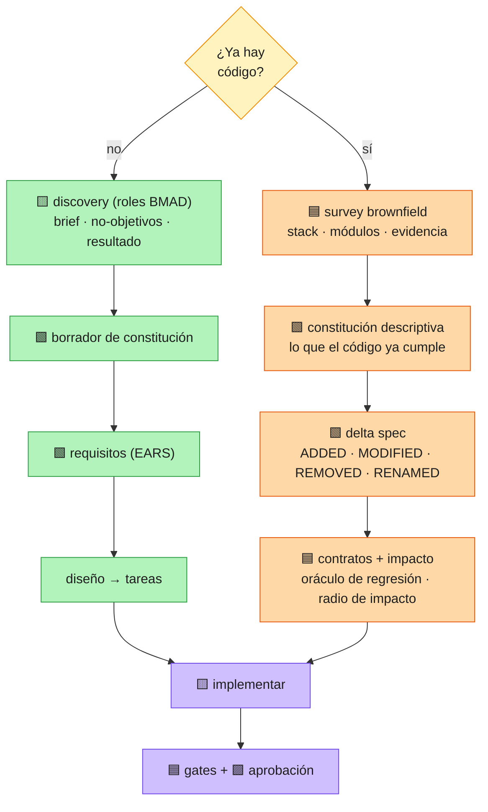

### Modo reverse engineering (brownfield, por etapas)

Cada etapa tiene un gate; solo las reglas que confirmó una persona llegan a la línea base de la spec.

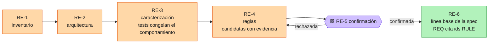

### Conversor EARS

Entra texto libre, salen requisitos comprobables — o una pregunta precisa. Nunca adivina.

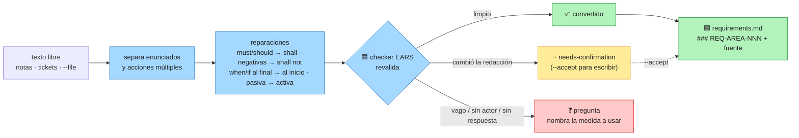

### Reglas dinámicas (sin LLM)

Los eventos (los lanza una persona, un escáner, un monitor o un pipeline — nunca el agente) cambian el plan de forma determinista; un evento repetido no hace nada.

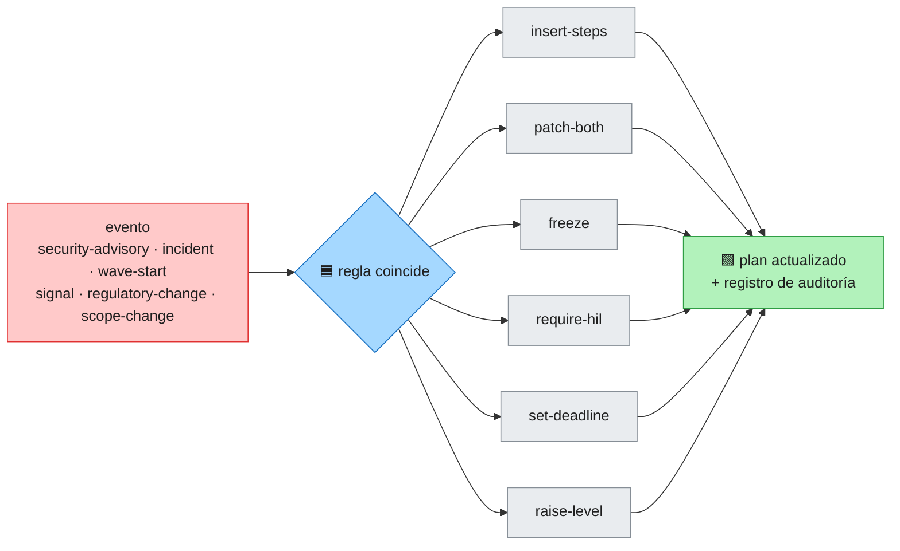

### Migration Kit

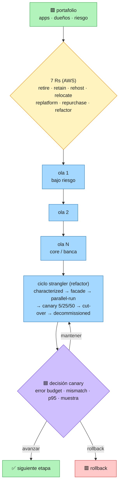

### ¿Dónde estoy?

`open-sdd where` muestra la fase, el progreso ponderado por coste de paso, los pasos pendientes y
las decisiones en espera; `--save` escribe un checkpoint reanudable en `.sdd/state/checkpoint.md`.

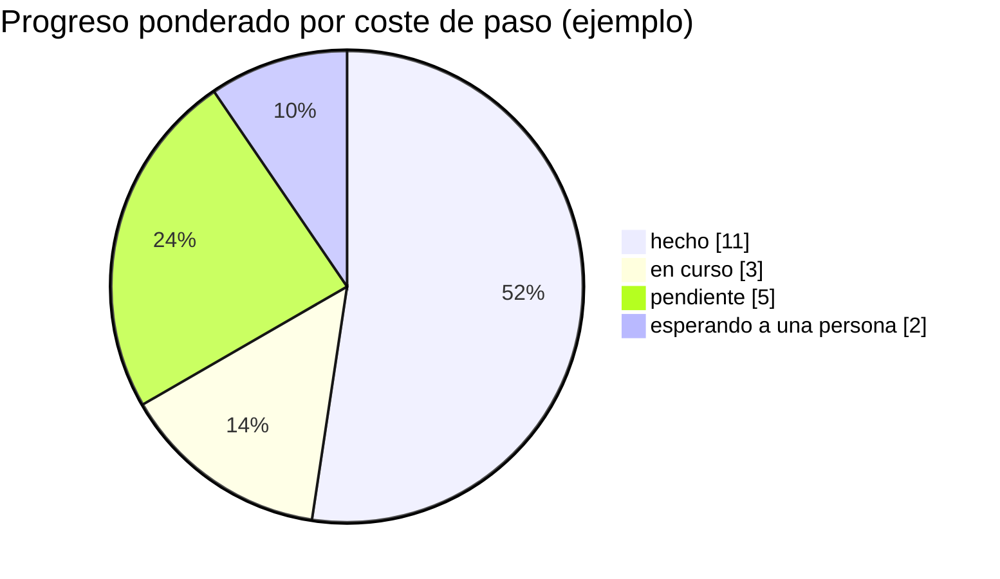

### Plugin AI-DLC

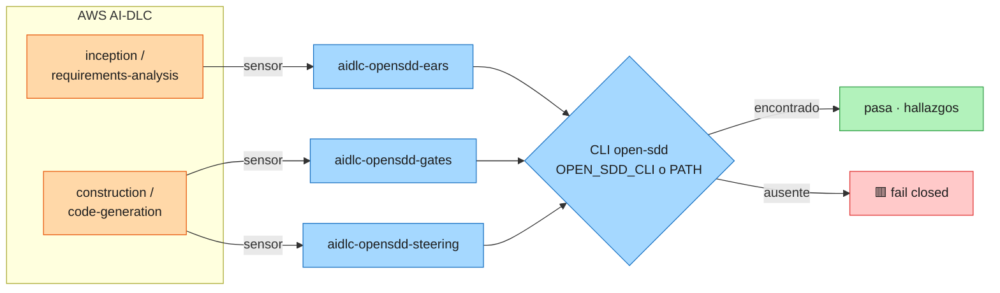

## La constitución

La constitución es la autoridad ante la que responde cada spec. Vive en `.sdd/steering/constitution.md`
y es una lista de principios, cada uno con la evidencia que lo sostiene. Toda spec se valida contra ella,
y un veredicto bloqueante cita el principio que lo rechazó. Es **obligatoria en todos los niveles de
rigor**: subir el listón añade comprobaciones, pero nunca quita esta.

Tiene dos orígenes, y el archivo registra cuál aplica:

- **Descriptiva** (código existente): `open-sdd brownfield constitution . --write` extrae los principios
  que el código ya cumple, cada uno con su evidencia. Las prácticas que quieres y que el código aún no
  sigue pasan a ser *enmiendas propuestas*, no reglas en vigor.
- **Ratificada** (decisión humana): `open-sdd brownfield constitution . --draft` escribe un borrador
  que explícitamente no está en vigor. `open-sdd govern constitution --evidence-pack` da a un modelo o a
  un revisor lo que necesita para mejorarlo, y
  `open-sdd govern constitution --ratify --by "<nombre>" --rationale "<por qué>" --write` lo pone en
  vigor, registrando quién lo ratificó y por qué. Una ratificación sin persona nombrada y sin motivo se rechaza.

`open-sdd govern constitution --matrix` muestra cómo está cada spec frente a cada principio, y
`open-sdd status` informa de la alineación constitucional junto al resto del score.

## Lo que obtienes

- **22 plantillas de comando, instaladas por defecto.** Cada workflow es un comando en el chat del
  propio agente (`/sdd-specify`, `/sdd-converge`, …), y cada uno ejecuta una orden real del motor en
  vez de pedirle a un modelo que «considere» una comprobación. Sin MCP y sin red. El argumento que
  escribes se traduce al marcador propio de cada anfitrión (`{{args}}`, `${input:request}`,
  `$ARGUMENTS`), y el límite de tamaño que documenta cada fabricante se comprueba en vez de suponerse.
  `open-sdd templates` las lista.
- **Un servidor MCP, si lo quieres.** Un servidor stdio JSON-RPC con 11 herramientas y recursos de solo
  lectura, invocable desde cualquier anfitrión MCP moderno. Sin red, sin backend de modelo, sin claves
  de API. Es opt-in (`--mcp`), porque algunos anfitriones y algunas políticas de seguridad no lo
  permiten.
- **Specs delta.** `ADDED` / `MODIFIED` / `REMOVED` / `RENAMED`, con ids `REQ-<AREA>-<NNN>` acotados
  a la delta, para que el contrato del cambio siga siendo finito.
- **Una constitución como pivote.** Cada spec se valida contra `.sdd/steering/constitution.md`;
  `brownfield constitution --draft` la propone y una persona la ratifica.
- **Una escalera de exigencia.** `spec-first` → `spec-anchored` → `spec-as-source`, fluida por
  defecto y acumulativa: cada paso solo añade gates, y una constitución válida es obligatoria en
  todos los niveles.
- **Un gate de commit y comprobaciones de PR.** Un hook de pre-commit sobre el índice preparado, y un
  workflow de pull request que ejecuta la cadena completa.
- **Un paquete de auditoría.** Un sha256 por artefacto más SARIF 2.1.0; sale con código distinto de
  cero ante un hallazgo bloqueante.
- **Asistentes bajo demanda.** Donde un comando ya encontró una brecha —un requisito EARS ambiguo, un
  marcador sin rellenar, una constitución ausente— propone un arreglo listo para pegar o formula una
  pregunta explícita.
- **Adopción brownfield.** `brownfield bootstrap` produce un mapa de módulos, un documento de
  inteligencia del código, una constitución reversa y candidatos de reutilización primero.
- **Importador.** `import spec-kit` mapea los artefactos de spec-kit a `.sdd/` y nombra cada omisión
  con su motivo.

## Cómo se compara

Cualitativo, a partir de la documentación pública de las alternativas. Esto **no es un benchmark**.

| | esta herramienta | spec-kit | paquetes de skills solo-prompt |
|---|---|---|---|
| Naturaleza | CLI + motor MCP | toolkit de prompts/skills | prompts y skills |
| Integración con el anfitrión | servidor MCP; 35 definiciones de agente, 32 convenciones de comando (20 verificadas, 12 rechazadas con la URL que falló) más un fork declarado, 26 registros MCP verificados; las 22 plantillas de comando son el camino por defecto sin MCP | amplia superficie de instalación e integración | el chat del anfitrión |
| Specs para código existente | specs delta + constitución reversa | flujo de specs; hay una extensión de bootstrap brownfield propuesta (#1436) | solo documentos |
| Enforcement | gates ejecutables, códigos de salida, hook de commit + checks de PR | prompts y revisión | ninguno |
| Evidencia / auditoría | paquete de auditoría, sha256 por artefacto, SARIF | los propios documentos | ninguno |
| Sin red | sin red, sin backend de modelo | plantillas y scripts locales | depende del anfitrión |

spec-kit hace dos cosas que este repositorio no hace: un ecosistema y una superficie de integración
mucho más amplios, y una curva de aprendizaje más suave. Si vives en él, es una buena elección; no se
reclama paridad de ecosistema, de pulido ni de adopción. [Migrar desde spec-kit](docs/guides/migrate-from.md)
mapea sus artefactos a los de esta herramienta.

### Lo mejor de cada herramienta, en un solo sitio

open-sdd no sustituye a estas herramientas copiándolas: toma la idea que cada una hace mejor, la convierte en una
comprobación determinista o en un comando cuando se puede, y deja fuera lo que solo añade ceremonia. Ideas y reglas,
no código (todas MIT); en [modos SDD](docs/guides/sdd-modes.md) está por qué se incluye cada pieza.

| Herramienta | Lo que mejor hace | Lo que toma open-sdd | Dónde | Lo que deja fuera, y por qué |
|---|---|---|---|---|
| **Spec Kit** (GitHub) | la constitución como autoridad; `/clarify`; `/analyze` entre artefactos | constitución exigida en cada peldaño gobernado; clarify como preguntas acotadas derivadas de los hallazgos de ambigüedad deterministas; la coherencia entre artefactos como comprobación ejecutable, no como prompt | `brownfield constitution`, `govern`, `brownfield clarify`, `consistency` | gates escritos como prompts: aquí devuelven códigos de salida |
| **OpenSpec** (Fission-AI) | el cambio como delta (ADDED · MODIFIED · REMOVED · RENAMED); `archive` | specs delta con ids estables; archivo de specs verificadas; un comportamiento por requisito | `delta init/validate`, `archive`, `requirements review` | aplicar deltas a mano: lo hace `delta` |
| **BMAD-METHOD**¹ | discovery antes de construir; non-goals; métodos de elicitación | gate del `brief.md`: non-goals obligatorios, resultado medible, supuestos sin confirmar que bloquean; registro de decisiones solo-añadir | `/sdd-discovery`, `discovery lint/log` | personas permanentes y la ceremonia completa de PRD/arquitectura: basta un agente con lentes |
| **Feathers** (*Working Effectively with Legacy Code*) | pruebas de caracterización | congelar el comportamiento actual antes de tocar código heredado sin pruebas | `/sdd-characterize`, `brownfield contracts` | — |
| **SteelForge IDE** | niveles y flujos que se eligen primero; tinyspec; EARS → Gherkin | modo `explore` fuera de la escalera; skills por tipo de proyecto; escenarios de aceptación trazados a cada REQ | `modes`, `/sdd-tiny`, `/sdd-promote`, `gherkin` | — |

¹ «BMAD-METHOD» y «BMad» son marcas de BMad Code; el nombre solo identifica el origen de las ideas.

## Lo que todavía no hace

- **El descubrimiento de módulos es solo para Node.** Las raíces de workspace salen de
  `package.json`; los monorepos de Maven/Gradle, Go, Rust y Python devuelven un único módulo raíz en
  `brownfield bootstrap`.
- **El análisis de impacto tiene clases conocidas de falsos positivos.** `brownfield impact` lee el
  grafo de imports y la delta, y una comprobación con ese nivel de ruido puede entrenar a sus
  lectores a ignorarla.
- **Tres convenciones de plantillas de comando se rechazan, no se adivinan.** Codex, Zed y Cline no
  documentan directorio de comandos de proyecto, así que `init --write` imprime la convención que no
  pudo verificar y no escribe nada ahí. `open-sdd templates` lista los once anfitriones y los marca.
- **Un `docker build` local sigue siendo de una sola arquitectura.** Produce la arquitectura del
  builder; la imagen multi-arquitectura (`linux/amd64` + `linux/arm64`) la construye y publica el job
  de contenedor de CI, así que necesita los runners de GitHub, no un portátil.
- **Las mediciones son sintéticas.** `docs/MEASUREMENTS.md` registra 10/10 clases inyectadas
  detectadas en repositorios que escribió este proyecto —autoconsistencia, no recall ni precisión de
  campo. Las cifras κ/FPR/latencia del paper pertenecen a un prototipo no publicado y no son
  mediciones de este repositorio.
- **El suelo de commit está instalado, pero el nivel A no está verificado.** El hook y la matriz de PR
  existen y se ejecutan; ningún centinela de comportamiento ha verificado el bloqueo en tiempo de
  escritura en ningún anfitrión, y `git commit --no-verify` no se registra.

La lista completa de brechas (G-01 … G-33), cada una con su ubicación en el código, está en
[docs/PAPER-ALIGNMENT.md](docs/PAPER-ALIGNMENT.md).

## De dónde viene

La arquitectura es la que describe *Orquestación SDD-First Multiagente para Desarrollo Enterprise: una
arquitectura de referencia Zero-Trust para gobernar la ingeniería de software agéntica a escala*, de
Mario Alejandro Ramos (rev. 3, septiembre de 2026,
[doi:10.13140/RG.2.2.29185.42087](https://doi.org/10.13140/RG.2.2.29185.42087)). De ahí vienen la cadena de
gates (C1–C7, O1–O7), los niveles de enforcement A–D (techo y suelo), la conformidad C0–C3, los seis
invariantes, las olas transaccionales y la constitución como pivote.

- **El preprint** de esta herramienta, que resume la arquitectura, el harness Zero-Trust y el modelo de
  especificaciones vivas: [`docs/papers/open-sdd-preprint.pdf`](docs/papers/open-sdd-preprint.pdf)
  (fuentes LaTeX en español y en [inglés](docs/papers/open-sdd-preprint-en.tex)).
- **Qué está implementado y qué no:** [`docs/PAPER-ALIGNMENT.md`](docs/PAPER-ALIGNMENT.md) vincula cada
  sección del paper con el símbolo que la implementa y enumera cada brecha declarada.
  `open-sdd assure claims --verify` ejecuta ese registro, que debe quedar en 0 rotas.
- Las mediciones del prototipo del paper (κ, la tasa de falsos positivos de C4, los tiempos de barrido)
  son de ese prototipo y **no** son mediciones de este repositorio.

## Documentación

[Instalación](docs/INSTALL.md) · [Inicio rápido (60 s)](docs/guides/quickstart-60s.md) ·
[Integraciones](docs/guides/integrations.md) · [Playbooks](docs/guides/playbooks.md) · [Manual](docs/MANUAL.md) · [Migration Kit](docs/guides/modernize-kit.md) · [Sabores, ingeniería inversa y asistentes](docs/guides/flavours.md) · [Proyectos existentes](docs/guides/existing-projects.md) ·
[Migrar desde spec-kit](docs/guides/migrate-from.md) ·
[Mediciones](docs/MEASUREMENTS.md) · [Alineación con el paper y brechas](docs/PAPER-ALIGNMENT.md) ·
[English](README.md) · [Changelog](CHANGELOG.md)

## Licencia

MIT — consulta [LICENSE](LICENSE).
