# SteelFoundry — SDD Toolkit

**Why the name.** A foundry melts many raw materials into standard, repeatable steel parts. SteelFoundry
does the same with Spec-Driven Development: it **consolidates in one toolkit the whole range of cases** — from a
minor change or a quick PoC, through spikes and small projects, up to large programmes and migrations with
strict, audited rigor — and the ceremony grows only as the work demands (levels L0–L6, rigor ladder). It is
**agnostic**: the same specs, gates and audit work with any agent (Claude Code, Cursor, Copilot, Codex,
Gemini, Windsurf…) and any model, through skills, commands and MCP. And it **supports the spec process by
taking the best of other toolkits** — Spec Kit's constitution, BMAD's role-based discovery, Kiro's EARS
requirements and steering, OpenSpec's delta specs — cast into one deterministic engine.

`steelfoundry` is the layer that makes an AI coding agent's "done" verifiable: executable gates, delta
specs for code that already exists, and a constitution that validates every spec.

> 📘 Manual: [English](docs/MANUAL.md) · [Español](docs/MANUAL.es.md)

> **SteelFoundry** was called **open-sdd**. The `open-sdd`, `sdd-open` and `sdd` commands still work as aliases of `steelfoundry`, and existing `.sdd/` folders need no change.

[](https://github.com/Brujo2020/OpenSDD/blob/main/LICENSE)
[](https://github.com/Brujo2020/OpenSDD/actions/workflows/gates.yml)

**English** · [Español](README.es.md)

## Five verbs: all you need

> 📘 One-page visual guide with a small end-to-end example and the QC report: [docs/GUIA.md](docs/GUIA.md) (Spanish).

You do not need the other 50 commands to use steelfoundry. Five verbs cover the whole lifecycle; the
tool decides everything that evidence can decide (agent, greenfield or brownfield, level, rigor,
playbook) and asks a person only for a human decision. Every other command still works and is listed
by `steelfoundry help --all`.

| | Verb | What it does | What it decides for you |
|---|---|---|---|
| 🟢 | `steelfoundry` | Where you are: score, phase and the **one** next action | The next action |
| 🟢 | `steelfoundry setup` | Installs into the repository (same as `init`; plan first, `--write` applies) | Agent and terrain |
| 🟢 | `steelfoundry start "<what you want>"` | Starts any work, from a typo to a modernization | Level L0–L6, variant, rigor, playbook |
| 🔴 | `steelfoundry check` | One verdict: the whole gate chain (same as `gates run`) | Nothing: it only passes or blocks |
| 🔵 | `steelfoundry decide` | Lists the decisions waiting for a person, with the exact command | Nothing: a person decides |

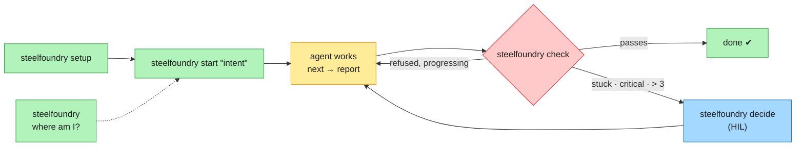

### Who decides what

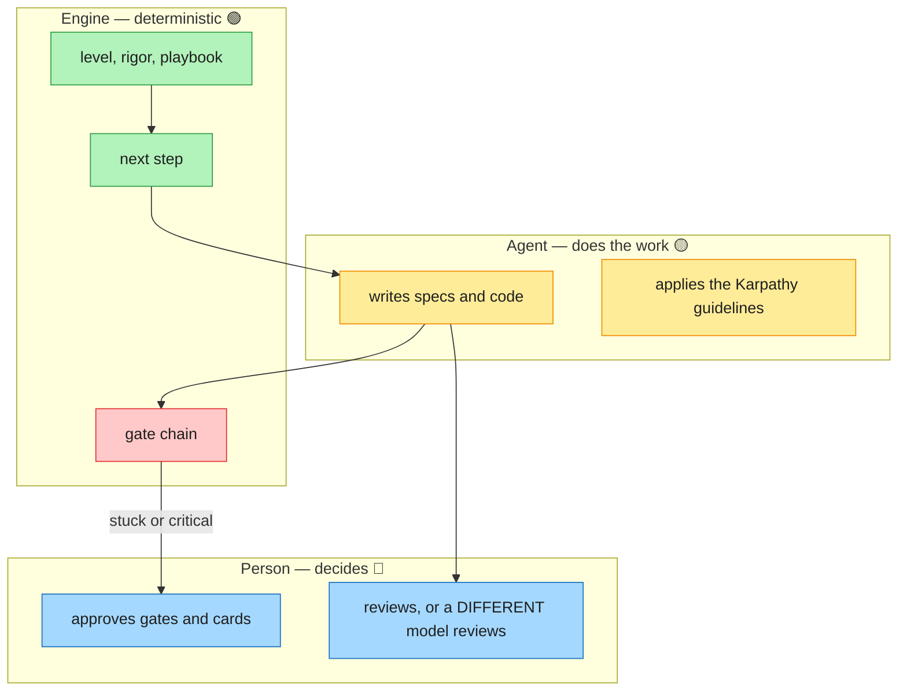

### Colour legend (diagrams and console)

| Colour | Meaning | Examples |
|---|---|---|
| 🟢 Green | Automatic: the tool decides from evidence | level, rigor, playbook, next action |
| 🟡 Amber | Advisory: reported, never blocks | standards findings, reuse candidates, missing `C-INDEPENDENT-REVIEW` |
| 🔴 Red | Blocks: exit 1 until fixed | gates C1–C3, invalid constitution, stale review receipt |
| 🔵 Blue | A person decides | HIL cards, phase gates, ratifying the constitution |

### Three rules that always apply

| Rule | How it is enforced |
|---|---|
| Karpathy guidelines (think, simplicity, surgical changes, goal-driven) | `karpathy-guidelines` skill installed in every project |
| Review is human, or by a model **different** from the author | constitution `C-INDEPENDENT-REVIEW`; an agent session cannot sign a human review, and `--by-model` must differ from `--author-model` |
| A stuck task → a person decides | escalates at the 1st critical failure, the 2nd identical failure (no progress) or after more than 3 failures; the engine prepares a card (retry · park · exception) and only a person retries or approves (`steelfoundry decide`) |


## The problem

AI agents write code fast, and their "it is finished" is a claim nobody checks.
Prompt-only spec-driven tools produce documents, and a document does not fail a build.
This tool turns the claim into something executable: a gate decides pass or fail, and a control that
is declared but not implemented is reported as declared instead of counted as green.

## Install and the first 60 seconds

```bash
npx @brujo2020/steelfoundry init . --write
```

Run it inside your repository. It detects the host agent, records the rigor level in
`.sdd/settings/rigor.json`, installs the commit gate (`.git/hooks/pre-commit`) and — with no MCP, no
network and no API key — the **22 prompt templates** as the host's own chat commands. It is
plan-first: without `--write` it only prints the plan, and it never overwrites an existing file. To
install the host's skills too, add `--skills`; `steelfoundry integrate <host> --write` installs the skills
**and** registers the MCP server (`--list` shows all 25 hosts, each with a verified registration).

Want to see the flow before installing it? `steelfoundry templates` lists all 22 workflows, what each one
writes, and the directory each of the eleven hosts reads. MCP is opt-in (`--mcp`): a host that blocks
it, or a security policy that allow-lists it, does not lose any workflow.

**Coming from the unscoped `open-sdd` package?** That older install declared the same three command
names, and its symlinks survive its own uninstall — so `npm install -g @brujo2020/steelfoundry@latest`
stops with `EEXIST: file already exists … /bin/sdd`. Remove the dangling links, install again, and
clear the shell's command cache, which still points at the old binary:

```bash
rm -f "$(npm prefix -g)/bin/sdd" "$(npm prefix -g)/bin/sdd-open"   # left behind, both dangling
npm install -g @brujo2020/steelfoundry@latest
hash -r                       # zsh: rehash — or open a new terminal
steelfoundry --version            # must print v3.10.0, not the 2.x banner
```

A stale global is not cosmetic: the installed commit hook resolves its CLI through `PATH`, so an old
one makes the gate report nothing while the configuration still reads "blocking" (G-36). Details in
[docs/guides/upgrade.md](docs/guides/upgrade.md#coming-from-the-unscoped-open-sdd-package).

Then the one door. No arguments, read-only: it prints a 0–100 SDD score, the current phase and ONE
next action, with one line of why.

```bash
steelfoundry                 # SDD score, phase and the single next action
steelfoundry status          # the same state as a full panel
steelfoundry --help          # every command
```

The console messages are currently Spanish; `--lang en` fully translates `steelfoundry tour` and
`steelfoundry context` only. The commands above work from the published package. In this checkout,
replace `steelfoundry` with `node tools/open-sdd/dist/cli.js`.

Optional: the 60-second demo, offline, in a throwaway temp directory.

```bash
git clone https://github.com/Brujo2020/OpenSDD && cd opensdd
bash scripts/demo-60s.sh
```

It injects four real incoherences — an untraced requirement, a completed task with no evidence, an
unfilled `{{…}}` marker, a declared contract that does not exist — and exits non-zero if the tool
misses any of them.

## Every flow at a glance

[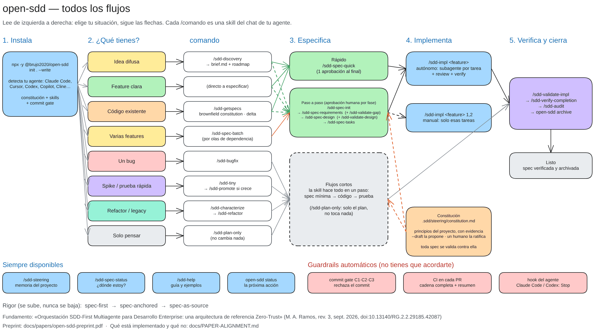](docs/diagrams/open-sdd-flows.excalidraw)

Read it left to right: pick the row that matches your situation and follow the arrows. Every
`/command` is a skill in your agent's chat; `steelfoundry …` runs in a terminal.

| Your situation | Start with | What you get |
|---|---|---|
| A fuzzy idea | `/sdd-discovery "<idea>"` | `brief.md` (non-goals, a measurable outcome, assumptions) and a roadmap, then one spec or a batch |
| A clear feature | `/sdd-spec-quick <feature>`, or the step-by-step chain below | requirements → design → tasks |
| Existing code | `/sdd-getspecs`, `steelfoundry brownfield constitution . --write`, `steelfoundry delta init <feature> "<change>"` | steering, a descriptive constitution and a delta spec for the change, not for the whole system |
| Several features | `/sdd-spec-batch` | every spec in the roadmap, generated by dependency wave |
| A bug | `/sdd-bugfix` | actual · expected · what must not change, then the fix and its proof |
| A spike | `/sdd-tiny`, then `/sdd-promote` if it grows | a three-line spec (goal · done when · out of scope) |
| A refactor, or untested legacy | `/sdd-characterize`, then `/sdd-refactor` | today's behaviour frozen in tests, then a change proven not to alter it |
| Only a plan | `/sdd-plan-only` | a plan; nothing is changed |

**Step by step**, with a human approval at each phase: `/sdd-spec-init` → `/sdd-spec-requirements`
(`/sdd-validate-gap` on existing code) → `/sdd-spec-design` (`/sdd-validate-design`) → `/sdd-spec-tasks`.
**Implement** with `/sdd-impl <feature>`, which runs one subagent per task with an independent review
and a verify gate, or with `/sdd-impl <feature> 1,2` for just those tasks. **Close** with `/sdd-validate-impl` →
`/sdd-verify-completion` → `/sdd-audit` → `steelfoundry archive <feature>`. These are available at any
point: `/sdd-steering` (project memory), `/sdd-spec-status`, `/sdd-help` and `steelfoundry status`. These
run on their own: the commit gate (C1 · C2 · C3 over the staged index), the full chain on every pull
request, and, where the host supports it, a Stop hook in the agent's loop.

The editable source is [`docs/diagrams/open-sdd-flows.excalidraw`](docs/diagrams/open-sdd-flows.excalidraw)
(open it at [excalidraw.com](https://excalidraw.com) → *Open*). The same map in Mermaid, rendered by GitHub:

<details>
<summary>Mermaid version</summary>

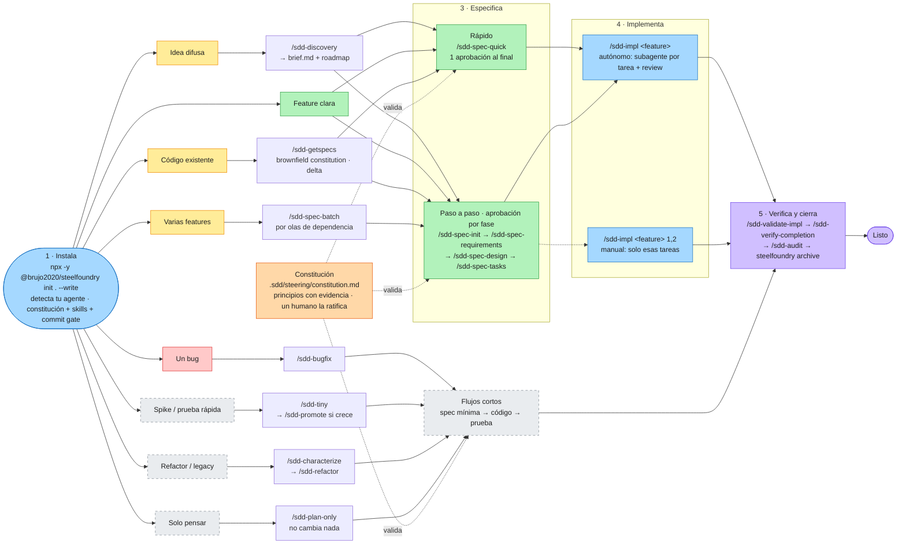

</details>

## How it works, in pictures

All diagrams below render on GitHub. Colors mean the same thing everywhere:
🟦 engine (deterministic) · 🟨 agent (proposes) · 🟪 person (decides) · 🟩 artifact · 🟥 stop / blocked.

### Who decides what

The agent proposes, the deterministic engine checks, a named person approves. `approved` never
comes from an agent.

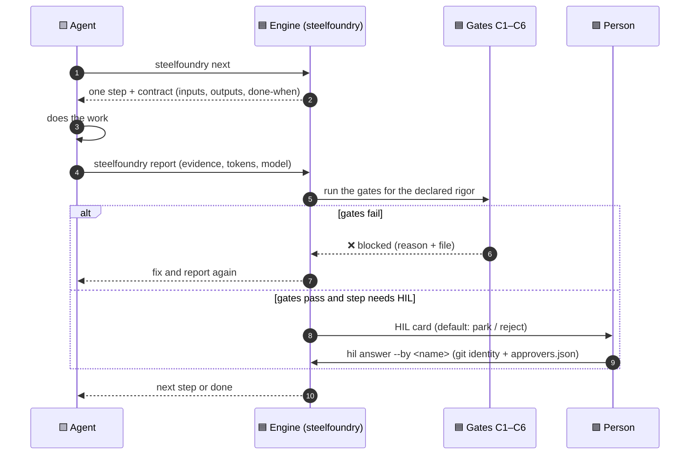

### The two ladders: level and rigor

Pick **how big** the work is (L0–L6) and **how strict** it is (rigor). Each rung only adds checks.

```mermaid
flowchart LR
  subgraph LEVEL["Level · how big"]
    direction LR
    L0["L0<br/>tiny"] --> L1["L1<br/>PoC / spike"] --> L2["L2<br/>feature · bug"] --> L3["L3<br/>small project"] --> L4["L4<br/>multi-feature"] --> L5["L5<br/>multi-unit"] --> L6["L6<br/>modernization"]
  end
  subgraph RIGOR["Rigor · how strict"]
    direction LR
    R1["tiny-spec<br/>goal · done-when · out of scope"] --> R2["spec-first<br/>EARS + constitution<br/>C1 + C2"] --> R3["spec-anchored<br/>+ delta · traceability · drift<br/>C1 C2 C3 C6"] --> R4["spec-as-code<br/>+ contracts · regeneration<br/>C1 … C6"]
  end
  LEVEL ~~~ RIGOR
  classDef lv fill:#a5d8ff,stroke:#1971c2,color:#1e1e1e
  classDef r1 fill:#e9ecef,stroke:#868e96,color:#1e1e1e
  classDef r2 fill:#b2f2bb,stroke:#2f9e44,color:#1e1e1e
  classDef r3 fill:#ffec99,stroke:#f08c00,color:#1e1e1e
  classDef r4 fill:#ffc9c9,stroke:#e03131,color:#1e1e1e
  class L0,L1,L2,L3,L4,L5,L6 lv
  class R1 r1
  class R2 r2
  class R3 r3
  class R4 r4
```

Ceremony (`minimal` · `standard` · `strict`) and variant (`greenfield` · `brownfield`) are chosen
per run: `steelfoundry start "<intent>" --level L2 --variant brownfield --rigor spec-anchored`.

### Greenfield vs brownfield

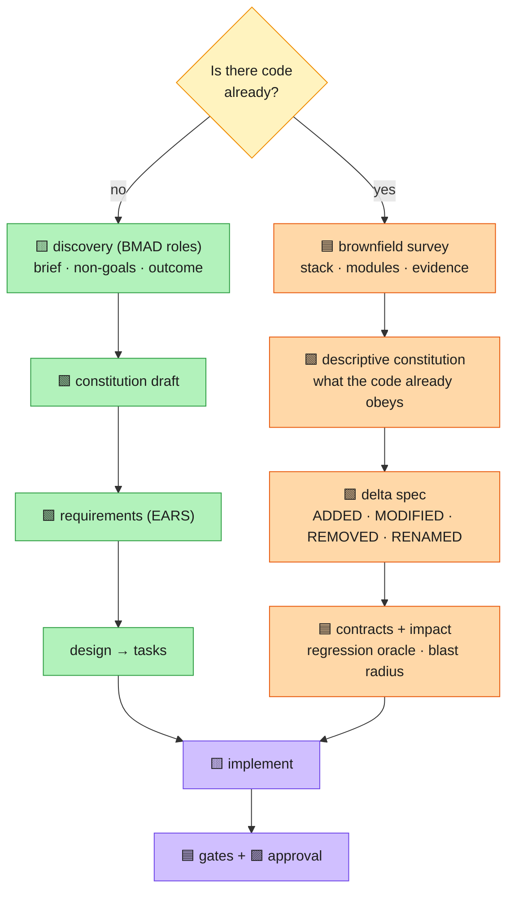

### Reverse engineering mode (brownfield, by stages)

Each stage has a gate; only rules a person confirmed reach the spec baseline.

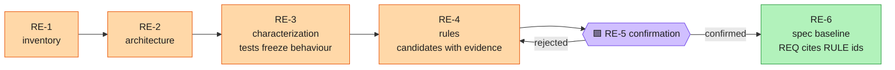

### EARS converter

Free text in, testable requirements out — or a precise question. It never guesses.

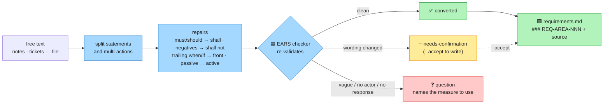

### Dynamic rules (no LLM)

Events (raised by a person, scanner, monitor or pipeline — never by the agent) change the plan deterministically; a repeated event is a no-op.

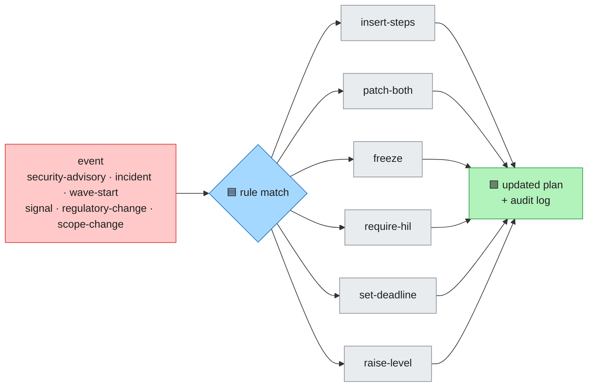

### Migration Kit

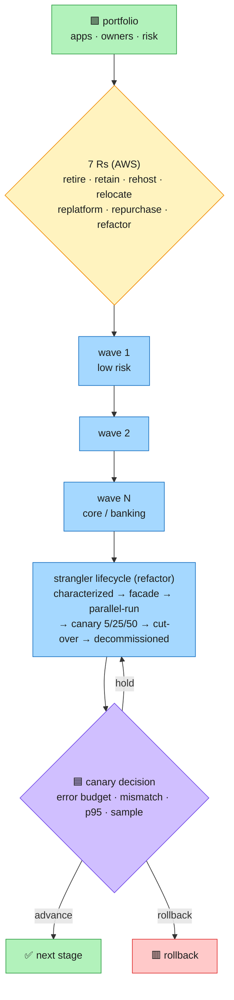

### Where am I?

`steelfoundry where` shows phase, progress weighted by step cost, pending steps and waiting decisions;
`--save` writes a resumable checkpoint to `.sdd/state/checkpoint.md`.

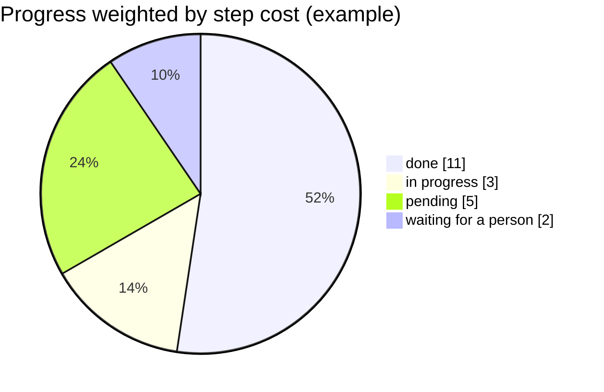

### AI-DLC plugin

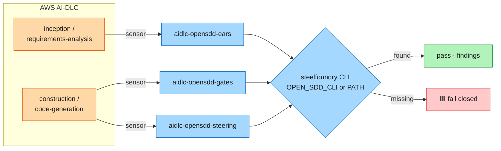

## The constitution

The constitution is the authority every spec answers to. It lives in `.sdd/steering/constitution.md`
and it is a list of principles, each with the evidence that supports it. Every spec is validated
against it, and a blocking verdict cites the principle that refused. It is **required at every rigor
level**, so raising the bar adds checks but never removes this one.

It has two origins, and the file records which one applies:

- **Descriptive** (existing code): `steelfoundry brownfield constitution . --write` reverse-engineers the
  principles the code already obeys, each with its evidence. Practices you want but the code does not
  follow yet become *proposed amendments*, not rules in force.
- **Ratified** (a human decision): `steelfoundry brownfield constitution . --draft` writes a draft that is
  explicitly not in force. `steelfoundry govern constitution --evidence-pack` gives a model or a reviewer
  what it needs to improve it, and
  `steelfoundry govern constitution --ratify --by "<name>" --rationale "<why>" --write` puts it in force,
  recording who ratified it and why. A ratification without a named person and a reason is refused, and it
  must be confirmed by typing `RATIFICAR` on the terminal (an agent session cannot); see
  [Manual §16.1](docs/MANUAL.md#161-ratifying-the-constitution-mandatory-terminal-confirmation).

`steelfoundry govern constitution --matrix` shows how each spec stands against each principle.
`steelfoundry status` reports constitutional alignment next to the rest of the score.

## What you get

- **22 prompt templates, installed by default.** Every workflow is a command in your agent's own chat
  (`/sdd-specify`, `/sdd-converge`, …), and each one runs a real engine command rather than asking a
  model to "consider" a check. No MCP, no network. The argument you type is translated into each host's
  own token (`{{args}}`, `${input:request}`, `$ARGUMENTS`), and a host's documented size limit is
  checked rather than assumed. `steelfoundry templates` lists them.
- **An MCP server, if you want one.** A stdio JSON-RPC server with 11 tools and read-only resources,
  callable by any modern MCP host. No network, no model backend, no API keys. It is opt-in (`--mcp`),
  because some hosts and some security policies do not allow it.
- **Delta specs.** `ADDED` / `MODIFIED` / `REMOVED` / `RENAMED`, with delta-scoped `REQ-<AREA>-<NNN>`
  ids, so the contract of change stays finite.
- **A constitution as the pivot.** Every spec is validated against
  `.sdd/steering/constitution.md`; `brownfield constitution --draft` proposes it and a human ratifies it.
- **A rigor ladder.** `spec-first` → `spec-anchored` → `spec-as-source`, fluid by default and
  cumulative: each step only adds gates, and a valid constitution is required at every level.
- **A commit gate and PR checks.** A pre-commit hook over the staged index, and a pull-request
  workflow that runs the full chain.
- **An audit bundle.** One sha256 per artifact plus SARIF 2.1.0; exits non-zero on a blocking finding.
- **On-demand assistants.** Where a command already found a gap — an ambiguous EARS requirement, an
  unfilled marker, a missing constitution — it proposes a paste-ready fix or asks an explicit question.
- **Brownfield adoption.** `brownfield bootstrap` produces a module map, a codebase-intelligence
  document, a reverse constitution and reuse-first candidates.
- **Importer.** `import spec-kit` maps spec-kit artifacts into `.sdd/` and names every skip with
  its reason.

## How it compares

Qualitative, from the alternatives' public documentation. This is **not a benchmark**.

| | this tool | spec-kit | prompt-only skill packs |
|---|---|---|---|
| Nature | CLI + MCP engine | prompt/skill toolkit | prompts and skills |
| Host integration | MCP server; 35 agent definitions, 32 command conventions (20 verified, 12 refused with the URL that failed) plus a declared fork, 26 verified MCP registrations; the 22 prompt templates are the no-MCP default | broad install and integration surface | the host's chat |
| Specs for existing code | delta specs + reverse constitution | spec workflow; a brownfield-bootstrap extension is proposed (#1436) | documents only |
| Enforcement | executable gates, exit codes, commit hook + PR checks | prompts and review | none |
| Requirements & standards | 32 machine-checkable requirements checks and a 16-entry standards catalogue (`standards`, `requirements review`); every finding carries a position, a basis and a graded remedy or an explicit question — and it stays **advisory until a corpus measures its precision**; the count is verified by `CLM-067`, not hand-written | a checklist prompt | none |
| Evidence / audit | audit bundle, sha256 per artifact, SARIF | the documents themselves | none |
| Offline | no network, no model backend | local templates and scripts | host-dependent |

spec-kit does two things this repository does not: a much broader ecosystem and integration surface,
and a gentler learning curve. If you live in it, it is a good choice; no parity of ecosystem, polish
or adoption is claimed. [Migrate from spec-kit](docs/guides/migrate-from.md) maps its artifacts onto
this one.

### The best of each tool, in one place

steelfoundry does not replace these tools by copying them: it takes the one idea each does best, turns it into a
deterministic check or a command where possible, and leaves out what only adds ceremony. Ideas and rules, not code
(all MIT); see [SDD modes](docs/guides/sdd-modes.md) for why each piece is included.

| Tool | What it does best | What steelfoundry takes | Where | What it leaves out, and why |
|---|---|---|---|---|
| **Spec Kit** (GitHub) | the constitution as the authority; `/clarify`; `/analyze` across artifacts | constitution required at every governed rung; clarify as bounded questions derived from the deterministic ambiguity findings; cross-artifact consistency as an executable check, not a prompt | `brownfield constitution`, `govern`, `brownfield clarify`, `consistency` | gates written as prompts: here they return exit codes |
| **OpenSpec** (Fission-AI) | change as a delta (ADDED · MODIFIED · REMOVED · RENAMED); `archive` | delta specs with stable ids; archiving verified specs; one behaviour per requirement | `delta init/validate`, `archive`, `requirements review` | applying deltas by hand: `delta` owns it |
| **BMAD-METHOD**¹ | discovery before building; non-goals; elicitation methods | `brief.md` gate: mandatory non-goals, measurable outcome, unconfirmed assumptions block; append-only decision log | `/sdd-discovery`, `discovery lint/log` | permanent personas and full PRD/architecture ceremony: one agent with lenses is enough |
| **Feathers** (*Working Effectively with Legacy Code*) | characterization tests | freeze current behaviour before touching untested legacy | `/sdd-characterize`, `brownfield contracts` | — |
| **SteelForge IDE** | levels and flows people pick first; tinyspec; EARS → Gherkin | `explore` mode outside the ladder; skills by project type; acceptance scenarios traced to each REQ | `modes`, `/sdd-tiny`, `/sdd-promote`, `gherkin` | — |

¹ "BMAD-METHOD" and "BMad" are trademarks of BMad Code; the name is used only to identify the source of the ideas.

## What it does not do yet

- **Module discovery is Node-only.** Workspace roots come from `package.json`; Maven/Gradle, Go, Rust
  and Python monorepos return a single root module from `brownfield bootstrap`.
- **Impact analysis has known false-positive classes.** `brownfield impact` reads the import graph
  and the delta, and a check with that noise level can train its readers to ignore it.
- **Three command-template conventions are refused, not guessed.** Codex, Zed and Cline document no
  project-scoped command directory, so `init --write` prints the convention it could not verify and
  writes nothing there. `steelfoundry templates` lists all eleven hosts and marks each one.
- **A local `docker build` is still single-architecture.** It produces the builder's architecture; the
  multi-arch image (`linux/amd64` + `linux/arm64`) is built and pushed by the CI container job, so it
  requires GitHub's runners rather than a laptop.
- **The measurements are synthetic.** `docs/MEASUREMENTS.md` records 10/10 injected classes caught on
  repositories this project wrote — self-consistency, not field recall or precision. The paper's
  κ/FPR/latency figures belong to an unpublished prototype and are not measurements of this repository.
- **The commit floor is installed, but level A is not verified.** The hook and the PR matrix exist
  and run; no behavioural sentinel has verified write-time blocking in any host, and
  `git commit --no-verify` is not recorded.

The complete list of gaps (G-01 … G-33), each with its code location, is in
[docs/PAPER-ALIGNMENT.md](docs/PAPER-ALIGNMENT.md).

## Where this comes from

The architecture is the one described in *Orquestación SDD-First Multiagente para Desarrollo
Enterprise: una arquitectura de referencia Zero-Trust para gobernar la ingeniería de software
agéntica a escala*, by Mario Alejandro Ramos (rev. 3, September 2026,
[doi:10.13140/RG.2.2.29185.42087](https://doi.org/10.13140/RG.2.2.29185.42087)). It contributes the
gate chain (C1–C7, O1–O7), the enforcement levels A–D (a ceiling and a floor), conformance C0–C3,
the six invariants, transactional waves and the constitution as the pivot.

- **The preprint** of this tool, which summarises the architecture, the Zero-Trust harness and the
  living-specification model: [`docs/papers/open-sdd-preprint.pdf`](docs/papers/open-sdd-preprint.pdf)
  (LaTeX sources in Spanish and [English](docs/papers/open-sdd-preprint-en.tex)).
- **What is implemented and what is not:** [`docs/PAPER-ALIGNMENT.md`](docs/PAPER-ALIGNMENT.md) maps every
  section of the paper to the symbol that implements it and lists every declared gap.
  `steelfoundry assure claims --verify` executes that registry, and it must report 0 broken.
- The paper's prototype measurements (κ, C4's false-positive rate, the sweep times) belong to that
  prototype and are **not** measurements of this repository.

## Documentation

[Install](docs/INSTALL.md) · [Quickstart (60 s)](docs/guides/quickstart-60s.md) ·
[Integrations](docs/guides/integrations.md) · [Playbooks](docs/guides/playbooks.md) · [Manual](docs/MANUAL.md) · [Migration Kit](docs/guides/modernize-kit.md) · [Flavours, reverse engineering and assistants](docs/guides/flavours.md) · [Existing projects](docs/guides/existing-projects.md) ·
[Migrate from spec-kit](docs/guides/migrate-from.md) ·
[Every flow](docs/diagrams/open-sdd-flows.excalidraw) · [Measurements](docs/MEASUREMENTS.md) ·
[Paper alignment and gaps](docs/PAPER-ALIGNMENT.md) · [Preprint](docs/papers/open-sdd-preprint.pdf) ·
[Español](README.es.md) · [Changelog](CHANGELOG.md)

## License

MIT — see [LICENSE](LICENSE).
