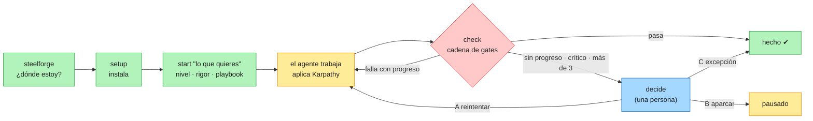
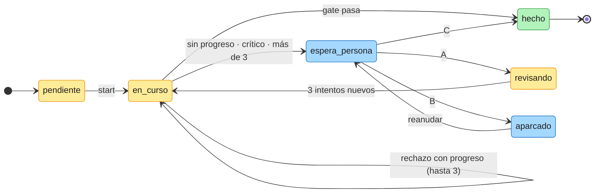
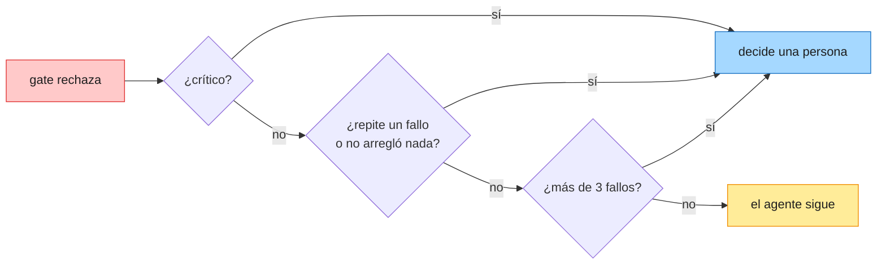
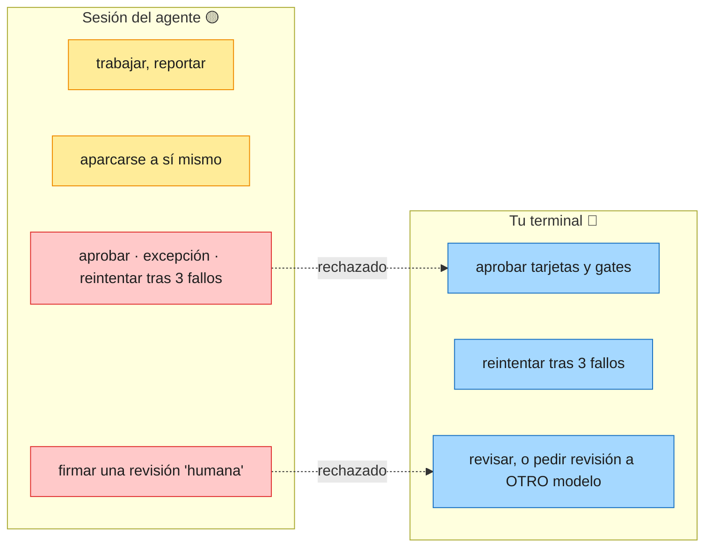
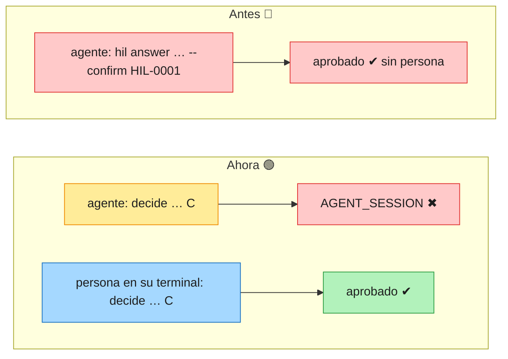

# open-sdd — Guía visual en una página

Todo lo que necesitas para usar steelforge con seguridad, en diagramas y un ejemplo pequeño. Las
salidas de consola de esta guía son reales (CLI de este repositorio, 2026-10-23), no ilustrativas.

## 1. El mapa en 30 segundos

Cinco verbos. La herramienta decide lo que la evidencia permite; una persona decide lo demás.



| Verbo | Úsalo cuando… | Qué decide solo |
|---|---|---|
| `steelforge` | no sabes qué toca | la **única** siguiente acción |
| `steelforge setup --write` | el repositorio aún no tiene open-sdd | agente, terreno, rigor, constitución, hook, reglas |
| `steelforge start "<lo que quieres>"` | empiezas cualquier trabajo | nivel L0–L6, variante, rigor, playbook |
| `steelforge check` | quieres un veredicto | nada: pasa (exit 0) o bloquea (exit 1) |
| `steelforge decide` | algo espera a una persona | nada: lo decides tú |

## 2. Leyenda de colores

| Color | Significa | Ejemplos |
|---|---|---|
| 🟢 Verde | Automático: decide la herramienta con evidencia | nivel, rigor, playbook, siguiente acción |
| 🟡 Ámbar | Consultivo: se informa, nunca bloquea | hallazgos de estándares, candidatos de reutilización |
| 🔴 Rojo | Bloquea: exit 1 hasta corregirlo | gates C1–C3, constitución inválida |
| 🔵 Azul | Decide una persona | tarjetas HIL, reintento tras 3 fallos, ratificar la constitución (tecleando `RATIFICAR` en la terminal) |

## 3. Un ejemplo pequeño y seguro, de principio a fin

Proyecto mínimo: `package.json` y `src/math.js` con una función `add`. Objetivo: añadir `subtract`.

```text
$ open-sdd
SDD 15% · Fase 1 · Especificar · … · siguiente: steelforge setup --write
Por qué: steelforge no está instalado en este repositorio: setup declara el rigor, la constitución y el hook de commit.

$ steelforge setup --write
    ✓ escrito: .sdd/settings/rules/karpathy-guidelines.md
  … 5 artefacto(s) por crear (rigor, constitución, reglas, hook de commit, plantillas de comando)

$ open-sdd
SDD 55% · … · siguiente: steelforge start "<lo que quieres>"

$ steelforge start "add a subtract function"
Level L2 · feature · brownfield (workspace has source code) · rigor spec-first → playbook legacy-untested
Run add-subtract-function started.
```

El agente trabaja. Si el gate rechaza su resultado y el **segundo intento repite el mismo fallo**, no
tiene sentido un tercero: decide una persona (ver «Política de escalado», más abajo).

```text
# intento 1
gate refused for sdd-getspecs (failed iteration 1/3)
# intento 2
gate refused for sdd-getspecs — escalated to HIL (no progress after 2 attempts, the same failure twice in a row
  (ARTIFACT_MISSING, RECALL_MISSING)): a person answers: steelforge decide add-subtract-function HIL-0001 <A|B|C> --by "<name>"

$ steelforge decide
1 decisión(es) esperan a una persona:
  add-subtract-function · HIL-0001 — sdd-getspecs is stuck — no progress after 2 attempts, the same failure twice in a row (ARTIFACT_MISSING, RECALL_MISSING): how do we continue?
      steelforge decide add-subtract-function HIL-0001 <A|B|C> --by "<name>"
```

Si el **agente** intenta decidir por ti, se rechaza:

```text
$ steelforge decide add-subtract-function HIL-0001 C --by "Ana"     # desde la shell del agente
AGENT_SESSION: this decision cannot come from an agent session. A person takes it from their own terminal: …
```

Tú, desde **tu** terminal, eliges A (reintentar con nuevas instrucciones), B (aparcar) o C (excepción
registrada). Al final, `steelforge check` da el veredicto.

## 4. El ciclo de vida de un paso



| Opción | Qué pasa | Quién puede elegirla |
|---|---|---|
| **A** reintentar | vuelve a trabajo con un presupuesto nuevo y tus instrucciones | 🔵 solo una persona |
| **B** aparcar | se detiene; es lo que ocurre si nadie responde en 24 h | 🟢 persona o agente |
| **C** excepción | se completa con la excepción registrada en la auditoría | 🔵 solo una persona, nunca en modo autónomo |

### Política de escalado

Un número fijo de intentos es una regla débil: corta a un agente que está convergiendo y deja que uno
atascado gaste intentos que no aportan información nueva. Por eso el motor escala en lo **primero**
que ocurra:

| Disparador | Cuándo | Por qué |
|---|---|---|
| 🔴 Fallo crítico | **1.er** intento | integridad rota (`RECEIPT_TAMPERED`, `QUESTIONS_CHANGED`): reintentar no lo arregla |
| 🟠 Sin progreso | desde el **2.º** intento | repite un fallo anterior (también A, B, A) o no arregló nada del intento previo: está atascado |
| 🟡 Tope con progreso | **4.º** intento (más de 3) | arregla algo en cada intento, pero el presupuesto se acabó |
| 🟢 Con progreso | intentos 1–3 | sigue trabajando: `failed iteration 2/3, progressing` |



La cuenta se reinicia con cada decisión humana, escalado o paso completado, y cada paso cuenta solo
sus propios fallos (`escalationVerdict` en `tools/open-sdd/src/core/engine.ts`).

## 5. Quién puede decidir qué



| Acción | Agente | Persona | Cómo se comprueba |
|---|---|---|---|
| Trabajar y reportar pasos | 🟢 sí | 🟢 sí | `next` / `report` |
| Aparcar | 🟢 sí | 🟢 sí | siempre seguro |
| Aprobar, excepción, reintentar tras 3 fallos | 🔴 no | 🔵 sí | sesión de agente → rechazo `AGENT_SESSION` |
| Revisión humana | 🔴 no | 🔵 sí | sesión de agente sin `--by-model` → rechazo |
| Revisión por modelo | 🟡 solo con dos modelos **distintos** | 🔵 sí | `--by-model` ≠ `--author-model` (`C-INDEPENDENT-REVIEW`) |

## 6. Control de calidad: 5 fallos críticos corregidos

Revisión del 2026-10-23 sobre el flujo E2E real. Cada fallo tiene una prueba en
`tools/open-sdd/test/qcCritical.test.ts` que **falla con el código anterior y pasa con el nuevo**.
Una segunda revisión por otro modelo (Sonnet) encontró 6 defectos más en las correcciones, todos corregidos.

| # | Fallo | Riesgo | Corrección | Estado |
|---|---|---|---|---|
| 1 | El agente podía aprobar su propia tarjeta HIL con `--confirm <id>` (el id lo imprime el propio CLI) | 🔴 el «humano en el bucle» no era humano | desde una sesión de agente, aprobar exige teclear el id en la terminal (`/dev/tty`, 60 s); igual en `modernize rules adopt` y `reverse confirm` | 🟢 |
| 2 | El agente podía firmar una revisión «humana» omitiendo `--by-model` | 🔴 `C-INDEPENDENT-REVIEW` era declarativo | una sesión de agente necesita `--by-model` y `--author-model` distintos | 🟢 |
| 3 | Al escalar, decidir exigía escribir un JSON a mano; además el agente podía «reintentar» y reiniciar su propio presupuesto | 🔴 la regla de los intentos era evitable o inutilizable | el motor prepara la tarjeta (A reintentar · B aparcar · C excepción); reintentar lo decide una persona; al reanudar se presenta de nuevo; se escala por falta de progreso, no solo por conteo | 🟢 |
| 4 | `setup` (camino por defecto) no instalaba las reglas permanentes | 🟠 Karpathy «siempre» no llegaba al proyecto | `setup` escribe `.sdd/settings/rules/karpathy-guidelines.md` y cada comando instalado lleva las 3 reglas | 🟢 |
| 5 | La puerta recomendaba comandos avanzados en vez de los 5 verbos | 🟠 la experiencia simple se contradecía | `steelforge` sugiere `setup`, `start` y `check` | 🟢 |



**Evidencia:** suite completa 172 ficheros / 2503 tests en verde; registro de claims 84, 0 rotas
(CLM-084); `steelforge check` en este repositorio → «La cadena pasa».

## 7. Límites honestos

| Límite | Por qué | Mitigación |
|---|---|---|
| Un agente decidido puede simular una terminal (`script`, `expect`, un pty) | la confirmación por terminal eleva la barrera, no prueba identidad | lista de aprobadores (`.sdd/settings/approvers.json`) ligada a la identidad git; revisar el canal `tty-confirmed` en la auditoría |
| Los modelos de una revisión son autodeclarados | el CLI no puede verificar qué modelo escribió el código | registrar la revisión desde la herramienta del revisor; revisión humana en cambios críticos |
| La política de escalado solo ve los rechazos reportados al motor (`report`) | lo que el agente no reporta no se cuenta | usar el ciclo `next`/`report` (lo hacen los playbooks) |
| Un agente puede simular progreso (arreglar un problema artificial por intento) | el progreso se mide por mensajes de fallo, no por intención | el tope de más de 3 sigue aplicándose: como mucho gana 2 intentos |
| C7/Karpathy no inspecciona el código | se activa, no se mide (`inspects: false`) | revisión independiente |

## Estado claro, validación y auditoría

| Pregunta | Orden | Qué responde |
|---|---|---|
| ¿Cómo va? | `steelforge flow` | cada feature en una línea: SIN EMPEZAR · EN CURSO · ESPERA UNA DECISIÓN · BLOQUEADO · TERMINADO, etapa n/9, tareas, qué lo bloquea y la siguiente orden |
| ¿Qué pruebas exige cada tarea? | `steelforge validation <feature>` | las clases de prueba que suben las reglas (dinero, datos personales, acceso, API, latencia, migraciones y las tuyas) y por qué |
| ¿Quién decidió qué? | `steelforge audit trail <feature>` | persona (con email git), agente, regla o sistema; por qué; sobre qué requisito y principio; cadena de hashes |
| Para un tablero | `steelforge flow <feature> --json` | esquema `open-sdd.flow/1` |

**Ratificar la constitución.** *Objetivo*: que sus principios pasen a ser reglas que los gates citan.
*Alcance*: solo los principios del borrador. *Cómo*: `steelforge assist constitution` o
`govern constitution --ratify --by "<nombre>" --rationale "<motivo>" --write`, y teclear `RATIFICAR` en la
terminal. *Dónde queda*: `.sdd/steering/constitution.md` (enmienda por principio) y
`.sdd/engine/_governance.audit.jsonl` (quién, email, motivo, principios). Un intento sin confirmar no escribe
nada y también queda registrado.
