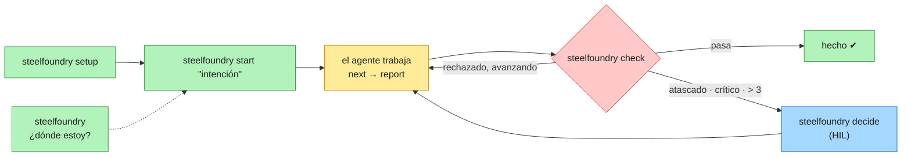
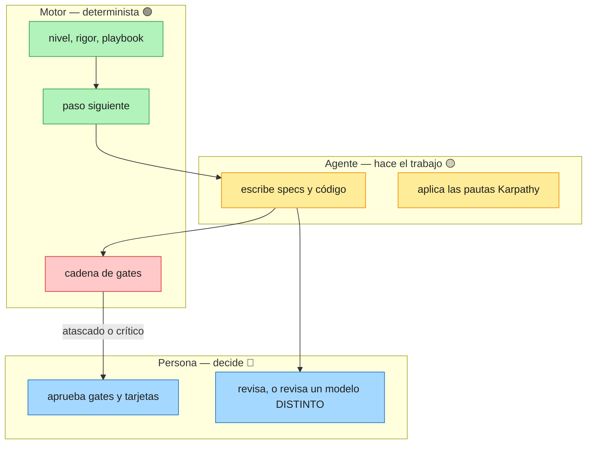

# SteelFoundry — SDD Toolkit · Manual de usuario

Spec-Driven Development agnóstico del modelo: un toolkit que ajusta el proceso al tamaño del trabajo —
desde una errata o una PoC rápida hasta un programa de migración estricto y auditado — donde **un motor
determinista decide**, **los agentes proponen** y **personas con nombre aprueban**.

> **Por qué «SteelFoundry».** Una fundición funde muchos materiales en bruto en piezas de acero estándar
> y repetibles. SteelFoundry hace eso con el SDD: consolida toda la variedad de casos (PoC → spike →
> proyecto pequeño → programa con rigor estricto) en un solo toolkit, funciona con cualquier agente y
> modelo, y toma lo mejor de otros toolkits — la constitución de Spec Kit, el discovery por roles de
> BMAD, EARS y steering de Kiro, las specs delta de OpenSpec — fundido en un solo motor determinista.
>
> Antes se llamaba **open-sdd**: los comandos `open-sdd`, `sdd-open` y `sdd` siguen funcionando, y las
> carpetas `.sdd/`, las variables `OPEN_SDD_*`, los esquemas `open-sdd.*/1` y las herramientas MCP
> `open_sdd_*` no cambian.
>
> 📘 Edición en inglés: [MANUAL.md](MANUAL.md) · Guía visual de una página: [GUIA.md](GUIA.md) · Por qué existe, qué tomó de cada toolkit y su alcance preciso: [POR-QUE.md](POR-QUE.md).

---

## Cinco verbos: todo lo que necesitas

No necesitas los otros 50 comandos para usar steelfoundry. Cinco verbos cubren todo el ciclo; la
herramienta decide todo lo que la evidencia puede decidir (agente, greenfield o brownfield, nivel, rigor,
playbook) y solo le pregunta a una persona lo que es una decisión humana. El resto de comandos sigue
funcionando y aparece con `steelfoundry help --all`.

| | Verbo | Qué hace | Qué decide por ti |
|---|---|---|---|
| 🟢 | `steelfoundry` | Dónde estás: puntuación, fase y la **única** acción siguiente | La acción siguiente |
| 🟢 | `steelfoundry setup` | Se instala en el repositorio (igual que `init`; primero el plan, `--write` aplica) | Agente y terreno |
| 🟢 | `steelfoundry start "<lo que quieres>"` | Empieza cualquier trabajo, de una errata a una migración | Nivel L0–L6, variante, rigor, playbook |
| 🔴 | `steelfoundry check` | Un veredicto: toda la cadena de gates (igual que `gates run`) | Nada: solo pasa o bloquea |
| 🔵 | `steelfoundry decide` | Lista las decisiones que esperan a una persona, con el comando exacto | Nada: decide una persona |



### Quién decide qué



### Leyenda de colores (diagramas y consola)

| Color | Significado | Ejemplos |
|---|---|---|
| 🟢 Verde | Automático: la herramienta decide con evidencia | nivel, rigor, playbook, acción siguiente |
| 🟡 Ámbar | Consultivo: se informa, nunca bloquea | hallazgos de estándares, candidatos de reutilización, falta `C-INDEPENDENT-REVIEW` |
| 🔴 Rojo | Bloquea: exit 1 hasta corregirlo | gates C1–C3, constitución inválida, recibo de revisión caducado |
| 🔵 Azul | Decide una persona | tarjetas HIL, gates de fase, ratificar la constitución (tecleando `RATIFICAR`) |

### Tres reglas que siempre aplican

| Regla | Cómo se hace cumplir |
|---|---|
| Pautas Karpathy (pensar, simplicidad, cambios quirúrgicos, guiado por objetivos) | skill `karpathy-guidelines` instalado en cada proyecto |
| La revisión es humana, o la hace un modelo **distinto** del autor | constitución `C-INDEPENDENT-REVIEW`; una sesión de agente no puede firmar una revisión humana, y `--by-model` debe ser distinto de `--author-model` |
| Una tarea atascada → decide una persona | escala al 1.er fallo crítico, al 2.º fallo idéntico (sin avance) o tras más de 3 fallos; el motor prepara una tarjeta (reintentar · aparcar · excepción) y solo una persona reintenta o aprueba (`steelfoundry decide`) |

## Contenido

1. [Conceptos](#1-conceptos)
2. [Instalación y puesta en marcha](#2-instalación-y-puesta-en-marcha)
3. [Inicio rápido según el tamaño del trabajo](#3-inicio-rápido-según-el-tamaño-del-trabajo)
4. [Niveles, variantes y rigor](#4-niveles-variantes-y-rigor)
5. [La ejecución: next y report](#5-la-ejecución-next-y-report)
6. [Persona en el bucle (HIL)](#6-persona-en-el-bucle-hil)
7. [Asistentes: discovery, EARS, steering, constitución](#7-asistentes)
8. [Modo de ingeniería inversa](#8-modo-de-ingeniería-inversa)
9. [Migration Kit](#9-migration-kit)
10. [Flujos dinámicos (eventos y reglas)](#10-flujos-dinámicos-eventos-y-reglas)
11. [Playbooks](#11-playbooks)
12. [Memoria y mejora continua](#12-memoria-y-mejora-continua)
13. [Progreso y checkpoints: `where`](#13-progreso-y-checkpoints-where)
14. [Trabajo multi-unidad y olas](#14-trabajo-multi-unidad-y-olas)
15. [Hosts de agentes, skills y MCP](#15-hosts-de-agentes-skills-y-mcp)
16. [Gobierno: gates, constitución, afirmaciones](#16-gobierno) — [16.1 Ratificar la constitución](#161-ratificar-la-constitución-confirmación-obligatoria-en-la-terminal)
17. [Archivos y carpetas](#17-archivos-y-carpetas)
18. [Referencia de comandos](#18-referencia-de-comandos)
19. [Escenarios resueltos](#19-escenarios-resueltos) — [19b Ofertas](#19b-para-ofertas-y-aceptación-del-cliente) · [19c Aseguramiento](#19c-aseguramiento-validación-por-reglas-estado-y-auditoría) · [19d Operación](#19d-operación-coste-telemetría-mcp-atestación-estado-en-el-pr)
20. [Problemas frecuentes](#20-problemas-frecuentes)
21. [Límites y lo que no está verificado](#21-límites-y-lo-que-no-está-verificado)

---

## 1. Conceptos

| Término | Significado |
|---|---|
| **Spec** | `.sdd/specs/<feature>/`: `requirements.md` (EARS), `plan.md` (o `design.md`), `tasks.md`. |
| **Steering** | `.sdd/steering/`: memoria del proyecto — `product.md`, `tech.md`, `structure.md`, `constitution.md`. |
| **Constitución** | Principios contra los que se comprueba cada spec; la autoridad que cita un veredicto bloqueante. |
| **Nivel** | Tamaño del trabajo: L0 mínimo … L6 migración. Decide playbook y ceremonia. |
| **Variante** | `greenfield` (nuevo) o `brownfield` (código existente). |
| **Rigor** | Exigencia: `tiny-spec` → `spec-first` → `spec-anchored` → `spec-as-code` (se acepta el nombre antiguo `spec-as-source`). |
| **Playbook** | Fases ordenadas de pasos para un tipo de caso (`.playbook.json`). |
| **Ejecución (run)** | Un playbook en marcha para una feature (`.sdd/engine/<feature>.state.json`). |
| **Directiva** | Lo que el motor le dice al agente que haga ahora (`run-step`, `ask`, `present-gate`, `handoff`, `parked`, `done`). |
| **Ceremonia** | `minimal` (L0–L1), `standard` (L2–L4), `strict` (L5–L6: exige lista de aprobadores). |
| **Tarjeta HIL** | Una decisión preparada para una persona: una pregunta, 2–4 opciones con consecuencias, evidencia y un valor por defecto que nunca aprueba. |
| **Evento** | Algo no planificado (aviso de seguridad, incidente, cambio regulatorio, señal) o el inicio de una ola. |
| **Regla** | `on / when / priority / actions` deterministas que convierten un evento en cambios del flujo. |

**Quién decide qué**

| Decisión | Motor (determinista) | Agente (modelo) | Persona con nombre |
|---|---|---|---|
| Nivel, variante, rigor, playbook | ✓ | — | puede forzarlo (`--level`, `--variant`, `--rigor`) |
| Qué paso corre; veredictos de los gates | ✓ | — | — |
| Hacer el paso, redactar artefactos | — | ✓ | revisa |
| Más riesgo ante un evento | valida | propone con evidencia | — |
| Aprobaciones, «no afectado», cut-over, desmantelar | prepara la tarjeta | — | ✓ |
| Confirmar reglas inferidas, adoptar reglas aprendidas, promover lecciones | propone | — | ✓ |
| Exigencia de pruebas por tarea | ✓ (reglas de validación) | — | escribe las reglas del proyecto |
| Ratificar la constitución | muestra objetivo, alcance y registro | — | ✓ (teclea `RATIFICAR`) |

---

## 2. Instalación y puesta en marcha

```bash
npm install -g @brujo2020/steelfoundry      # o: npx @brujo2020/steelfoundry …
steelfoundry --version
steelfoundry setup --write                  # instala, y en una terminal ofrece construir la constitución guiada
steelfoundry integrate claude-code --write  # skills para un host (cursor, codex, gemini-cli, windsurf, …)
steelfoundry doctor                         # autodiagnóstico: Node, CLI, gate de commit, constitución, specs
```

Desde un checkout: `npm install && npm run build`, y luego `node tools/open-sdd/dist/cli.js …`.
`npm install` instala también el gate de pre-commit (C1/C2/C3 sobre el índice preparado).

**Aprobadores** (obligatorios con ceremonia estricta, recomendados siempre):

```json
// .sdd/settings/approvers.json
{ "approvers": [ { "name": "Ana Rojas", "email": "ana.rojas@acme.example" } ] }
```

El `--by` de una respuesta debe nombrar a un aprobador de la lista **y** coincidir con la identidad git de
la terminal que se usa.

---

## 3. Inicio rápido según el tamaño del trabajo

Empieza siempre preguntándole al motor qué opina:

```bash
steelfoundry start "<lo que quieres hacer>" --dry-run
```

| Quieres… | Comando | Qué pasa |
|---|---|---|
| corregir una errata | `steelfoundry start "fix typo in README"` | L0, playbook `tiny`, 2 pasos, sin paquete de contexto |
| probar una idea | `steelfoundry start "prototype voice search"` | L1 PoC, ceremonia mínima |
| añadir una feature | `steelfoundry start "add CSV export to reports"` | L2, spec-first (variante brownfield si hay código) |
| construir una app pequeña | `steelfoundry start "new service for document signing from scratch"` | L3 `greenfield` |
| entregar varias features | `steelfoundry start "plataforma: onboarding, cobros, notificaciones"` | L4 `multi-feature`, y propone una spec por feature |
| cambiar varios servicios | `steelfoundry start "split billing into 3 microservices"` | L5 `multi-unit`, estricta |
| entender código heredado | `steelfoundry start "reverse engineer the billing system"` | `reverse-engineering`, ver §8 |
| migrar una cartera | `steelfoundry migrate init --example datacenter-exit` | ver §9 |
| no estás seguro | `steelfoundry assist` | recomienda asistentes según el estado del repo |

Luego el bucle: `steelfoundry next <feature>` → hacer el paso → `steelfoundry report …` (ver §5). Mira
el estado cuando quieras con `steelfoundry flow` (§19c) o `steelfoundry where` (§13).

---

## 4. Niveles, variantes y rigor

### 4.1 Niveles

| Nivel | Se reconoce por (ejemplos) | Ceremonia |
|---|---|---|
| L0 mínimo | typo, rename, bump, readme, docs, format, lint | minimal |
| L1 PoC | poc, prototype, spike, experiment, demo, hackathon, mvp | minimal |
| L2 feature | por defecto para un cambio; bug/refactor eligen `bug`/`refactor` | standard |
| L3 proyecto pequeño | from scratch, nueva app/servicio/proyecto | standard |
| L4 mediano | platform, roadmap, varias features, ≥ 3 features listadas | standard |
| L5 grande | ≥ 2 servicios/repos/unidades nombrados, o varios repos en el workspace | strict |
| L6 migración | migrar una cartera, mainframe, COBOL, salida del datacenter, de Oracle a PostgreSQL, cloud migration, monolito a microservicios, strangler | strict |

Reglas que nunca se doblan:
- **El riesgo solo sube el nivel.** Pagos, autenticación, datos personales, migración, infraestructura o datos en un cambio «mínimo» lo convierten en L2. Una PoC con datos personales es L2.
- **Una PoC explícita sigue siendo PoC** aunque trate de algo grande; la escala pasa a ser un aviso.
- **Añadir una palabra de riesgo o de escala nunca baja el nivel** (probado como invariante metamórfico).
- `--level Lx` fuerza un nivel; la salida registra lo que dijo el clasificador.

### 4.2 Variantes

Por la intención («existente», «legacy», «sistema actual» → brownfield; «from scratch», «nueva app» →
greenfield) y si no, por el workspace (hay código fuente → brownfield). Se fuerza con `--variant`.

| Nivel | Greenfield | Brownfield |
|---|---|---|
| L0 | `tiny` | `tiny` |
| L1 | `spike` / `poc-to-feature` | `poc-brownfield` |
| L2 | `base/spec-first`, `bug`, `refactor` | `brownfield-extension`, `legacy-untested` (sin tests) |
| L3 | `greenfield` | `project-brownfield` |
| L4 | `multi-feature` | `multi-feature-brownfield` |
| L5 | `multi-unit-greenfield` | `multi-unit` |
| L6 | `modernize` | `modernize` |

### 4.3 Rigor

| Rigor | Añade | Piso para |
|---|---|---|
| `tiny-spec` | spec de tres líneas (objetivo · hecho cuando · fuera de alcance), el cambio, evidencia fresca | L0–L1 |
| `spec-first` | requisitos EARS, constitución, diseño, tareas; gates C1+C2 | L2–L4 |
| `spec-anchored` | validación del diseño, Gherkin, olas, validación, paquete de auditoría, archivo; C3, C6 | L5–L6 |
| `spec-as-code` (nombre antiguo `spec-as-source`) | discovery, contratos, auditoría; cadena completa | — |

```bash
steelfoundry start "add CSV export" --rigor spec-anchored
```

Los pasos más estrictos se componen sobre el playbook de la variante en
`.sdd/playbooks/<feature>-<rigor>.playbook.json`. Una petición por debajo del piso del nivel, o de lo
declarado en `.sdd/settings/rigor.json` (para L2+), se sube con un aviso. Los pasos que la variante no
puede alimentar se omiten y se imprime el motivo. Las 48 combinaciones L0–L5 × 2 variantes × 4 rigores
están probadas.

---

## 5. La ejecución: next y report

El motor es el mismo para cualquier host. El agente pregunta qué hacer y dice qué pasó:

```bash
steelfoundry next <feature> [--json] [--auto-handoff]
steelfoundry report <feature> --step <id> --result <started|awaiting-approval|completed|rejected|revised|skipped|park|unpark> \
  [--produced a,b] [--reason r] [--by nombre] [--tokens n] [--model id] [--duration s]
```

| Directiva | El agente… |
|---|---|
| `handoff` | escribe el paquete de contexto acotado (`steelfoundry handoff write <f> <paso>`), o usa `--auto-handoff` |
| `ask` | lleva las preguntas abiertas al usuario; el usuario confirma (`steelfoundry questions confirm <f> <paso> --by …`) |
| `run-step` | lee el paquete, reformula objetivo e ids de aceptación (`steelfoundry handoff recall <f> <paso> --text "…"`), informa `started`, hace el paso, informa `completed` (automático) o `awaiting-approval` (gate humano) |
| `present-gate` | prepara una tarjeta si no existe y **se detiene** para la persona |
| `parked` | explica el motivo y se detiene |
| `done` | no queda nada |

**Comprobaciones al informar `completed` / `awaiting-approval`**: existen las salidas declaradas
(`ARTIFACT_MISSING`), se hizo el recall (`RECALL_MISSING`/`RECALL_MISMATCH`), las preguntas están
confirmadas y sin cambios, los artefactos están sellados, los recibos de revisión están frescos, se
cumplen los criterios de la etapa de ingeniería inversa (`REVERSE_STAGE_OPEN`) y, al cerrar una fase, la
trazabilidad (un requisito huérfano o un id fantasma bloquea). `report` nunca acepta `approved`.

La ceremonia mínima (L0–L1) se salta el paquete y el recall. Otros comandos:
`engine start|status|list`, `engine status <f> --mermaid`, `engine event <f> --file e.json`.

---

## 6. Persona en el bucle (HIL)

```bash
steelfoundry hil prepare <feature> --card card.json      # validada: una pregunta, 2–4 opciones, líneas de evidencia
steelfoundry hil review <feature> --html                 # página offline con cada tarjeta abierta y el comando exacto para responder
steelfoundry hil answer <feature> <card-id> <opción> --by "<nombre>" [--confirm <card-id>]
steelfoundry hil list <feature> [--overdue]
steelfoundry hil stats <feature>                         # escalados inútiles por disparador → propuestas de umbral
```

Reglas de la tarjeta: el valor por defecto (que se aplica al vencer el plazo) solo puede **aparcar** o
**rechazar**; las tarjetas `irreversible-damage` aparcan por defecto; `accept-as-is` solo desde la tercera
revisión; los overrides se rechazan en modo autónomo.

Reglas de identidad: las respuestas registran la identidad git; con `approvers.json`, `--by` debe ser una
persona de la lista cuyo email coincida con el de la terminal; desde una sesión de agente (sin TTY,
`CLAUDECODE=1`, `OPEN_SDD_AGENT=1`) una aprobación exige que la persona teclee el id en su terminal. Una
persona que trabaja en una terminal no interactiva define `OPEN_SDD_HUMAN=1`. La ceremonia estricta exige
`approvers.json`. **Los intentos rechazados** (un agente que intenta aprobar, una persona fuera de la
lista) quedan en el registro de auditoría (§19c).

Formato de línea de evidencia: `kept|revised|dropped -> <cambio> -> <evidencia con un número>`.

---

## 7. Asistentes

```bash
steelfoundry assist                                   # qué asistente ayuda ahora (según el estado del repo)
```

### 7.1 Discovery por roles (al estilo BMAD)

```bash
steelfoundry assist discover "exportar facturas para clientes" --feature facturas
# responde .sdd/questions/facturas/discovery.md
steelfoundry assist brief facturas --write            # compone y valida .sdd/specs/facturas/brief.md
steelfoundry discovery log facturas kill "sin facturas XML en v1"   # registro de decisiones (append-only)
```

Las preguntas vienen de roles — analista, PM, arquitecto, UX, QA, seguridad — elegidos de forma
determinista por nivel, variante, señales de UI y riesgo (el rol de seguridad entra solo si hay datos
sensibles). Se responde con la letra y el detalle tras dos puntos
(`C: los clientes no pueden exportar facturas (40 tickets/mes)`). Un agente solo puede escribir
`ASSUMPTION: …`; el brief lleva entonces `[ASSUMPTION A1]` y **no pasa la validación** hasta que una
persona lo confirme o lo descarte. El trabajo L0 no necesita discovery.

### 7.2 Conversión a EARS y revisión

```bash
steelfoundry assist ears "cuando un pago falla el sistema debe avisar al cliente"
steelfoundry assist ears --file notas.md                                    # una frase por línea/viñeta
steelfoundry assist ears "Users can export the report." --system "the reporting service"
steelfoundry assist ears --file notas.md --feature facturas --write --area INV [--accept]
steelfoundry assist ears review facturas                                    # sugerencias sobre requirements.md
steelfoundry requirements review facturas                                   # coach de requisitos (ambigüedad, AMB-00x…)
steelfoundry brownfield clarify facturas                                    # preguntas de clarificación
```

Los cinco patrones (las palabras clave y `shall` quedan en inglés; tus cláusulas conservan tu idioma):

| Patrón | Plantilla |
|---|---|
| Ubicuo | `The <system> shall <response>.` |
| Evento | `WHEN <trigger>, the <system> shall <response>.` |
| Estado | `WHILE <state>, the <system> shall <response>.` |
| Opcional | `WHERE <feature>, the <system> shall <response>.` |
| No deseado | `IF <condition>, THEN the <system> shall <response>.` |

Cada frase recibe un estado, una confianza y notas:

| Estado | Significado | Lo escribe `--write` |
|---|---|---|
| `converted` | reescritura sin ambigüedad | sí |
| `needs-confirmation` (`~`) | reescritura que cambia palabras que una persona debe revisar | solo con `--accept` |
| `question` | no se puede enunciar sin adivinar | nunca |

**La herramienta no inventa requisitos**: cuando falta un dato (un actor, un umbral) pregunta.
**Ambigüedad**: los términos vagos («rápido», «quickly», «appropriate», «securely»…) usan una sola lista
para C1, el asistente EARS y clarify. Cuando hay requisitos ambiguos, `brownfield specify --write` y
`requirements review` lo avisan y, en una terminal, **ofrecen ejecutar clarify** en el acto (solo se
aplican las respuestas que tecleas). La acción siguiente que propone `steelfoundry` pasa a ser
`brownfield clarify <feature>`.

### 7.3 Borradores de steering

```bash
steelfoundry assist steering --write     # o: steelfoundry steering draft --write
steelfoundry steering check              # listo solo cuando no quedan (inferred) ni [NEEDS CLARIFICATION]
```

Redacta `product.md`, `tech.md` y `structure.md` a partir del workspace. Toda suposición va marcada
`(inferred)` y todo lo desconocido como `[NEEDS CLARIFICATION]`. Nunca sobrescribe sin `--force`.

### 7.4 Constitución guiada

```bash
steelfoundry assist constitution     # en una terminal: entrevista guiada → borrador → ratificación con tu nombre
steelfoundry assist constitution --draft       # desde lo que el código ya cumple (evidencia por principio)
steelfoundry brownfield constitution . --interview --answers respuestas.json --write   # sin terminal (CI, agente)
```

El asistente pregunta de a una, con valores por defecto (Enter acepta, «?» explica por qué se pregunta),
guarda el borrador y ofrece ratificarlo. Lo que el código ya demuestra no se pregunta. En un proyecto
nuevo, las decisiones de la entrevista entran como principios **normativos** y los ratifica la persona; los
principios **descriptivos** (afirman algo del código) siguen exigiendo evidencia. `setup --write` ofrece
este asistente al terminar. Un borrador nunca es autoridad hasta que una persona lo ratifica (§16.1).

---

## 8. Modo de ingeniería inversa

Para sistemas existentes que nadie entiende del todo. Por etapas e incremental (por porciones).

```bash
steelfoundry start "reverse engineer the billing system" --feature billing-baseline
steelfoundry reverse init --scope payments --critical payments
steelfoundry reverse next
steelfoundry reverse status [--feature billing-baseline] [--mermaid] [--json]
steelfoundry reverse confirm RULE-PAY-001 --by "Ana Rojas" [--confirm RULE-PAY-001]
steelfoundry reverse init --scope accounts     # siguiente porción: añade módulos, conserva marcas y trabajo
```

| Etapa | Hecha cuando | Quién trabaja |
|---|---|---|
| RE-1 inventario | `.sdd/reverse/inventory.json` lista ≥ 1 módulo | motor (`reverse init`) |
| RE-2 arquitectura | `.sdd/reverse/architecture.md` nombra cada módulo | el agente redacta, una persona revisa |
| RE-3 caracterización | `.sdd/reverse/characterization.json` asocia ≥ 60 % de los módulos (todos los críticos) a tests existentes | el agente escribe tests |
| RE-4 reglas | `.sdd/reverse/rules.md` tiene una línea RULE o NONE por módulo | el agente infiere |
| RE-5 confirmación | ≥ 80 % de reglas confirmadas, ninguna inferida en módulos críticos | **persona** (`reverse confirm`) |
| RE-6 línea base de spec | cada RULE confirmada citada en `.sdd/specs/<feature>/requirements.md` | agente + asistente EARS |

Una etapa nunca está hecha mientras una anterior siga abierta. Umbrales en `.sdd/settings/reverse.json`
(`{"minCharacterized": 0.6, "minConfirmed": 0.8}`).

```
- RULE-PAY-001 [payments] los reembolsos se permiten hasta 30 días tras la captura — inferred
- RULE-PAY-002 [payments] no se reembolsa más de lo capturado — confirmed by Ana Rojas (2026-10-23)
- NONE [notify] sin reglas de negocio — confirmed by Ana Rojas
```

---

## 9. Migration Kit

`steelfoundry migrate` (el nombre antiguo `modernize` sigue funcionando). L6 es el nivel de **migración**:
una cartera de aplicaciones que cambia de plataforma, decidida por componente con las 7 Rs de AWS.

**Ejemplos enterprise** (`steelfoundry migrate init --example <id>`):

| Ejemplo | Escenario | Qué ejercita |
|---|---|---|
| `banking` | Core en mainframe | strangler, cut-over regulado |
| `insurance-mainframe` | Aseguradora que sale del MIPS: COBOL/CICS, DB2, IMS, batch JCL | refactor vs retain del mainframe, impresión a SaaS, retiro de QMF |
| `datacenter-exit` | Retailer que cierra su datacenter antes del fin del contrato | relocate de VMware, repurchase de correo/archivos, retain por residencia |
| `database` | Telco que sale de Oracle hacia PostgreSQL gestionado | replatform de BBDD, refactor de facturación PL/SQL, retener lo que ya está en cloud |
| `monolith` | Monolito Java EE → servicios, Java 8→21, AngularJS sin soporte | strangler empezando por checkout, retener la pasarela de pagos SaaS |

```bash
steelfoundry migrate init [--example <id>]     # .sdd/modernize/portfolio.json
steelfoundry migrate assess                     # riesgo + 7 Rs por componente, con regla y motivo
steelfoundry migrate override <id> <r> --by "<nombre>" --reason "<por qué>"
steelfoundry migrate waves [--max 3]            # retirar primero → piloto → olas por dependencias
steelfoundry migrate estimate                   # semanas-persona P50/P90 por ola
steelfoundry migrate plan <feature>             # ejecución L6, ceremonia estricta, unidades y olas
steelfoundry migrate wave <feature> <n>         # las reglas insertan los pasos de cada componente
steelfoundry migrate advance <id> --to <etapa> [--metrics m.json]
steelfoundry migrate status [--json|--mermaid|--html]
```

**Campos del portafolio** por componente: `id`, `criticality` (1–5), `businessValue` (1–5), `techFit`
(1–5), `businessDemand` (high|normal|low), `usage` (active|low|none), `sensitivity`
(public|internal|confidential|regulated), `testCoverage` (0–1), `eol`, `saasAvailable`,
`differentiating`, `recentlyUpgraded`, `residencyHold`, `platform`, `dependsOn`, `owner`.

**Riesgo (0–100)**: criticidad 35 %, sensibilidad 25 %, falta de tests 20 %, acoplamiento 10 %, fin de vida 10 %.

**Tabla de las 7 Rs** (gana la primera que encaja; AWS Prescriptive Guidance):

| Regla | R | Cuándo |
|---|---|---|
| D-RETIRE | retire | sin uso entrante |
| D-RETAIN-TARGET | retain | ya está en `cloud` o `saas` (nada que mover) |
| D-RETAIN-RESIDENCY | retain | retención por residencia de datos |
| D-RETAIN-RECENT | retain | actualizado recientemente |
| D-REPURCHASE | repurchase | existe un SaaS equivalente y no diferencia al negocio |
| D-MAINFRAME-REFACTOR | refactor | mainframe/midrange con demanda alta |
| D-MAINFRAME-RETAIN | retain | mainframe/midrange en otro caso |
| D-REFACTOR / D-REFACTOR-LARGE | refactor | demanda alta con mal encaje técnico o poca cobertura |
| D-REPLATFORM | replatform | fin de vida o mal encaje (migraciones grandes: mover primero, modernizar después) |
| D-RELOCATE | relocate | VMware |
| D-REHOST | rehost | en otro caso |

**Olas**: se retira lo que nadie llama; un piloto (no regulado, criticidad < 4, menor riesgo); después
niveles de dependencia, menor riesgo primero, ≤ `max` por ola, ≤ 1 componente de criticidad 5 por ola.

**Ciclo de vida** (refactor): planned → characterized → facade → parallel-run → canary-5 → canary-25 →
canary-50 → cut-over → decommissioned. Retroceder es un rollback (permitido hasta desmantelar). Un
componente congelado no avanza.

**Decisión canary** desde `m.json`: `rollback` si la tasa de error > 2× el presupuesto o el desajuste >
10× el umbral; `hold` si falta algún criterio o la muestra; si no, `advance`.

**Aprobaciones**: el cut-over de componentes regulados o de criticidad ≥ 4 y todo desmantelamiento crean
una tarjeta; desmantelar es `irreversible-damage` (por defecto aparca).

---

## 10. Flujos dinámicos (eventos y reglas)

Sin modelo: las reglas convierten eventos en cambios del flujo. El mismo evento dos veces no hace nada.

```bash
steelfoundry engine event <feature> --file evento.json   # o: steelfoundry migrate event …
steelfoundry migrate propose <feature> --file propuesta.json   # evidencia del agente: solo puede subir el riesgo
steelfoundry migrate resolve <feature> --event <id>
steelfoundry migrate learn <feature> --event <id> [--reflect]
steelfoundry migrate rules [list | adopt <id> --by "<nombre>" [--confirm <id>]]
```

**Evento** (`source` debe ser human|scanner|monitor|pipeline — un agente no puede levantar eventos):

```json
{ "id": "CVE-2026-4242", "type": "security-advisory", "at": "2026-10-24T08:00:00Z", "source": "scanner",
  "title": "RCE en librería de logging", "components": ["auth-service"], "env": "prod",
  "cvss": 10, "exploited": true, "evidence": ["https://nvd.nist.gov/vuln/detail/CVE-2026-4242"] }
```

Tipos: `security-advisory`, `incident`, `wave-start`, `signal`, `regulatory-change`, `scope-change`.
Severidad: CVSS ≥ 9 crítica, ≥ 7 alta, ≥ 4 media, si no baja; explotada → crítica.

**Regla propia** en `.sdd/settings/dynamic-rules.json` (`"schema": "open-sdd.dynamic-rules/1"`):

```json
{ "schema": "open-sdd.dynamic-rules/1",
  "rules": [ { "id": "SCOPE-HIL", "on": "scope-change", "when": "component == cobros", "priority": 5,
    "rationale": "Todo cambio de alcance en cobros lo aprueba Producto",
    "actions": [ { "type": "require-hil", "trigger": "scope-change", "step": "scope-approval",
                   "use": "opensdd:skill/sdd-spec-requirements",
                   "question": "¿Aprueba Producto el cambio {event} en {component}?" } ] } ] }
```

- Señales de `when`: `type`, `severity`, `cvss`, `exploited`, `env`, `stage`, `component`, `level`, `wave`,
  `risk`, `signal`… Operadores `== != >= <= > <`, `&` y `|`.
- Acciones: `insert-steps`, `patch-both`, `freeze`, `require-hil`, `set-deadline`, `raise-level`.
- Las propuestas del agente se rechazan si nombran un componente desconocido, no traen evidencia, bajan el
  riesgo o afirman «no afectado» (eso lo decide una persona).
- Aprendizaje: un evento resuelto de un tipo → hipótesis en cuarentena; dos → evidencia. Una brecha
  estructural produce un **candidato a regla** que solo adopta una persona con nombre.

---

## 11. Playbooks

```bash
steelfoundry playbook profile                 # señales detectadas y tipo de proyecto
steelfoundry playbook plan "<intención>" [--save nombre]
steelfoundry playbook check <nombre|archivo>
steelfoundry playbook build <nombre> --target <host|prompt|mcp|aidlc> [--write]
steelfoundry playbook improve <nombre> [--k 3]
steelfoundry playbook new <nombre> --from <base> [--add fase:uso[:human]] [--skip id]
steelfoundry playbook diff <a> <b>
steelfoundry playbook list | save
steelfoundry engine start <feature> --playbook <nombre>     # el motor dicta cada paso con next
```

Un playbook propio es un **flujo determinista**: el agente no improvisa el orden; los pasos `:human` solo
avanzan con la respuesta de una persona. `improve` nunca conserva un candidato que quite un gate humano o
una comprobación de seguridad.

---

## 12. Memoria y mejora continua

```bash
steelfoundry memory capture --kind <gate-block|hil-answer|human-edit|recall-mismatch> --text "…"
steelfoundry memory reflect --file reflection.json
steelfoundry memory promote <id> --by "<nombre>"
steelfoundry memory withdraw --origin <id>
steelfoundry memory list
```

Se captura solo: gates rechazados, respuestas HIL, ediciones de archivos revisados, recall que no coincide.
Una lección basada solo en evidencia confundida queda en cuarentena; los secretos se rechazan; solo las
lecciones promovidas llegan a los paquetes de contexto, como hipótesis.

---

## 13. Progreso y checkpoints: `where`

```bash
steelfoundry where                         # cada ejecución: fase, barra de progreso, pendientes, decisiones
steelfoundry where <feature> --json
steelfoundry where --line                  # una línea para el prompt
steelfoundry where --save --note "antes del comité"   # .sdd/state/checkpoint.md y .json
```

Para el **estado claro** (estado, etapa n/9, qué lo bloquea, siguiente orden) y tableros, usa
`steelfoundry flow` (§19c).

---

## 14. Trabajo multi-unidad y olas

```bash
steelfoundry engine start <feature> --playbook multi-unit --units api,web:api,ui:api+web
steelfoundry waves <feature> --baseline 1 --protect tests/oracle.test.ts
steelfoundry waves <feature> --verify 1 --check "npm test" --units api,web
steelfoundry impl <feature> --parallel     # olas de tareas (P) con _Boundary:_ disjuntos y camino crítico
```

En `tasks.md`, `(P)` marca una tarea paralelizable, `_Boundary:_` los archivos que puede tocar y
`_Depends:_` el orden. Las tareas con límites disjuntos van en la misma ola; los ciclos se rechazan; un
solo escritor por feature. El árbitro de olas rechaza el merge si falla un check o cambió un archivo
protegido.

---

## 15. Hosts de agentes, skills y MCP

- Skills en cada host: `sdd-playbook`, `sdd-modernize` (niveles, migración, eventos), `sdd-discovery`,
  `sdd-tiny`, `sdd-spec-*`, `sdd-impl` (ejecuta `validation --record` y etiqueta la evidencia),
  `sdd-review`, `sdd-verify-completion`, `sdd-characterize`, `sdd-getspecs`.
- Reglas duras para los agentes: nunca informar `approved`, nunca responder tarjetas, nunca ratificar,
  nunca adoptar reglas ni promover lecciones, nunca levantar eventos, proponer solo con evidencia.
- MCP (`steelfoundry mcp`): `open_sdd_next`, `open_sdd_report`, `open_sdd_status`, `open_sdd_context_pack`,
  `open_sdd_gates_run`, `open_sdd_flow`, `open_sdd_validation`, `open_sdd_audit_trail` y los recursos de la
  constitución.
- AI-DLC: tipos de paso `aidlc:stage/*`, `import aidlc` y la plantilla de plugin en
  `templates/integrations/aidlc-plugin/opensdd/`.

---

## 16. Gobierno

```bash
steelfoundry gates chain --profile regulated     # resuelve la cadena Zero-Trust
steelfoundry gates run [C1 C2 C3] [--staged] [--strict]
steelfoundry govern rigor | conformance | hitl | discipline | constitution
steelfoundry status <feature> --check [--strict]
steelfoundry review record <feature> <paso> --by "<nombre>" --artifact <ruta>
steelfoundry assure claims --verify              # registro de afirmaciones: debe quedar en 0 rotas
steelfoundry audit <feature> | audit bundle | audit sarif | audit trail
```

El gate de seguridad **C2** escanea siempre `specs/` y `steering/` (lo que el agente lee como
instrucciones) en busca de inyección dirigida a agentes (frases que piden ignorar las instrucciones
previas, saltarse el hook de pre-commit o los gates, aprobarse a sí mismo, o que simulan un mensaje de
sistema), además de secretos y comandos destructivos. Nunca te saltes el gate de commit con `--no-verify`; declara un falso positivo real con su
motivo en `.sdd/settings/security-allowlist.json`.

### 16.1 Ratificar la constitución (confirmación obligatoria en la terminal)

**Objetivo.** Ratificar da autoridad a los principios del borrador: desde ese momento los gates y las
revisiones los citan como reglas del proyecto, y cambiar uno exige una enmienda. Por eso es un acto de una
persona, no de un agente.

**Alcance.** Solo los principios de `constitution.draft.md` (todos, o los de `--ids`). Un principio
*descriptivo* (afirma algo del código) necesita evidencia; uno *normativo* (una decisión del equipo, por
ejemplo de la entrevista guiada) lo ratifica la persona con nombre. Nada más cambia.

**Cómo.** `steelfoundry assist constitution` te guía hasta el final, o directamente:

```bash
steelfoundry govern constitution --ratify --by "<nombre>" --rationale "<motivo>" --write
```

Antes de escribir, el comando muestra el objetivo, la lista exacta de principios, quién (nombre y email
git) y dónde quedará registrado, y te pide **teclear `RATIFICAR` en tu terminal** (`/dev/tty`, 60 s). Sin
terminal — una sesión de agente, un script de CI, tiempo agotado o un texto distinto — no se escribe nada,
el intento queda registrado (`CONSTITUTION_RATIFY_REFUSED`) y el comando sale con 1. Sin `--write` solo
muestra lo que pasaría y no pregunta nada.

**Dónde queda registrado.**

| Dónde | Qué |
|---|---|
| `.sdd/steering/constitution.md` | cada principio con su enmienda `AMD-RATIFY-<id>`: quién, cuándo, por qué |
| `.sdd/engine/_governance.audit.jsonl` | `CONSTITUTION_RATIFIED` (o `…_REFUSED`): persona, email git, motivo, principios; encadenado por hash |
| `steelfoundry audit trail --actor human` | la vista legible; `--principle C-…` para un principio |

Límite: teclear en la terminal sube la exigencia de «un agente escribió un nombre» a «alguien en la
terminal lo confirmó»; no prueba la identidad (un agente podría abrir una pseudo-terminal). La identidad la
da el email git que queda registrado.

---

## 17. Archivos y carpetas

| Ruta | Contenido |
|---|---|
| `.sdd/specs/<f>/` | `requirements.md`, `plan.md`/`design.md`, `tasks.md`, `brief.md`, `delta.md`, `sow.md` |
| `.sdd/steering/` | `product.md`, `tech.md`, `structure.md`, `constitution.md`, `constitution.draft.md` |
| `.sdd/settings/` | `approvers.json`, `rigor.json`, `dynamic-rules.json`, `reverse.json`, `hitl.json`, `security-allowlist.json`, `validation-rules.json`, `estimate.json`, `migration-estimate.json`, `finops.json` |
| `.sdd/playbooks/` | playbooks del proyecto y generados |
| `.sdd/engine/` | `<f>.state.json`, `<f>.audit.jsonl` (registro de decisiones encadenado), `_governance.audit.jsonl` (ratificaciones), `<f>.lock` |
| `.sdd/attestations/` | `<f>.intoto.json` (in-toto Statement v1) |
| `.sdd/handoff/<f>/` | paquetes de contexto, registros de recall |
| `.sdd/questions/<f>/` | archivos de preguntas (incluido `discovery.md`) |
| `.sdd/hil/<f>/` | tarjetas, respuestas, `review.html` |
| `.sdd/events/<f>/` | registros de eventos con decisiones y propuestas |
| `.sdd/modernize/` | `portfolio.json`, `assessment.json`, `dispositions.json`, `waves.json`, `state.json`, `status.html` |
| `.sdd/reverse/` | `inventory.json`, `architecture.md`, `characterization.json`, `rules.md` |
| `.sdd/memory/` | bandeja, candidatos, cuarentena, lecciones |
| `.sdd/reviews/` | recibos de revisión |
| `.sdd/state/` | `checkpoint.md`, `checkpoint.json`, libro de progreso |

---

## 18. Referencia de comandos

| Comando | Para qué |
|---|---|
| `start "<intención>"` | nivel/variante/rigor → playbook → ejecución → primer paso; propone el reparto en features |
| `next <f>` | directiva siguiente |
| `report <f> --step --result` | informar de un paso (con `--tokens`, `--model`) |
| `flow [f] [--json\|--markdown]` | estado claro, etapas, pasos, decisiones, métricas |
| `where [f]` | progreso, pendientes, checkpoint |
| `validation <f> [--record]` | pruebas que debe mostrar cada tarea, por reglas |
| `audit trail [f] [--requirement\|--principle\|--actor\|--who] [--csv\|--otlp f]` | registro de decisiones |
| `attest <f> [--write]` / `attest --verify <archivo>` | atestación in-toto |
| `estimate <f> [--sow --write]`, `migrate estimate` | estimaciones y alcance de una oferta |
| `trace <f> [--mermaid\|--csv]` | trazabilidad requisito → tarea |
| `impl <f> [--parallel]` | implementación; plan de olas y camino crítico |
| `engine start\|status\|list\|event` | ejecuciones |
| `handoff write\|recall\|check` | paquetes de contexto |
| `questions check\|confirm` | archivos de preguntas |
| `hil prepare\|answer\|list\|stats\|review` | decisiones para personas |
| `assist [discover\|brief\|ears\|steering\|constitution]` | asistentes |
| `requirements review\|fix`, `brownfield clarify` | calidad de requisitos y clarificación |
| `steering check\|draft` | steering |
| `reverse init\|status\|next\|confirm` | ingeniería inversa |
| `migrate …` | Migration Kit (alias `modernize`) |
| `playbook …` | playbooks |
| `memory …` | memoria |
| `waves <f>` | plan de olas / árbitro |
| `brownfield …`, `delta …` | consola brownfield y deltas |
| `import spec-kit` | importar un proyecto Spec Kit |
| `gates`, `govern`, `assure`, `audit`, `status --check`, `doctor` | gobierno |

Todo comando responde a `--help`; `steelfoundry help <comando>` muestra uso y ejemplos;
`steelfoundry help exit-codes` documenta los códigos de salida (0 ok, 1 rechazado por un gate, 2 uso).

---

## 19. Escenarios resueltos

### 19.1 Cambio mínimo (3 comandos)

```bash
steelfoundry start "fix typo in README"
steelfoundry report fix-typo-readme --step sdd-tiny --result started
steelfoundry report fix-typo-readme --step sdd-tiny --result completed
```

### 19.2 Un cambio mínimo que se vuelve riesgoso

```bash
echo '{"id":"sig-1","type":"signal","at":"2026-10-24T09:00:00Z","source":"human","title":"la errata está en la ruta de error de auth","components":[],"signal":{"name":"touches-auth","risk":true},"evidence":["comentario de revisión #12"]}' > sig.json
steelfoundry engine event fix-typo-readme --file sig.json   # → L2, ceremonia estándar
```

### 19.3 Una PoC que se convierte en feature

```bash
steelfoundry start "prototype voice search then turn into a feature if it works"   # poc-to-feature
```

### 19.4 Feature brownfield con más rigor

```bash
steelfoundry start "add CSV export to the existing reports" --rigor spec-anchored
steelfoundry assist ears "When the export completes the reporting service must email the link to the requester."
```

### 19.5 Ingeniería inversa de un módulo heredado y después cambiarlo

```bash
steelfoundry start "reverse engineer the billing system" --feature billing-baseline
steelfoundry reverse init --scope payments --critical payments
steelfoundry reverse next          # repetir hasta RE-6
steelfoundry start "add partial refunds to the existing payments module"
```

### 19.6 Migración con un CVE crítico imprevisto el día del go-live

`migrate init --example banking` → `assess` → `waves` → `plan` → `wave 1..3`; un evento del escáner (CVSS
10, explotado) congela los componentes, fija 24 h de plazo, parchea legado **y** nuevo, y crea tarjetas de
cambio de emergencia; las propuestas del agente «no afectado» se rechazan; una persona aprueba; `resolve`
descongela; `learn --reflect` deja un candidato a regla que adopta una persona. La historia completa corre
en `tools/open-sdd/test/mkBankingScenario.test.ts` (20 pasos).

---

## 19b. Para ofertas y aceptación del cliente

```bash
steelfoundry estimate <feature>               # esfuerzo P50/P90 + calendario con olas paralelas (factores declarados)
steelfoundry estimate <feature> --sow --write # .sdd/specs/<feature>/sow.md: alcance, exclusiones, entregables, aceptación, supuestos, riesgos
steelfoundry migrate estimate                 # semanas-persona por ola según las 7 Rs
steelfoundry trace <feature> --csv --out matriz.csv   # requisito × tarea × estado × evidencia
```

Los factores viven en `.sdd/settings/estimate.json` y `.sdd/settings/migration-estimate.json`; cada salida
dice si usó los de partida (no calibrados) o los tuyos. Las preguntas de clarify abiertas encarecen la
estimación.

## 19c. Aseguramiento: validación por reglas, estado y auditoría

**Validación que debe mostrar cada tarea** — la deciden reglas, nunca un modelo. Toda tarea exige `unit`;
una regla que encaja con los requisitos que cita, los archivos de su `_Boundary:_` o su título AÑADE
clases y una cobertura mínima. Las reglas solo suben la exigencia y su orden no importa.

| Regla de partida | Se activa con | Añade | Severidad |
|---|---|---|---|
| VR-MONEY | debitar/acreditar, monto, saldo, libro mayor, reembolso… | integration, contract, property, independent-review, cobertura ≥ 90 % | block |
| VR-PII | datos personales, email, tarjeta, teléfono, RUT/DNI… | integration, security-scan | block |
| VR-AUTH | auth, login, token, rol, permiso (o rutas `auth/`) | integration, security-scan, independent-review | block |
| VR-PUBLIC-API | rutas `api/`, `routes/`, `controllers/`… | contract | warn |
| VR-LATENCY | «within N ms/s», p95, latencia | performance | warn |
| VR-MIGRATION | tareas de migración o rutas `migrations/` | integration, e2e | block |

Tus reglas van en `.sdd/settings/validation-rules.json` (`schema: open-sdd.validation-rules/1`; el mismo id
reemplaza una de partida) y pueden citar un principio de la constitución (`"principle": "C-…"`), que es lo
que muestra la auditoría. La tarea demuestra cada clase en su evidencia:
`_Evidence:_ [unit] [integration] [contract] … [review: Nombre] [coverage 93%]`.

```bash
steelfoundry validation <feature>            # por tarea: clases exigidas, la regla y el texto que la disparó; exit 1 si una tarea hecha no tiene una clase bloqueante
steelfoundry validation <feature> --record   # además registra cada decisión en la auditoría (una vez por cambio)
```

**Estado claro y flujo**:

```bash
steelfoundry flow                    # todas las features, una línea cada una
steelfoundry flow <feature>          # constitución → discovery → requisitos → clarify → diseño → tareas → implementación → validación → aprobación
steelfoundry flow <feature> --json   # esquema open-sdd.flow/1 para tableros
```

```
  ▶ EN CURSO · etapa 7/9 Implementación · tareas 1/4
  siguiente: steelfoundry impl cobros
```

Estados: SIN EMPEZAR · EN CURSO · ESPERA UNA DECISIÓN · BLOQUEADO · TERMINADO. `status.blockedBy` dice qué
lo bloquea (tareas hechas sin la validación exigida, auditoría manipulada, ejecución aparcada) y
`status.next` es la orden exacta. El discovery es opcional: sin `brief.md` pero con requisitos aparece
como saltado.

**Registro de auditoría** — una fila por decisión: quién (persona con email git, agente, regla o sistema),
por qué, sobre qué requisitos y principios, con evidencia. Se registran ratificaciones, decisiones HIL,
intentos rechazados, revisiones, validaciones por regla y eventos. Cada registro está encadenado por hash;
una línea manipulada se informa y el comando sale con 1.

```bash
steelfoundry audit trail <feature> --requirement REQ-COB-001   # qué se decidió sobre este requisito
steelfoundry audit trail <feature> --principle C-BOUNDARIES
steelfoundry audit trail <feature> --actor human               # human | agent | rule | system
steelfoundry audit trail <feature> --decisions --csv > registro.csv
```

## 19d. Operación: coste, telemetría, MCP, atestación, estado en el PR

```bash
steelfoundry flow <feature>                          # además: tokens, modelos y coste (precios en .sdd/settings/finops.json)
steelfoundry audit trail [feature] --otlp otlp.json  # OTLP/JSON para un OpenTelemetry Collector (receiver otlpjsonfile)
steelfoundry attest <feature> --write                # .sdd/attestations/<feature>.intoto.json (in-toto Statement v1)
steelfoundry attest --verify <archivo>               # exit 1 si cambió la spec, la constitución o la auditoría
steelfoundry flow --markdown                         # tabla de estado para un PR o $GITHUB_STEP_SUMMARY
```

`.sdd/settings/finops.json`: `{ "budgetTokens": 2000000, "usdPerMillionTokens": { "<modelo>": 15, "default": 3 } }`.
Los pasos declaran su consumo con `steelfoundry report <feature> --step <id> --result <r> --tokens N --model M`.
La GitHub Action publica `flow --markdown` en el resumen del job.

---

## 20. Problemas frecuentes

| Mensaje | Significado / solución |
|---|---|
| `AGENT_SESSION` | aprobación desde una terminal de agente: la persona la confirma en su terminal o usa `OPEN_SDD_HUMAN=1` |
| `APPROVER_NOT_LISTED` | `--by` no está en `approvers.json`, o el email git de esta terminal es de otra persona |
| `APPROVERS_REQUIRED` | ceremonia estricta: crea `.sdd/settings/approvers.json` |
| `RECALL_MISSING` / `RECALL_MISMATCH` | reformula el paso y los ids de aceptación con `handoff recall` |
| `ARTIFACT_MISSING` | la salida declarada del paso no está en disco |
| `REVERSE_STAGE_OPEN` | no se cumplen los criterios de la etapa; `reverse next` los lista |
| `FROZEN` | un evento abierto congeló el componente; resuélvelo primero |
| `CANARY_HOLD` / `CANARY_ROLLBACK` | métricas por debajo del criterio / por encima del umbral de rollback |
| `Ratificación NO confirmada` | teclea `RATIFICAR` en tu propia terminal; un agente o un script de CI no puede ratificar (§16.1) |
| `validation` sale con 1 | a una tarea hecha le falta una clase que exigen sus reglas: añade la prueba y su etiqueta `[clase]` |
| `audit trail` sale con 1 / flow `BLOQUEADO` por la auditoría | se editó o borró una línea de un registro encadenado; investiga antes de confiar en él |
| C2 falla por `guardrail-bypass`/`self-approval`/`role-header` | hay una instrucción dirigida al agente en una spec; quítala o declárala con motivo si es legítima |

**¿Por qué mi cambio mínimo pasó a L2?** Nombra un riesgo (auth, pagos, datos personales…).
**¿Puede aprobar un agente si se lo pido?** No: las aprobaciones y la ratificación exigen la identidad y la
terminal de la persona.
**¿Son regulatorias las horas de SLA?** No: son valores de partida; pon tu política en `dynamic-rules.json`.

---

## 21. Límites y lo que no está verificado

- No incluye un modelo: los asistentes son deterministas y los agentes corren en tu host.
- Detectar una sesión de agente es un freno, no autenticación; el registro es la identidad git y
  `approvers.json`. Para aprobación criptográfica, firma commits/respuestas (no incluido).
- Las estimaciones (`estimate`, `migrate estimate`) y el coste FinOps usan factores y precios declarados;
  no están calibrados.
- Teclear `RATIFICAR` sube la exigencia pero no prueba la identidad; la atestación no está firmada hasta
  que la firmes (por ejemplo con Sigstore).
- Las reglas de validación encajan por texto y rutas: pueden dispararse de más o de menos; ajústalas en
  `validation-rules.json`.
- La tabla de las 7 Rs codifica la guía de AWS como reglas; no sustituye un assessment con los dueños.
- EARS disciplina cómo se enuncia un requisito, no si es correcto.

Fuentes: AWS Prescriptive Guidance — *About the migration strategies* (7 Rs); AWS DevOps Blog —
*AI-Driven Development Life Cycle*.
