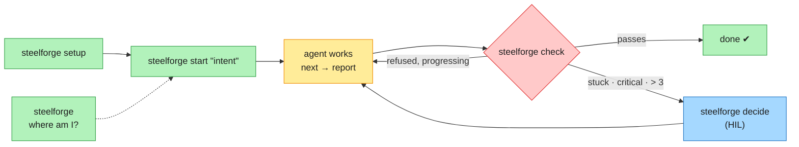
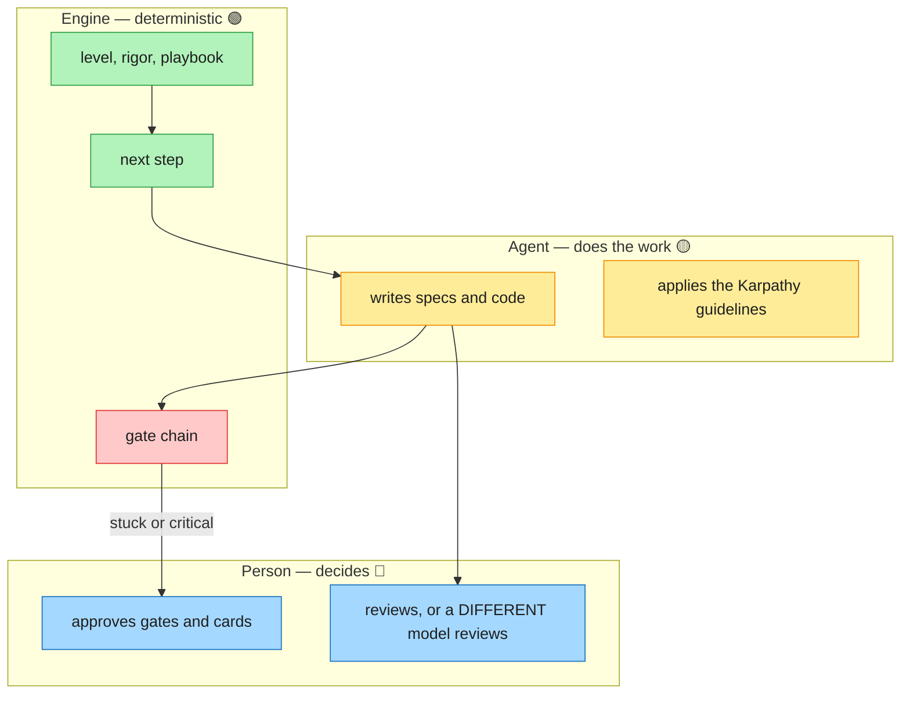

# open-sdd — User Manual (v3.10.0)

Model-agnostic Spec-Driven Development: one CLI that scales the process to the work — from a typo to
the modernization of a banking portfolio — where a **deterministic engine decides**, **agents
propose**, and **named people approve**.

---

## Five verbs: all you need

> 📘 One-page visual guide with a small end-to-end example and the QC report: [GUIA.md](GUIA.md) (Spanish).

You do not need the other 50 commands to use steelforge. Five verbs cover the whole lifecycle; the
tool decides everything that evidence can decide (agent, greenfield or brownfield, level, rigor,
playbook) and asks a person only for a human decision. Every other command still works and is listed
by `steelforge help --all`.

| | Verb | What it does | What it decides for you |
|---|---|---|---|
| 🟢 | `steelforge` | Where you are: score, phase and the **one** next action | The next action |
| 🟢 | `steelforge setup` | Installs into the repository (same as `init`; plan first, `--write` applies) | Agent and terrain |
| 🟢 | `steelforge start "<what you want>"` | Starts any work, from a typo to a modernization | Level L0–L6, variant, rigor, playbook |
| 🔴 | `steelforge check` | One verdict: the whole gate chain (same as `gates run`) | Nothing: it only passes or blocks |
| 🔵 | `steelforge decide` | Lists the decisions waiting for a person, with the exact command | Nothing: a person decides |



### Who decides what



### Colour legend (diagrams and console)

| Colour | Meaning | Examples |
|---|---|---|
| 🟢 Green | Automatic: the tool decides from evidence | level, rigor, playbook, next action |
| 🟡 Amber | Advisory: reported, never blocks | standards findings, reuse candidates, missing `C-INDEPENDENT-REVIEW` |
| 🔴 Red | Blocks: exit 1 until fixed | gates C1–C3, invalid constitution, stale review receipt |
| 🔵 Blue | A person decides | HIL cards, phase gates, ratifying the constitution |

### Three rules that always apply

| Rule | How it is enforced |
|---|---|
| Karpathy guidelines (think, simplicity, surgical changes, goal-driven) | `karpathy-guidelines` skill installed in every project |
| Review is human, or by a model **different** from the author | constitution `C-INDEPENDENT-REVIEW`; an agent session cannot sign a human review, and `--by-model` must differ from `--author-model` |
| A stuck task → a person decides | escalates at the 1st critical failure, the 2nd identical failure (no progress) or after more than 3 failures; the engine prepares a card (retry · park · exception) and only a person retries or approves (`steelforge decide`) |


## Contents

1. [Concepts](#1-concepts)
2. [Install and set up](#2-install-and-set-up)
3. [Quick start by size of work](#3-quick-start-by-size-of-work)
4. [Levels, variants and rigor](#4-levels-variants-and-rigor)
5. [The run: next and report](#5-the-run-next-and-report)
6. [Human in the loop (HIL)](#6-human-in-the-loop-hil)
7. [Assistants: discovery, EARS, steering, constitution](#7-assistants)
8. [Reverse engineering mode](#8-reverse-engineering-mode)
9. [Migration Kit](#9-migration-kit)
10. [Dynamic workflows (events and rules)](#10-dynamic-workflows-events-and-rules)
11. [Playbooks: plan, check, build, improve, author](#11-playbooks)
12. [Memory and continuous improvement](#12-memory-and-continuous-improvement)
13. [Progress and checkpoints: `where`](#13-progress-and-checkpoints-where)
14. [Multi-unit work and waves](#14-multi-unit-work-and-waves)
15. [Agent hosts, skills and MCP](#15-agent-hosts-skills-and-mcp)
16. [Governance: gates, constitution, claims](#16-governance)
17. [Files and folders](#17-files-and-folders)
18. [Command reference](#18-command-reference)
19. [Worked scenarios](#19-worked-scenarios)
20. [Troubleshooting and FAQ](#20-troubleshooting-and-faq)
21. [Limits and what is not verified](#21-limits-and-what-is-not-verified)

---

## 1. Concepts

| Term | Meaning |
|---|---|
| **Spec** | `.sdd/specs/<feature>/`: `requirements.md` (EARS), `plan.md` (or `design.md`), `tasks.md`. |
| **Steering** | `.sdd/steering/`: project memory — `product.md`, `tech.md`, `structure.md`, `constitution.md`. |
| **Constitution** | Principles every spec is checked against; the authority a blocking verdict cites. |
| **Level** | Size of the work: L0 tiny … L6 modernization. Decides playbook and ceremony. |
| **Variant** | `greenfield` (new) or `brownfield` (existing code). |
| **Rigor** | Strictness: `tiny-spec` → `spec-first` → `spec-anchored` → `spec-as-code` (legacy name `spec-as-source` accepted). |
| **Playbook** | Ordered phases of steps for one kind of case (`.playbook.json`). |
| **Run** | One playbook executing for one feature (`.sdd/engine/<feature>.state.json`). |
| **Directive** | What the engine tells the agent to do next (`run-step`, `ask`, `present-gate`, `handoff`, `parked`, `done`). |
| **Ceremony** | `minimal` (L0–L1), `standard` (L2–L4), `strict` (L5–L6: approvers list required). |
| **HIL card** | A prepared decision for a person: one question, 2–4 options with consequences, evidence, a default that never approves. |
| **Event** | Something unplanned (security advisory, incident, regulatory change, signal) or a wave start. |
| **Rule** | Deterministic `on / when / priority / actions` that turns an event into workflow changes. |

**Who decides what**

| Decision | Engine (deterministic) | Agent (model) | Named person |
|---|---|---|---|
| Level, variant, rigor, playbook | ✓ | — | may override (`--level`, `--variant`, `--rigor`) |
| Which step runs; gate verdicts | ✓ | — | — |
| Doing the step, drafting artifacts | — | ✓ | reviews |
| More risk on an event | validates | proposes with evidence | — |
| Approvals, "not affected", cut-over, decommission | prepares the card | — | ✓ |
| Confirming inferred rules, adopting learned rules, promoting lessons | proposes | — | ✓ |

---

## 2. Install and set up

```bash
npm install -g @brujo2020/steelforge      # or: npx @brujo2020/steelforge …
steelforge --version
steelforge init . --write                 # installs the command templates for your host
steelforge integrate claude-code --write  # skills for a host (cursor, codex, gemini-cli, windsurf, …)
steelforge doctor                         # self-diagnosis: Node, CLI, commit gate, constitution, specs
```

From a checkout: `npm install && npm run build`, then `node tools/open-sdd/dist/cli.js …`.
`npm install` also installs the pre-commit gate (C1/C2/C3 on the staged index).

**Approvers** (required for strict ceremony, recommended always):

```json
// .sdd/settings/approvers.json
{ "approvers": [ { "name": "Ana Rojas", "email": "ana.rojas@bank.example" } ] }
```

An answer's `--by` must name a listed approver **and** match the git identity of the shell in use.

---

## 3. Quick start by size of work

Always start by asking the engine what it thinks:

```bash
steelforge start "<what you want to do>" --dry-run
```

| You want to… | Command | What happens |
|---|---|---|
| fix a typo | `steelforge start "fix typo in README"` | L0, playbook `tiny`, 2 steps, no pack, no recall |
| try an idea | `steelforge start "prototype voice search"` | L1 PoC, minimal ceremony |
| add a feature | `steelforge start "add CSV export to reports"` | L2, spec-first (brownfield variant if code exists) |
| build a small app | `steelforge start "new service for document signing from scratch"` | L3 `greenfield` |
| deliver several features | `steelforge start "platform with onboarding, billing and notifications"` | L4 `multi-feature` |
| change several services | `steelforge start "split billing into 3 microservices"` | L5 `multi-unit`, strict |
| understand legacy code | `steelforge start "reverse engineer the billing system"` | `reverse-engineering`, see §8 |
| modernize a portfolio | `steelforge migrate init --example banking` | see §9 |
| not sure | `steelforge assist` | recommends assistants from the repo state |

Then loop: `steelforge next <feature>` → do the step → `steelforge report …` (see §5). Check progress any
time with `steelforge where`.

---

## 4. Levels, variants and rigor

### 4.1 Levels

| Level | Recognised by (examples) | Ceremony |
|---|---|---|
| L0 tiny | typo, rename, bump, readme, docs, format, lint | minimal |
| L1 PoC | poc, prototype, spike, experiment, demo, hackathon, mvp | minimal |
| L2 feature | default for a change; bug/refactor words pick `bug`/`refactor` | standard |
| L3 small project | from scratch, new app/service/project, build an app | standard |
| L4 medium | platform, roadmap, several features, ≥ 3 features listed | standard |
| L5 large | ≥ 2 services/repos/units named, or several repos in the workspace | strict |
| L6 modernization | modernize, mainframe, COBOL, monolith to microservices, strangler, portfolio migration | strict |

Rules that never bend:
- **Risk only raises the level.** Payments, auth, PII, migration, infra or data in a "tiny" change make it L2. A PoC with personal data is L2.
- **An explicit PoC stays a PoC** even about a big subject ("PoC of mainframe modernization"); scale becomes a warning.
- **Adding a risk or scale word never lowers the level** (tested as a metamorphic invariant).
- `--level Lx` forces a level; the output records what the classifier said.

### 4.2 Variants

From the intent ("existing", "legacy", "current system" → brownfield; "from scratch", "new app" →
greenfield), else from the workspace (source code present → brownfield). Override with `--variant`.

| Level | Greenfield | Brownfield |
|---|---|---|
| L0 | `tiny` | `tiny` |
| L1 | `spike` / `poc-to-feature` | `poc-brownfield` |
| L2 | `base/spec-first`, `bug`, `refactor` | `brownfield-extension`, `legacy-untested` (no tests) |
| L3 | `greenfield` | `project-brownfield` |
| L4 | `multi-feature` | `multi-feature-brownfield` |
| L5 | `multi-unit-greenfield` | `multi-unit` |
| L6 | `modernize` | `modernize` |

### 4.3 Rigor

| Rigor | Adds | Floor for |
|---|---|---|
| `tiny-spec` | three-line spec (goal · done when · out of scope), the change, fresh evidence | L0–L1 |
| `spec-first` | EARS requirements, constitution, design, tasks; gates C1+C2 | L2–L4 |
| `spec-anchored` | design validation, Gherkin, waves, validation, audit bundle, archive; C3, C6 | L5–L6 |
| `spec-as-code` (legacy name `spec-as-source`) | discovery, contracts, audit; full chain | — |

```bash
steelforge start "add CSV export" --rigor spec-anchored
```

The stricter steps are composed onto the variant playbook into
`.sdd/playbooks/<feature>-<rigor>.playbook.json`. A request below the level floor, or below a declared
`.sdd/settings/rigor.json` (for L2+), is raised with a warning. Steps the variant cannot feed are
skipped and the reason is printed. All 48 combinations L0–L5 × 2 variants × 4 rigors are tested.

---

## 5. The run: next and report

The engine is the same for every host. The agent asks what to do and says what happened:

```bash
steelforge next <feature> [--json] [--auto-handoff]
steelforge report <feature> --step <id> --result <started|awaiting-approval|completed|rejected|revised|skipped|park|unpark> \
  [--produced a,b] [--reason r] [--by name] [--tokens n] [--model id] [--duration s]
```

| Directive | Agent does |
|---|---|
| `handoff` | writes the bounded context pack (`steelforge handoff write <f> <step>`), or use `--auto-handoff` |
| `ask` | puts the open questions in the question file to the user; user confirms (`steelforge questions confirm <f> <step> --by …`) |
| `run-step` | reads the pack, restates goal and acceptance ids (`steelforge handoff recall <f> <step> --text "…"`), reports `started`, does the step, reports `completed` (auto) or `awaiting-approval` (human gate) |
| `present-gate` | prepares a card if none exists and **stops** for the person |
| `parked` | explains the reason and stops |
| `done` | nothing left |

**Gates on `completed` / `awaiting-approval`**: declared outputs exist (`ARTIFACT_MISSING`), recall
done (`RECALL_MISSING`/`RECALL_MISMATCH`), questions confirmed and unchanged, artifacts stamped, review
receipts fresh, reverse-engineering stage criteria met (`REVERSE_STAGE_OPEN`), and at the end of a phase
the traceability gate (orphan requirement or phantom id blocks). `approved` is never accepted from
`report`.

Minimal ceremony (L0–L1) skips the pack and the recall. Other commands:
`engine start|status|list`, `engine status <f> --mermaid`, `engine event <f> --file e.json`.

---

## 6. Human in the loop (HIL)

```bash
steelforge hil prepare <feature> --card card.json      # validated: one question, 2–4 options, evidence lines
steelforge hil review <feature> --html                 # offline page with every open card and the exact answer command
steelforge hil answer <feature> <card-id> <option> --by "<name>" [--confirm <card-id>]
steelforge hil list <feature> [--overdue]
steelforge hil stats <feature>                         # useless escalations per trigger → threshold proposals
```

Card rules: the default (applied when the deadline passes) may only **park** or **reject**;
`irreversible-damage` cards default to park; `accept-as-is` only from the third revision; overrides are
refused in autonomous mode.

Identity rules: answers record the git identity; with `approvers.json`, `--by` must be a listed person
whose email matches the shell's git email; from an agent session (no TTY, `CLAUDECODE=1`,
`OPEN_SDD_AGENT=1`) an approval needs `--confirm <card-id>` typed by the person. A person working in a
non-interactive shell sets `OPEN_SDD_HUMAN=1`. Strict ceremony requires `approvers.json`.

Evidence line format: `kept|revised|dropped -> <change> -> <evidence with a number>`.

---

## 7. Assistants

```bash
steelforge assist                                   # which assistant helps now (by repository state)
```

### 7.1 Discovery by roles (BMAD-style)

```bash
steelforge assist discover "invoice export for customers" --feature invoices
# answer .sdd/questions/invoices/discovery.md
steelforge assist brief invoices --write            # composes and lints .sdd/specs/invoices/brief.md
```

Questions come from roles — analyst, PM, architect, UX, QA, security — chosen deterministically by
level, variant, UI signals and risk. Answer with a letter and the detail after a colon
(`C: customers cannot export invoices (40 tickets/month)`). An agent may only write
`ASSUMPTION: …`; the brief then carries `[ASSUMPTION A1]` and **does not pass lint** until a person
confirms or discards it. L0 work needs no discovery.

### 7.2 EARS conversion and review

```bash
steelforge assist ears "When a payment fails the system must notify the customer. The export should be fast."
steelforge assist ears --file notes.md                                    # one statement per line/bullet
steelforge assist ears "Users can export the report." --system "the reporting service"
steelforge assist ears --file notes.md --feature invoices --write --area INV [--accept]
steelforge assist ears review invoices                                    # suggestions over requirements.md
```

The five patterns (keywords and `shall` stay in English; your clauses keep your language):

| Pattern | Template |
|---|---|
| Ubiquitous | `The <system> shall <response>.` |
| Event | `WHEN <trigger>, the <system> shall <response>.` |
| State | `WHILE <state>, the <system> shall <response>.` |
| Optional | `WHERE <feature>, the <system> shall <response>.` |
| Unwanted | `IF <condition>, THEN the <system> shall <response>.` |

Each statement gets one status, a confidence and notes:

| Status | Meaning | Written by `--write` |
|---|---|---|
| `converted` | unambiguous rewrite | yes |
| `needs-confirmation` (`~`) | rewrite that changes wording a person should check | only with `--accept` |
| `question` | cannot be stated without guessing | never |

Repairs the converter makes: `must`/`should`/`debe` → `shall` (weak `should` is noted); negatives →
`shall not`; a trailing `when/if/while` clause moves to the front; passive with an agent ("is sent by
the mailer") becomes active; a user capability ("users can…") becomes `the <system> shall allow …`
(to confirm); several actions in one sentence become several requirements; `after/once/upon` openers
become `WHEN` with a note. It asks a question for a vague term ("fast", "secure", "rápido" — the
question names the measure to use), a person as the actor without `--system`, or a missing response.
Every proposal is re-validated by the EARS checker before it is shown. `--write` appends
`### REQ-<AREA>-NNN` with the statement and its source text; the command exits `0` only when no
question remains.

### 7.3 Steering drafts

```bash
steelforge assist steering --write     # or: steelforge steering draft --write
steelforge steering check              # ready only when no (inferred) / [NEEDS CLARIFICATION] remain
```

Drafts `product.md`, `tech.md`, `structure.md` from the workspace (README, manifests, languages,
modules, tests). Every guess is marked `(inferred)`; every unknown is `[NEEDS CLARIFICATION]`. Existing
files are never overwritten without `--force`.

### 7.4 Constitution

```bash
steelforge assist constitution --draft       # from what the code already obeys (evidence per principle)
steelforge assist constitution --interview   # questions for what evidence cannot answer
steelforge govern constitution …             # matrix, evidence pack, ratification by a named person
```

A draft is never authority until a named person ratifies it.

---

## 8. Reverse engineering mode

For existing systems nobody fully understands. Multi-stage and incremental (slice by slice).

```bash
steelforge start "reverse engineer the billing system" --feature billing-baseline
steelforge reverse init --scope payments --critical payments
steelforge reverse next
steelforge reverse status [--feature billing-baseline] [--mermaid] [--json]
steelforge reverse confirm RULE-PAY-001 --by "Ana Rojas" [--confirm RULE-PAY-001]
steelforge reverse init --scope accounts     # next slice: adds modules, keeps flags and work
```

| Stage | Done when | Who works |
|---|---|---|
| RE-1 inventory | `.sdd/reverse/inventory.json` lists ≥ 1 module | engine (`reverse init`) |
| RE-2 architecture | `.sdd/reverse/architecture.md` names every module | agent drafts, person reviews |
| RE-3 characterization | `.sdd/reverse/characterization.json` maps ≥ 60 % of modules (all critical) to existing tests | agent writes tests |
| RE-4 rules | `.sdd/reverse/rules.md` has a RULE or NONE line per module | agent infers |
| RE-5 confirmation | ≥ 80 % rules confirmed, none inferred on critical modules | **person** (`reverse confirm`) |
| RE-6 spec baseline | every confirmed RULE id cited in `.sdd/specs/<feature>/requirements.md` | agent + EARS assistant |

A stage is never done while an earlier one is open. Under the `reverse-engineering` playbook the engine
refuses to complete a stage step whose criteria are unmet. Thresholds: `.sdd/settings/reverse.json`
(`{"minCharacterized": 0.6, "minConfirmed": 0.8}`).

Rules format:

```
- RULE-PAY-001 [payments] refunds are allowed within 30 days of capture — inferred
- RULE-PAY-002 [payments] no refund above the captured amount — confirmed by Ana Rojas (2026-10-23)
- NONE [notify] no business rules — confirmed by Ana Rojas
```

---

## 9. Migration Kit

`steelforge migrate` (the old name `modernize` still works). L6 is the **migration** level: a portfolio of
applications moving platform, decided per component with the AWS 7 Rs.

**Enterprise examples** (`steelforge migrate init --example <id>`):

| Example | Scenario | What it exercises |
|---|---|---|
| `banking` | Retail bank, core on mainframe | strangler, regulated cut-over |
| `insurance-mainframe` | Insurer leaving MIPS: COBOL/CICS, DB2, IMS, JCL batch | mainframe refactor vs retain, SaaS print, retire QMF |
| `datacenter-exit` | Retailer closing its data center before the hosting contract ends | relocate VMware, repurchase e-mail/files, residency retain |
| `database` | Telco leaving Oracle licences for managed PostgreSQL | replatform DBs, refactor PL/SQL billing, keep what is already cloud |
| `monolith` | Java EE monolith → services, Java 8→21, AngularJS EOL | strangler on checkout first, retain the SaaS payment gateway |

```bash
steelforge migrate init [--example <id>]     # .sdd/modernize/portfolio.json
steelforge migrate assess                     # risk score + AWS 7 Rs per component, with rule and reason
steelforge migrate override <id> <r> --by "<name>" --reason "<why>"
steelforge migrate waves [--max 3]            # retire first → pilot → dependency-ordered waves
steelforge migrate plan <feature>             # L6 run, strict ceremony, units and waves
steelforge migrate wave <feature> <n>         # rules insert each component's steps
steelforge migrate advance <id> --to <stage> [--metrics m.json]
steelforge migrate status [--json|--mermaid|--html]
```

**Portfolio fields** per component: `id`, `criticality` (1–5), `businessValue` (1–5), `techFit`
(1–5), `businessDemand` (high|normal|low), `usage` (active|low|none), `sensitivity`
(public|internal|confidential|regulated), `testCoverage` (0–1), `eol`, `saasAvailable`,
`differentiating`, `recentlyUpgraded`, `residencyHold`, `platform`, `dependsOn`, `owner`.

**Risk score (0–100)**: criticality 35 %, sensitivity 25 %, missing tests 20 %, coupling 10 %, end of life 10 %.

**7 Rs decision table** (first match wins; AWS Prescriptive Guidance):

| Rule | R | When |
|---|---|---|
| D-RETIRE | retire | no inbound use |
| D-RETAIN-TARGET | retain | already on `cloud` or `saas` (nothing to move) |
| D-RETAIN-RESIDENCY | retain | residency hold |
| D-RETAIN-RECENT | retain | recently upgraded |
| D-REPURCHASE | repurchase | SaaS equivalent, not differentiating |
| D-MAINFRAME-REFACTOR | refactor | mainframe/mid-range with high demand |
| D-MAINFRAME-RETAIN | retain | mainframe/mid-range otherwise |
| D-REFACTOR / D-REFACTOR-LARGE | refactor | high demand with poor fit or low coverage |
| D-REPLATFORM | replatform | end of life or poor fit (large migrations: move first, modernize after) |
| D-RELOCATE | relocate | VMware |
| D-REHOST | rehost | otherwise |

**Waves**: retire what nobody calls; one pilot (not regulated, criticality < 4, lowest risk); then
dependency levels, lowest risk first, ≤ `max` per wave, ≤ 1 criticality-5 component per wave; retained
components stay out and hybrid dependencies are listed.

**Lifecycle** (refactor): planned → characterized → facade → parallel-run → canary-5 → canary-25 →
canary-50 → cut-over → decommissioned. Other dispositions have shorter sequences. Backward moves are
rollbacks (allowed until decommission). Frozen components cannot move forward.

**Canary decision** from `m.json` (`sampleSize`, `errorRate`, `errorBudget`, `mismatchRate`, `p95Ms`,
`baselineP95Ms`): `rollback` if error rate > 2× budget or mismatch > 10× threshold; `hold` if any
criterion or the sample size is unmet; else `advance`.

**Approvals**: cut-over of regulated or criticality ≥ 4 components and every decommission create a card;
decommission is `irreversible-damage` (default park). Run `advance` again after the answer.

---

## 10. Dynamic workflows (events and rules)

No model involved: rules turn events into workflow changes.

```bash
steelforge migrate event <feature> --file event.json      # or: steelforge engine event <feature> --file …
steelforge migrate propose <feature> --file proposal.json # agent evidence: may only raise risk
steelforge migrate resolve <feature> --event <id>
steelforge migrate learn <feature> --event <id> [--reflect]
steelforge migrate rules [list | adopt <id> --by "<name>" [--confirm <id>]]
```

**Event** (`source` must be human|scanner|monitor|pipeline — an agent cannot raise events):

```json
{ "id": "CVE-2026-4242", "type": "security-advisory", "at": "2026-10-24T08:00:00Z", "source": "scanner",
  "title": "RCE in logging library", "components": ["auth-service", "card-processing"], "env": "prod",
  "cvss": 10, "exploited": true, "evidence": ["https://nvd.nist.gov/vuln/detail/CVE-2026-4242"] }
```

Types: `security-advisory`, `incident`, `wave-start`, `signal`, `regulatory-change`, `scope-change`.
Severity: CVSS ≥ 9 critical, ≥ 7 high, ≥ 4 medium, else low; exploited → critical.

**Rule**:

```json
{ "id": "SEC-CRITICAL-LANE", "on": "security-advisory", "when": "severity == critical | exploited == true",
  "priority": 10, "rationale": "…",
  "actions": [ { "type": "freeze", "reason": "…" }, { "type": "set-deadline", "sla": "critical" },
               { "type": "require-hil", "trigger": "emergency-change", "step": "emergency-change",
                 "use": "opensdd:modernize/emergency-change", "question": "Approve the emergency change for {event} on {component} now?" } ] }
```

- `when` signals: `type`, `severity`, `sev` (0–3), `cvss`, `exploited`, `env`, `stage`, `disposition`,
  `criticality`, `sensitivity`, `regulated`, `sbom`, `frozen`, `dual` (parallel run/canary), `level`
  (0–6), `wave`, `risk`, `signal`, `component`. Operators `== != >= <= > <`, `&` and `|`.
- Actions: `insert-steps`, `patch-both` (legacy and new during dual run), `freeze`, `require-hil`,
  `set-deadline`, `raise-level`.
- Rules live in `templates/modernize/rules.default.json` and `.sdd/settings/dynamic-rules.json` (a
  project rule with a default id replaces it). Policy defaults (SLA hours 24/72/336/720, canary
  thresholds) are **defaults to replace with your policy**.
- Behaviour: evaluated per affected component (most critical first) in priority-then-id order; the
  decision carries a digest; the same event twice is a no-op; urgent lanes jump the queue in the order
  understand → approve → change → verify; wave lanes queue in order.

**Agent proposals**: rejected if they name an unknown component, lack evidence, lower CVSS/severity/
exploitation, or claim "not affected" (a person's decision). Admitted proposals re-evaluate the rules and
only add.

**Learning**: one resolved event of a type → reflection is confounded (quarantined hypothesis); two →
evidence. A structural gap (e.g., exposure assessment needed for lack of an SBOM) produces a **rule
candidate** that only a named, confirmed person can adopt.

---

## 11. Playbooks

```bash
steelforge playbook profile                 # detected signals and project type
steelforge playbook plan "<intent>" [--save name]   # model-free plan: bands, kept/skipped steps, risk review
steelforge playbook check <name|file>       # unknown keys/steps, bad `when`, starved steps → exit 1
steelforge playbook build <name> --target <host|prompt|mcp|aidlc> [--write]
steelforge playbook improve <name> [--k 3]  # propose–probe–compose over recorded runs
steelforge playbook new <name> --from <base> [--add phase:use[:human]] [--skip id]
steelforge playbook diff <a> <b>
steelforge playbook list | save
```

Format (JSON, schema `templates/playbooks/playbook.schema.json`):

```json
{ "$schema": "./playbook.schema.json", "name": "mine", "extends": "bug",
  "phases": [ { "id": "fix", "steps": [ { "use": "opensdd:skill/sdd-review", "review": "human", "when": "tests == false" } ] } ],
  "customize": [ { "when": "governance == enterprise", "add": [ { "phase": "close", "use": "opensdd:command/audit-bundle" } ] } ] }
```

Step type families: `opensdd:skill/*`, `flow/*`, `module/*`, `command/*`, `gate/C1…C8`,
`modernize/*`, `reverse/*`, `aidlc:stage/*`. Library: `tiny`, `spike`, `poc-to-feature`,
`poc-brownfield`, `bug`, `refactor`, `greenfield`, `project-brownfield`, `brownfield-extension`,
`legacy-untested`, `multi-feature`, `multi-feature-brownfield`, `multi-unit`, `multi-unit-greenfield`,
`brownfield-aidlc-inception`, `reverse-engineering`, `modernize`, `fuzzy-idea`, `base/*`.

`improve` never keeps a candidate that removes a human gate or a security check; rejections a removed
step caught count as unobserved risk.

---

## 12. Memory and continuous improvement

```bash
steelforge memory capture --kind <gate-block|hil-answer|human-edit|recall-mismatch> --text "…"
steelforge memory reflect --file reflection.json
steelforge memory promote <id> --by "<name>"
steelforge memory withdraw --origin <id>
steelforge memory list
```

Captured automatically: refused gates, HIL answers, edits of reviewed files, recall mismatches.
Admission rules: a lesson resting only on confounded evidence is quarantined; secrets and grader text
are refused; only promoted lessons reach context packs, as hypotheses.

---

## 13. Progress and checkpoints: `where`

```bash
steelforge where                         # every run: phase, progress bar, pending, waiting decisions
steelforge where <feature> --json
steelforge where --line                  # one line for a prompt: "csv 40% sdd-spec-design ⚑1"
steelforge where --save --note "before CAB"   # .sdd/state/checkpoint.md and .json
```

Progress is weighted by step cost (count also shown). A remaining-time estimate appears after three
timed steps and is labelled uncalibrated. Resume in any session by reading
`.sdd/state/checkpoint.md` and running the `next` command it lists. Also: `engine list`,
`engine status <f> --mermaid`, `modernize status --html`, `reverse status`.

---

## 14. Multi-unit work and waves

```bash
steelforge engine start <feature> --playbook multi-unit --units api,web:api,ui:api+web
steelforge waves <feature> --baseline 1 --protect tests/oracle.test.ts
steelforge waves <feature> --verify 1 --check "npm test" --units api,web
```

Units with dependencies (`id:dep+dep`) become waves; cycles are refused; one writer per feature (lock).
The wave referee refuses a merge when a unit's check fails or a protected file changed.

---

## 15. Agent hosts, skills and MCP

- Skills (29, every skills host): highlights `sdd-playbook` (drive a run), `sdd-modernize` (levels,
  modernization, events), `sdd-discovery`, `sdd-tiny`, `sdd-spec-*`, `sdd-impl`, `sdd-review`,
  `sdd-verify-completion`, `sdd-characterize`, `sdd-getspecs`.
- Hard rules for agents: never report `approved`, never answer cards, never add `--confirm`, never adopt
  rules or promote lessons, never raise events, propose only with evidence.
- MCP (`steelforge mcp`): tools include `open_sdd_next`, `open_sdd_report` (with tokens/model),
  `open_sdd_status`, `open_sdd_context_pack`, `open_sdd_gates_run` and the constitution resources.
- AI-DLC: `aidlc:stage/*` step types, `import aidlc`, plugin template
  `templates/integrations/aidlc-plugin/opensdd/` in the AI-DLC plugin layout:
  `.aidlc-plugin/plugin.json`, sensors `aidlc-opensdd-{ears,gates,steering}` (deterministic,
  advisory), runners `tools/aidlc-sensor-*.ts` (Node built-ins only; CLI from `OPEN_SDD_CLI` or
  `PATH`, fail closed when absent), contributions on `inception/requirements-analysis` and
  `construction/code-generation`. Check it with
  `bun core/tools/aidlc-plugin-validate.ts <path>/opensdd` in an aidlc-workflows checkout.

---

## 16. Governance

```bash
steelforge gates chain --profile regulated     # resolve the Zero-Trust chain
steelforge gates run [C1 C2 C3] [--staged] [--strict]
steelforge govern rigor | conformance | hitl | discipline | constitution
steelforge status <feature> --check [--strict] # spec against the constitution
steelforge review record <feature> <step> --by "<name>" --artifact <path>   # review receipt; pre-commit freeze
steelforge assure claims --verify              # claims registry: must stay at 0 broken
steelforge audit <feature> | audit bundle | audit sarif
```

Never bypass the commit gate with `--no-verify`; declare a genuine false positive with a reason in
`.sdd/settings/security-allowlist.json`.

### 16.1 Ratifying the constitution (mandatory terminal confirmation)

**Objective.** Ratifying gives authority to the draft's principles: from then on the gates and reviews cite
them as project rules, and changing one needs an amendment. That is why it is a person's act, not an
agent's.

**Scope.** Only the principles in `constitution.draft.md` (all, or the ones in `--ids`). A *descriptive*
principle (it states something about the code) needs evidence; a *normative* one (a decision of the
team, e.g. from the guided interview) is ratified by the named person. Nothing else changes.

**How.** `steelforge assist constitution` guides you to the end, or directly:

```bash
steelforge govern constitution --ratify --by "<name>" --rationale "<why>" --write
```

Before writing, the command prints the objective, the exact list of principles, who (name and git email)
and where it will be recorded, and asks you to **type `RATIFICAR` on your terminal** (`/dev/tty`, 60 s).
Without a terminal — an agent session, a CI script, a timeout or a different text — nothing is written,
the attempt is recorded (`CONSTITUTION_RATIFY_REFUSED`) and the command exits 1. Without `--write` it only
shows what would happen and asks nothing.

**Where it is recorded.**

| Where | What |
|---|---|
| `.sdd/steering/constitution.md` | each principle with its amendment `AMD-RATIFY-<id>`: who, when, why |
| `.sdd/engine/_governance.audit.jsonl` | `CONSTITUTION_RATIFIED` (or `…_REFUSED`): person, git email, reason, principles; hash-chained |
| `steelforge audit trail --actor human` | the readable view; `--principle C-…` for one principle |

Limit: typing on the terminal raises the bar from "an agent typed a name" to "someone at the terminal
confirmed"; it is not a proof of identity (an agent could open a pseudo-terminal). Identity comes from the
git email recorded with it.

---

## 17. Files and folders

| Path | Content |
|---|---|
| `.sdd/specs/<f>/` | `requirements.md`, `plan.md`/`design.md`, `tasks.md`, `brief.md`, `delta.md` |
| `.sdd/steering/` | `product.md`, `tech.md`, `structure.md`, `constitution.md` |
| `.sdd/settings/` | `approvers.json`, `rigor.json`, `dynamic-rules.json`, `reverse.json`, `hitl.json`, `security-allowlist.json` |
| `.sdd/playbooks/` | project and generated playbooks |
| `.sdd/engine/` | `<f>.state.json`, `<f>.audit.jsonl`, `<f>.lock` |
| `.sdd/handoff/<f>/` | context packs, recall records |
| `.sdd/questions/<f>/` | question files (including `discovery.md`) |
| `.sdd/hil/<f>/` | cards, answers, `review.html` |
| `.sdd/events/<f>/` | event records with decisions and proposals |
| `.sdd/modernize/` | `portfolio.json`, `assessment.json`, `dispositions.json`, `waves.json`, `state.json`, `sbom/`, `rule-candidates/`, `status.html` |
| `.sdd/reverse/` | `inventory.json`, `architecture.md`, `characterization.json`, `rules.md` |
| `.sdd/memory/` | inbox, candidates, quarantine, lessons |
| `.sdd/reviews/` | review receipts |
| `.sdd/state/` | `checkpoint.md`, `checkpoint.json`, progress ledger |

---

## 18. Command reference

| Command | Purpose |
|---|---|
| `start "<intent>"` | level/variant/rigor → playbook → run → first step |
| `next <f>` | next directive |
| `report <f> --step --result` | report a step |
| `where [f]` | progress, pending, checkpoint |
| `engine start\|status\|list\|event` | runs |
| `handoff write\|recall\|check` | context packs |
| `questions check\|confirm` | question files |
| `hil prepare\|answer\|list\|stats\|review` | decisions for people |
| `assist [discover\|brief\|ears\|steering\|constitution]` | assistants |
| `steering check\|draft` | steering readiness / drafts |
| `reverse init\|status\|next\|confirm` | reverse engineering |
| `migrate init\|assess\|override\|waves\|plan\|wave\|advance\|event\|propose\|resolve\|learn\|rules\|status` | Migration Kit (alias `modernize`) |
| `playbook profile\|check\|plan\|build\|improve\|save\|list\|new\|diff` | playbooks |
| `memory capture\|reflect\|promote\|withdraw\|list` | memory |
| `review <f> --base` / `review record\|freeze-check` | requirement diffs / receipts |
| `waves <f> [--baseline\|--verify]` | wave plan / referee |
| `brownfield …`, `delta …` | brownfield console and deltas |
| `gates`, `govern`, `assure`, `audit`, `status --check`, `doctor` | governance |

Every command answers `--help`; `steelforge help <command>` shows usage and examples;
`steelforge help exit-codes` documents exit codes (0 ok, 1 refused by a gate, 2 usage).

---

## 19. Worked scenarios

### 19.1 Tiny change (3 commands)

```bash
steelforge start "fix typo in README"
steelforge report fix-typo-readme --step sdd-tiny --result started
steelforge report fix-typo-readme --step sdd-tiny --result completed   # then sdd-verify-completion
```

### 19.2 Tiny change that turns risky

```bash
echo '{"id":"sig-1","type":"signal","at":"2026-10-24T09:00:00Z","source":"human","title":"typo is in the auth error path","components":[],"signal":{"name":"touches-auth","risk":true},"evidence":["review comment #12"]}' > sig.json
steelforge engine event fix-typo-readme --file sig.json   # → L2, standard ceremony, requirements + human design review
```

### 19.3 PoC that becomes a feature

```bash
steelforge start "prototype voice search then turn into a feature if it works"   # poc-to-feature
```

### 19.4 Brownfield feature at higher rigor

```bash
steelforge start "add CSV export to the existing reports" --rigor spec-anchored
steelforge assist ears "When the export completes the reporting service must email the link to the requester."
```

### 19.5 Reverse engineering a legacy module, then changing it

```bash
steelforge start "reverse engineer the billing system" --feature billing-baseline
steelforge reverse init --scope payments --critical payments
steelforge reverse next          # repeat until RE-6
steelforge start "add partial refunds to the existing payments module"
```

### 19.6 Banking modernization with an unplanned critical CVE on go-live day

1. `modernize init --example banking` → `assess` → `waves` → `plan bank-mod` → `wave bank-mod 1..3`.
2. `auth-service` advances to parallel run.
3. A scanner event (CVSS 10, exploited) on `auth-service` and `card-processing`:
   critical, 24 h deadline, both frozen, lane first in the queue, legacy **and** new `auth-service`
   patched, C2 gate for regulated `card-processing`, emergency-change cards (default park).
4. Agent proposals: "not affected" rejected; unknown component rejected; "crm also bundles the library"
   with a vendor bulletin admitted → crm lane added.
5. A listed person approves with `--confirm`; the agent works the lane; `resolve` unfreezes; canary and
   cut-over (own approval) proceed.
6. `learn --reflect`: lesson quarantined (one event) + rule candidate "SBOM at wave start"; a person
   adopts it; the next wave inserts dependency scans; the next advisory is a cheaper lookup; with two
   events the lesson is evidence and a person promotes it.

The whole story runs in `tools/open-sdd/test/mkBankingScenario.test.ts` (20 ordered steps).

---

## 19b. For offers and client acceptance

```bash
steelforge estimate <feature>               # effort P50/P90 + calendar with parallel waves (declared factors)
steelforge estimate <feature> --sow --write # .sdd/specs/<feature>/sow.md: scope, exclusions, deliverables, acceptance, assumptions, risks
steelforge migrate estimate                 # person-weeks per wave from the 7 Rs
steelforge trace <feature> --csv --out matrix.csv   # requirement × task × status × evidence
steelforge assist constitution              # guided constitution: one question at a time, draft, ratify with your name
```

Factors live in `.sdd/settings/estimate.json` and `.sdd/settings/migration-estimate.json`; every output says
whether it used defaults (not calibrated) or yours.

## 19c. Assurance: validation by rule, flow and audit trail

**Validation each task must show** — decided by rules, never by a model. Every task needs `unit`; a rule
that matches the requirements it cites, the files of its `_Boundary:_` or its title ADDS kinds and a
minimum coverage. Rules only raise the bar and their order does not matter.

| Starting rule | Fires on | Adds | Severity |
|---|---|---|---|
| VR-MONEY | debit/credit, amount, balance, ledger, refund… | integration, contract, property, independent-review, coverage ≥ 90 % | block |
| VR-PII | personal data, email, card, phone, national id… | integration, security-scan | block |
| VR-AUTH | auth, login, token, role, permission (or `auth/` paths) | integration, security-scan, independent-review | block |
| VR-PUBLIC-API | `api/`, `routes/`, `controllers/`… paths | contract | warn |
| VR-LATENCY | "within N ms/s", p95, latency | performance | warn |
| VR-MIGRATION | migration tasks or `migrations/` paths | integration, e2e | block |

Your own rules go in `.sdd/settings/validation-rules.json` (`schema: open-sdd.validation-rules/1`; same id
replaces a starting rule) and may cite a constitution principle (`"principle": "C-…"`) — that is what the
audit shows. A task proves each kind in its evidence: `_Evidence:_ [unit] [integration] [contract] …
[review: Name] [coverage 93%]`.

```bash
steelforge validation <feature>            # per task: required kinds, the rule and the text that fired it; exit 1 if a done task lacks a blocking kind
steelforge validation <feature> --record   # also writes each decision to the audit log (once per change)
```

**Status and flow** — the clear status first, then every stage, the playbook steps, pending decisions and
flow metrics, in a stable schema for dashboards:

```bash
steelforge flow                    # every feature, one line each: state · stage n/9 · tasks · blockers · next command
steelforge flow <feature>          # constitution → discovery → requirements → clarify → design → tasks → implement → validate → approve
steelforge flow <feature> --json   # schema open-sdd.flow/1
```

```
  ▶ EN CURSO · etapa 7/9 Implementación · tareas 1/4
  siguiente: steelforge impl cobros
```

`status.state` is one of `not-started`, `in-progress`, `waiting-decision`, `blocked`, `done`;
`status.blockedBy` says what blocks it (tasks done without the required validation, a tampered audit log,
a parked run) and `status.next` is the exact next command. Discovery is optional: without `brief.md` but
with requirements it shows as `skipped`.

**Audit trail** — one record per decision: who (person with git email, agent, rule or system), why, on
which requirements and principles, with evidence. Ratifications, HIL decisions, refused attempts (an agent
trying to approve, a person not in `approvers.json`), reviews, rule-driven validation and dynamic events
are all recorded. Each log is hash-chained; a tampered line is reported and the command exits 1.

```bash
steelforge audit trail <feature> --requirement REQ-COB-001   # what was decided about this requirement
steelforge audit trail <feature> --principle C-BOUNDARIES
steelforge audit trail <feature> --actor human               # human | agent | rule | system
steelforge audit trail <feature> --decisions --csv > trail.csv
```

## 19d. Operating it: cost, telemetry, MCP, attestation, PR status

```bash
steelforge flow <feature>                          # also: tokens, models and cost (prices in .sdd/settings/finops.json)
steelforge audit trail [feature] --otlp otlp.json  # OTLP/JSON logs for an OpenTelemetry Collector (otlpjsonfile receiver)
steelforge attest <feature> --write                # .sdd/attestations/<feature>.intoto.json (in-toto Statement v1)
steelforge attest --verify <file>                  # exit 1 if the spec, constitution or audit log changed since
steelforge flow --markdown                         # status table for a PR or $GITHUB_STEP_SUMMARY
```

`.sdd/settings/finops.json`: `{ "budgetTokens": 2000000, "usdPerMillionTokens": { "<model>": 15, "default": 3 } }`.
Steps declare usage with `steelforge report <feature> --step <id> --result <r> --tokens N --model M`.
MCP tools: `open_sdd_flow`, `open_sdd_validation`, `open_sdd_audit_trail`.

## 20. Troubleshooting and FAQ

| Message | Meaning / fix |
|---|---|
| `AGENT_SESSION` | approval from an agent shell: the person adds `--confirm <id>` or uses an interactive shell / `OPEN_SDD_HUMAN=1` |
| `APPROVER_NOT_LISTED` | `--by` not in `approvers.json`, or the git email of this shell belongs to someone else |
| `APPROVERS_REQUIRED` | strict ceremony: create `.sdd/settings/approvers.json` |
| `RECALL_MISSING` / `RECALL_MISMATCH` | restate the step name and acceptance ids with `handoff recall` |
| `ARTIFACT_MISSING` | the step's declared output is not on disk |
| `REVERSE_STAGE_OPEN` | the reverse stage's exit criteria are unmet; `reverse next` lists them |
| `FROZEN` | an open event froze the component; resolve it first |
| `CANARY_HOLD` / `CANARY_ROLLBACK` | metrics below criteria / beyond rollback thresholds |
| `AWAITING_APPROVAL` | a card was created; answer it and run `advance` again |
| `LOCK_HELD` | another writer is updating the run; retry |
| `STARVED_STEP` | a step needs an output whose producer is skipped or later |
| `cannot report «x» while it is y` | follow the step lifecycle: pending → started → completed/awaiting-approval |

**Why did my tiny change become L2?** It names a risk (auth, payments, personal data…). Use `--level`
only if you accept the recorded override.
**Can an agent approve if I tell it to?** No: approvals need the person's identity, and `--confirm` must
be typed by the person.
**Are the SLA hours regulatory?** No. They are defaults; set your policy in `dynamic-rules.json`.

---

## 21. Limits and what is not verified

- No model backend ships: assistants are deterministic and agents run in your host.
- Agent-session detection is a speed bump, not authentication; git identity and `approvers.json` are
  the record. For cryptographic approval, use signed commits/answers (not built in).
- Planner composite scores, improvement metrics and remaining-time estimates are uncalibrated.
- The 7 Rs table encodes AWS guidance as rules; it does not replace an assessment with the owners.
- The AI-DLC plugin template has not been run through the AI-DLC validator.
- EARS disciplines the statement of a requirement, not its correctness.

Sources: AWS Prescriptive Guidance — *About the migration strategies* (7 Rs);
AWS DevOps Blog — *AI-Driven Development Life Cycle*.
