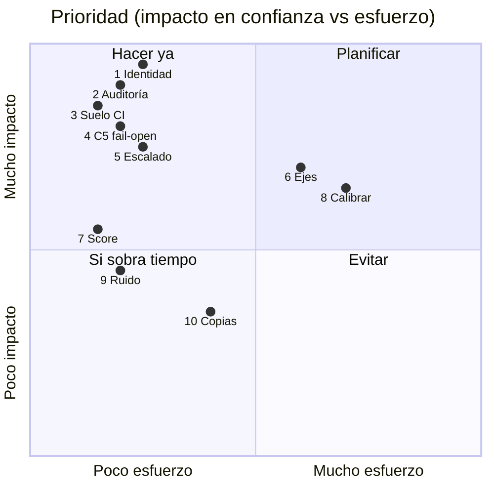
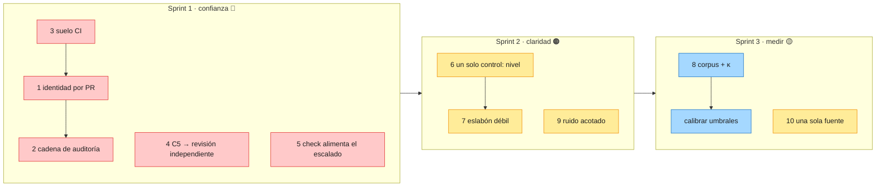

# Revisión experta — 10 puntos débiles y cómo resolverlos reutilizando lo que ya existe

Revisión del 2026-10-23 con criterio de arquitectura AWS, construcción de harnesses, QA y banca regulada.
Cada punto tiene **evidencia reproducible en este repositorio**, por qué importa y una solución que
**reutiliza piezas ya definidas** (marcadas con ♻️). Nada de esto está implementado todavía: es la
propuesta para decidir.

> **Estado (2026-10-23):** el sprint 1 (puntos 1–5) está implementado en la spec `trust-floor`: aprobadores en `setup` y obligatorios en `team`/`enterprise`, cadena de hashes en la auditoría, PR gate en `setup` para `team`/`enterprise`, `REVIEW_REQUIRED` cuando falta el sensor de C5, y `check` que escala y se detiene. Pendiente del punto 1: verificar las aprobaciones mediante revisión de PR (CODEOWNERS). Límites declarados al final de este documento.
>
> **Sprint 2 (puntos 6, 7, 9) implementado** en la spec `clarity`: el nivel fija el perfil mínimo (`profileFloor`, nunca por debajo de lo declarado); el titular de la puntuación es el eslabón más débil; el gate de estándares muestra solo lo que cambia, máximo 3. Pendiente del punto 6: que el hook de commit y el bloqueo de código sin spec también lean el perfil efectivo.
>
> **Sprint 3 (puntos 8, 10) implementado** en la spec `measure`: `assure calibrate` mide κ por detector sobre un corpus sembrado (cadena 0,70 · escalado 0,85 · EARS 0,75, precisión 1,00; ver `docs/MEASUREMENTS.md`); familia `trust` de mutantes (5/5 muertos); `npm run sync:templates` con `--check` en CI como fuente única de las skills compartidas y las reglas permanentes.

## Resumen

| # | Punto | Gravedad | Esfuerzo | Reutiliza |
|---|---|---|---|---|
| 1 | La identidad del aprobador la declara quien aprueba | 🔴 crítica | S | ♻️ PR gate, approvers.json, perfiles |
| 2 | El registro de auditoría se puede reescribir sin dejar rastro | 🔴 crítica | S | ♻️ sha256 de recibos, audit bundle, códigos críticos |
| 3 | En los proyectos destino el único suelo es un hook local saltable | 🔴 crítica | S | ♻️ `floor install --ci`, gates.yml |
| 4 | Un sensor ausente aprueba en silencio (C5 *fail-open*) | 🔴 crítica | S | ♻️ `C-INDEPENDENT-REVIEW`, recibos |
| 5 | El escalado a persona no ve el camino por defecto | 🔴 crítica | S | ♻️ `escalationVerdict`, `check`, Stop hook |
| 6 | Seis ejes de configuración y un valor por defecto que no protege | 🟠 alta | M | ♻️ niveles L0–L6, regla «nunca bajar el suelo» |
| 7 | Un número compuesto que esconde el eslabón más débil | 🟠 alta | S | ♻️ componentes ya medidos |
| 8 | La herramienta se verifica a sí misma y nada se calibra | 🟠 alta | M | ♻️ meta-eval (κ), patrón «falla con el código anterior» |
| 9 | Ruido consultivo: 110 avisos en cada `check` | 🟡 media | S | ♻️ objetivos de la delta, ficheros cambiados |
| 10 | Mantenimiento por copias: una regla toca ~50 ficheros | 🟡 media | M | ♻️ `_shared`, `ALWAYS_ON_RULES`, CLM-059 |

## 1. La identidad del aprobador la declara quien aprueba 🔴

**Evidencia.** Sin `.sdd/settings/approvers.json`, que `setup` no crea, `approverAllowed` acepta
cualquier `--by "<texto>"`. La confirmación por terminal (`confirmOnTty`) se supera con un pty
programático, y quedó documentado como residual.

**Por qué importa.** En banca, una aprobación sin identidad verificable equivale a no tener
aprobación. El CLI nunca podrá probar quién está frente al teclado.

**Solución ♻️.** Hay que sacar la identidad del CLI y llevarla a la plataforma, que ya la verifica:
- Las respuestas HIL ya son ficheros (`.sdd/hil/<feature>/HIL-*.answer.json`).
- En los perfiles `team` y `enterprise`, una respuesta que aprueba solo cuenta cuando llega a `main` mediante un PR aprobado por un CODEOWNER de `.sdd/hil/**`. El PR gate (`gates.yml`) ya existe; se le añade un check que lo exige.
- `setup` propone `approvers.json` a partir de los autores de `git log` (♻️ `gitIdentity`).
- `APPROVERS_REQUIRED`, que hoy solo aplica a la ceremonia estricta, pasa a ser obligatorio en `team` y `enterprise`.
- Resultado: el agente puede escribir la respuesta, pero no puede aprobar el PR.

## 2. El registro de auditoría se puede reescribir sin dejar rastro 🔴

**Evidencia.** `appendAudit` añade JSON por línea sin encadenar. El digest de un recibo de revisión
se fija en el log de auditoría, pero ese log se puede editar. Detectamos la manipulación del recibo,
pero no la del log que lo respalda.

**Por qué importa.** Un registro de auditoría que se puede editar no sirve como evidencia (EU AI Act,
SOX, normativa bancaria).

**Solución ♻️.**
- Cada evento guarda `prev`, el sha256 del evento anterior; es el mismo `sha256` que usan los recibos.
- `check` verifica la cadena y emite `AUDIT_CHAIN_BROKEN`, que se añade a ♻️ `CRITICAL_CODES`: escala a persona al primer intento.
- El hash de cabeza se incluye en ♻️ `audit bundle`, que ya lleva un sha256 por artefacto, y en un trailer del commit escrito por el pre-commit.
- Coste: unas 30 líneas.

## 3. En los proyectos destino el único suelo es un hook local saltable 🔴

**Evidencia.** `setup` escribe rigor, constitución, reglas, hook y plantillas, pero no un workflow de
CI. `git commit --no-verify` salta el hook. El propio repositorio declara que el nivel A es solo un
techo.

**Por qué importa.** Un control que el agente puede saltarse con un flag es una recomendación, no un
control.

**Solución ♻️.**
- `setup` incluye en el plan ♻️ `floor install --ci`, que ya genera el workflow de gates de PR. Lo instala por defecto en `team` y `enterprise`, y lo ofrece en `solo`.
- La puerta (`open-sdd`) muestra `suelo: local` o `suelo: CI` (♻️ `floor status`), para que nadie confunda los dos.

## 4. Un sensor ausente aprueba en silencio (C5 *fail-open*) 🔴

**Evidencia.** `steelforge check` en este repositorio imprime «Auto-autorizados por sensor no
disponible: C5». No se distribuye ningún backend de modelo, así que la alineación de intención nunca
se evalúa y aun así no bloquea.

**Por qué importa.** *Fail-open* es justo lo contrario de lo que espera un auditor: si falta el
sensor, el control debe fallar cerrado o pasar a una persona.

**Solución ♻️.** El sensor ausente se sustituye por la revisión independiente que ya definimos:
- Si C5 no tiene sensor, el paso exige un recibo de revisión (♻️ `review record`) de una persona o de un modelo distinto al autor (♻️ `C-INDEPENDENT-REVIEW`).
- En `solo` es consultivo. En `team` y `enterprise` bloquea con `REVIEW_REQUIRED`, que manda a `decide`.
- El sensor degradado deja de ser un agujero y pasa a ser una puerta humana.

## 5. El escalado a persona no ve el camino por defecto 🔴

**Evidencia.** `escalationVerdict` solo cuenta los `GATE_REFUSED` que llegan por `report` desde el
motor. El camino por defecto de `setup` son las plantillas de comando, sin motor. Un agente que
ejecuta `check` en bucle desde `/sdd-implement` nunca escala.

**Por qué importa.** La regla «atascado → persona» solo se cumple si el agente elige usar el motor.

**Solución ♻️.** Se cuenta donde todos pasan:
- `check` registra `CHECK_FAILED` con sus problemas estructurados en el mismo log de auditoría, por rama o por feature, y aplica ♻️ `escalationVerdict` sin cambios.
- Al escalar, `check` prepara la tarjeta (♻️ `prepareEscalationCard`) y sale con el código de puerta humana.
- El Stop hook que ♻️ `integrate` ya instala hace lo mismo al cerrar el turno del agente.

## 6. Seis ejes de configuración y un valor por defecto que no protege 🟠

**Evidencia.**
- Ejes: nivel L0–L6, variante (2), rigor (4), perfil de gobierno (3), ceremonia (3) y 25 playbooks: más de 1.000 combinaciones, de las que solo 48 están probadas.
- El perfil por defecto es `solo` («nothing blocks»), y aun así la puerta dice «gates OK · SDD 93 %».

**Por qué importa.** Nadie razona sobre seis ejes. El valor por defecto decide la seguridad real, y
hoy el valor por defecto no bloquea nada.

**Solución ♻️.** Un único control: el **nivel**, que `start` ya calcula a partir del riesgo.
- El nivel fija rigor, perfil, ceremonia y playbook en una sola tabla de `levels.ts`:
  - L0–L2 → `solo`
  - L3–L4 → `team`
  - L5–L6 → `enterprise`
- Se aplica la misma regla que el rigor (♻️ «nunca por debajo del suelo»): `governance.json` puede subir el perfil, nunca bajarlo.
- Los demás ejes pasan a ser derivados, y sus flags quedan en `help --all` para expertos.

## 7. Un número compuesto que esconde el eslabón más débil 🟠

**Evidencia.** En este repositorio, `SDD 93 %` convive con `evidencia 53 %`. Los pesos (20/15/15/15/10/15/10)
no están calibrados.

**Por qué importa.** En QA y en banca, la confianza de una cadena es la de su eslabón más débil. Un
promedio alto tranquiliza justo cuando no debería.

**Solución ♻️.**
- El titular pasa a ser el componente más bajo de los ya medidos: «SDD 53 % · eslabón débil: evidencia».
- El compuesto queda como detalle.
- Cero cálculo nuevo: los componentes ya existen.

## 8. La herramienta se verifica a sí misma y nada se calibra 🟠

**Evidencia.**
- Los 84 claims los ejecuta el propio CLI.
- Los 110 hallazgos de estándares son consultivos «hasta que un corpus mida su precisión», y no hay plan de corpus.
- El umbral «3» y la definición de progreso tampoco están medidos.
- ♻️ `metaEval` (κ de Cohen, N=120 preregistrado) existe y no se usa.

**Por qué importa.** Sin calibración, «bloquea» y «consultivo» son opiniones.

**Solución ♻️.** Un corpus de defectos sembrados que reutiliza el patrón de `qcCritical`
(«falla con el código anterior»):
- Se inyectan defectos conocidos en fixtures pequeñas: requisito huérfano, EARS inválido, recibo manipulado, bucle A,B,A.
- Se mide la tasa de detección por gate con ♻️ `cohensKappa`.
- Un estándar pasa a bloquear cuando supera ♻️ `SUBSTANTIAL_KAPPA` (0,61), la regla que ya está escrita.
- El umbral de escalado se ajusta con los `ESCALATED_TO_HIL` reales por motivo.

## 9. Ruido consultivo: 110 avisos en cada `check` 🟡

**Evidencia.** `check` en este repositorio informa de 110 hallazgos consultivos de 16 estándares, y
0 bloqueantes.

**Por qué importa.** La fatiga de alertas hace que también se ignoren los avisos que importan.

**Solución ♻️.**
- Solo se muestran los hallazgos sobre lo que cambia: objetivos de la delta (♻️ `delta`) o ficheros cambiados (♻️ `--staged` / `--base`).
- Se muestran como máximo 3, ordenados por gravedad.
- El resto queda en `check --all`: el mismo principio que los cinco verbos.

## 10. Mantenimiento por copias: una regla toca ~50 ficheros 🟡

**Evidencia.**
- 30 skills × 9 árboles idénticos, más 19 quickstarts y 22 plantillas.
- Hoy cada regla nueva tocó entre 19 y 38 ficheros, dos veces.
- CLM-059 vigila que las copias sean idénticas, pero no evita tener que editarlas.

**Por qué importa.** Cada copia es una oportunidad de deriva, y un riesgo de revisión en cada PR.

**Solución ♻️.**
- Una sola fuente: ♻️ `templates/agents/_shared` para las skills y un bloque generado entre marcadores (`<!-- open-sdd:rules -->`) en los quickstarts, rellenado desde ♻️ `ALWAYS_ON_RULES`.
- El build genera los árboles; CLM-059 sigue como guarda.

## Orden recomendado

El sprint 1 cierra la cadena de confianza de extremo a extremo:
- el suelo está en el servidor (3);
- quien aprueba es una persona verificada por la plataforma (1);
- lo que se aprobó no se puede reescribir (2);
- ningún sensor ausente aprueba (4);
- ningún bucle escapa al escalado (5).

Son cinco cambios pequeños, y cada uno reutiliza piezas que ya existen.

## Límites declarados tras el sprint 1

| Límite | Mitigación propuesta |
|---|---|
| Borrar las últimas líneas de un log de auditoría no se detecta (nada ancla la cabeza de la cadena) | anclar el hash de cabeza fuera del log: trailer del commit o comparación en CI contra la rama base |
| Dos escrituras concurrentes pueden romper la cadena | escribir bajo el bloqueo que el motor ya usa para su estado |
| Logs commiteados en dos ramas se rompen al fusionarse | logs por rama o driver de merge `union` |
| Sin spec, la feature de `REVIEW_REQUIRED` cae a `governance` | exigir la feature real y fallar cerrado cuando no se conoce |
| `.sdd/engine/_check*` commiteado lleva una tarjeta abierta a otra máquina | ignorarlo en git; en CI `check` no bloquea |
