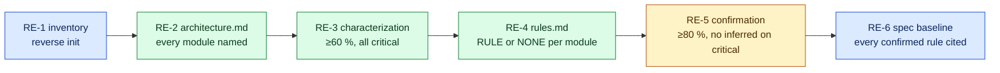

# Every flavour: levels × variants × rigor, reverse engineering, assistants, progress (v3.9.0)

```bash
open-sdd start "<intent>" [--variant greenfield|brownfield] [--rigor tiny-spec|spec-first|spec-anchored|spec-as-source] --dry-run
```

## Levels × variants

| Level | Greenfield | Brownfield |
|---|---|---|
| L0 tiny | `tiny` | `tiny` |
| L1 PoC | `spike` (or `poc-to-feature`) | `poc-brownfield` (characterize the touched area first) |
| L2 feature | `base/spec-first` (`bug`, `refactor` by intent) | `brownfield-extension`, or `legacy-untested` without tests |
| L3 small project | `greenfield` | `project-brownfield` (getspecs, constitution, delta, contracts) |
| L4 medium | `multi-feature` | `multi-feature-brownfield` |
| L5 large | `multi-unit-greenfield` | `multi-unit` (AI-DLC reverse engineering stage) |
| L6 modernization | `modernize` | `modernize` |
| reverse engineering | — | `reverse-engineering` (≥ L3) |

The variant comes from the intent ("existing", "legacy", "current system" → brownfield; "from scratch", "new app" → greenfield), else from the workspace (source code present → brownfield). `--variant` overrides it.

## Rigor ladder

| Rigor | Adds | Floor for |
|---|---|---|
| tiny-spec | three-line spec, the change, fresh evidence | L0–L1 |
| spec-first | EARS requirements, constitution, design, tasks, C1+C2 | L2–L4 |
| spec-anchored | design validation, Gherkin, waves, validation, audit bundle, archive (C3, C6) | L5–L6 |
| spec-as-source (spec-as-code) | discovery, contracts, audit | — |

Rigor is composed onto the variant playbook (`.sdd/playbooks/<feature>-<rigor>.playbook.json`). A request below the floor — or below a declared `.sdd/settings/rigor.json` — is raised with a warning; steps the variant cannot feed are skipped with the reason.

## Reverse engineering mode (multi-stage brownfield)



```bash
open-sdd reverse init --scope payments --critical payments   # first slice
open-sdd reverse next                                         # open stage and what closes it
open-sdd reverse confirm RULE-PAY-001 --by "Ana"              # a person confirms an inferred rule
open-sdd reverse init --scope accounts                        # next slice: adds, keeps the rest
open-sdd reverse status --mermaid
```

Rules live in `.sdd/reverse/rules.md` as `- RULE-PAY-001 [payments] text — inferred` (or `— confirmed by Ana (date)`, or `- NONE [module] … — confirmed by …`). Thresholds: `.sdd/settings/reverse.json` (`minCharacterized`, `minConfirmed`). Under `start "reverse engineer …"`, the engine refuses to complete a stage step whose criteria are unmet.

## Assistants

| Command | What it does | Who decides |
|---|---|---|
| `open-sdd assist` | recommends assistants from the repository state | — |
| `assist discover "<idea>"` | role questions (analyst, PM, architect, UX, QA, security) by level, variant, UI and risk | person answers; agent only `ASSUMPTION:` |
| `assist brief <f> --write` | composes and lints `brief.md` | lint blocks open assumptions |
| `assist ears "<text>"` | converts EN/ES sentences to EARS; vague, capability-only, compound or actor-less sentences become questions | person answers |
| `assist ears review <f>` | EARS assistant over `requirements.md` | — |
| `assist steering --write` | drafts product/tech/structure, every guess `(inferred)` | person confirms; `steering check` |
| `assist constitution [--draft\|--interview]` | constitution from the code, or the interview | ratified by a named person |

## Where are we

```bash
open-sdd where                    # every run: phase, progress bar (by step cost), pending, waiting decisions
open-sdd where bank-mod --save --note "before CAB"   # .sdd/state/checkpoint.md + .json to resume anywhere
open-sdd where --line             # one line for a shell prompt: "csv 40% sdd-spec-design ⚑1"
```

Percentages count planned work weighted by step cost, not a schedule; the remaining-time estimate appears only after three timed steps and is labelled uncalibrated.
