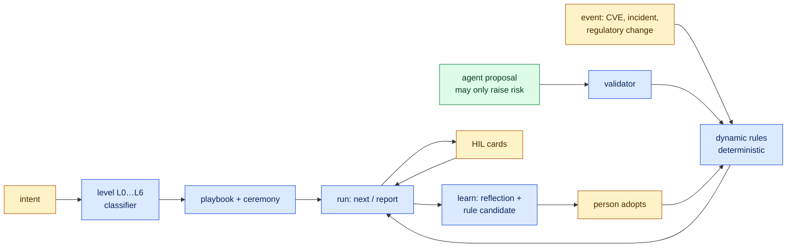

# Migration Kit and the level ladder

> The command is `steelforge migrate`; `steelforge modernize` remains as an alias. Data stays in `.sdd/modernize/`.

One entry point for any size of work — a typo, a PoC, a feature, a project, a programme, a full legacy
modernization — where **strategy is decided by a deterministic engine** (no model), **agents only
propose**, and **named people decide**. Unplanned events (a security patch on go-live day) reshape the
running workflow by rule, and the system learns from them with evidence.



## 1 · The level ladder

| Level | Example intent | Playbook | Ceremony |
|---|---|---|---|
| L0 tiny | "fix typo in README" | `tiny` | minimal — no pack, no recall |
| L1 PoC | "prototype voice search" | `spike` / `poc-to-feature` | minimal |
| L2 feature | "add CSV export", "fix the crash", "refactor orders" | `base/spec-first`, `bug`, `refactor`, `brownfield-extension` | standard |
| L3 small project | "new service for document signing from scratch" | `greenfield` | standard |
| L4 medium | "platform with onboarding, billing and notifications" | `multi-feature` | standard |
| L5 large | "split billing into 3 microservices" | `multi-unit` | strict — approvers required |
| L6 migration | "migrar el mainframe de pólizas", "salida del datacenter", "de Oracle a PostgreSQL" | `modernize` | strict |

```bash
steelforge start "fix typo in README"            # L0: two steps, done in three commands
steelforge start "prototype voice search" --dry-run
steelforge start "add refunds to payments"       # L2 + payments risk
```

Rules that never bend: a risk word (payments, auth, personal data, migration, infra, data) only raises
the level — "fix typo in the login page" is L2; a PoC with personal data is L2; an explicit PoC stays a
PoC even about a big subject ("PoC of mainframe modernization") and gets a warning instead. When a tiny
change turns out to touch something risky, a `signal` event raises the run to L2 and inserts
requirements and a human design review.

## 2 · Migration Kit

```bash
steelforge migrate init --example banking     # .sdd/modernize/portfolio.json
# other enterprise examples: insurance-mainframe · datacenter-exit · database · monolith
steelforge migrate assess                     # risk score + AWS 7 Rs per component, with rule and reason
steelforge migrate override crm retain --by "Ana" --reason "contract renewal in Q2"
steelforge migrate waves                      # retire first → pilot → dependency-ordered waves
steelforge migrate plan bank-mod              # L6 run, strict ceremony, units and waves
steelforge migrate wave bank-mod 1            # rules insert each component's steps
steelforge migrate advance auth-service --to canary-25 --metrics canary.json
steelforge migrate status --html              # one offline page for the steering committee
```

**7 Rs decision table** (first match wins; AWS Prescriptive Guidance, *About the migration strategies*):

| Rule | R | When |
|---|---|---|
| D-RETIRE | retire | no inbound use |
| D-RETAIN-RESIDENCY | retain | data residency hold |
| D-RETAIN-RECENT | retain | recently upgraded |
| D-REPURCHASE | repurchase | SaaS equivalent and not differentiating |
| D-MAINFRAME-REFACTOR | refactor | mainframe/mid-range with high business demand |
| D-MAINFRAME-RETAIN | retain | mainframe/mid-range otherwise (detailed assessment first) |
| D-REFACTOR / -LARGE | refactor | high demand and poor fit or low coverage |
| D-REPLATFORM | replatform | end of life or poor fit (in large migrations: move first, modernize after) |
| D-RELOCATE | relocate | VMware estate |
| D-REHOST | rehost | otherwise |

**Waves:** retire what nobody calls first; one pilot that is not regulated and has criticality < 4; then
dependency levels, lowest risk first, at most `--max` per wave and at most one criticality-5 component per
wave; retained components stay out and their hybrid dependents are listed.

**Lifecycle** (refactor): planned → characterized → facade → parallel-run → canary-5 → canary-25 →
canary-50 → cut-over → decommissioned. Canary moves are decided from metrics (`rollback` beyond 2× the
error budget or 10× the mismatch threshold; `hold` when any criterion or the sample size is unmet). A
frozen component cannot move forward. Cut-over of regulated or criticality ≥ 4 components and every
decommission wait for a person's card; decommission is `irreversible-damage` and defaults to park.

## 3 · Dynamic workflows without a model

Rules live in `templates/modernize/rules.default.json` and `.sdd/settings/dynamic-rules.json` (a project
rule with a default id replaces it). Each rule: `{id, on, when, priority, actions}`; evaluated per
affected component, priority then id, over a flat signal map (`severity`, `cvss`, `exploited`, `env`,
`stage`, `disposition`, `criticality`, `regulated`, `sbom`, `dual`, `level`…). Actions: `insert-steps`,
`patch-both`, `freeze`, `require-hil`, `set-deadline`, `raise-level`. The decision carries a digest of its
inputs; the same event twice is a no-op.

### The real test: a critical CVE on go-live day

```mermaid
sequenceDiagram
  participant S as Scanner
  participant O as open-sdd (rules)
  participant A as Agent
  participant P as Person (CAB)
  S->>O: event CVE CVSS 10, exploited, auth-service + card-processing
  O->>O: severity critical · deadline 24 h · freeze both · lane first in the queue
  O->>O: auth-service in parallel run → patch legacy AND modern
  O->>O: card-processing regulated → C2 security gate
  O->>P: emergency-change cards (default park)
  A->>O: proposal "card not affected" → rejected (a person decides that)
  A->>O: proposal "crm also bundles the lib" + bulletin → admitted → crm lane added
  P->>O: hil answer --by "Ana" --confirm HIL-0001 (listed approver, same git identity)
  A->>O: exposure → patch → regression → gate (reports)
  O->>O: resolve → unfreeze → canary may proceed
  O->>P: learn: lesson quarantined (1 event) + rule candidate "SBOM at wave start"
  P->>O: rules adopt --by "Ana" --confirm
  Note over O: next wave inserts dependency scans; next advisory is a lookup (lower cost)
```

The whole story runs as `test/mkBankingScenario.test.ts` (20 ordered steps).

## 4 · Who decides what

| Decision | Deterministic engine | Agent (model) | Named person |
|---|---|---|---|
| Level, playbook, ceremony | ✓ | — | may force `--level` (recorded) |
| 7 Rs, risk, waves | ✓ | gathers portfolio facts | overrides (recorded) |
| Steps inserted by an event, freeze, deadline | ✓ | — | — |
| More risk on an event | validates | proposes with evidence | — |
| "Not affected", emergency change, cut-over, decommission | prepares the card | — | ✓ |
| Adopting a learned rule, promoting a lesson | proposes | — | ✓ |

## What is not verified

- Thresholds (SLA hours, canary criteria) are defaults to replace with your policy, not regulatory values.
- The 7 Rs table encodes AWS guidance as rules; it does not replace a portfolio assessment with the owners.
- Agent-session detection is a speed bump, not authentication; git identity and `approvers.json` are the record.

Sources: [AWS — About the migration strategies (7 Rs)](https://docs.aws.amazon.com/prescriptive-guidance/latest/large-migration-guide/migration-strategies.md) ·
[AWS — AI-Driven Development Life Cycle](https://aws.amazon.com/blogs/devops/ai-driven-development-life-cycle).
