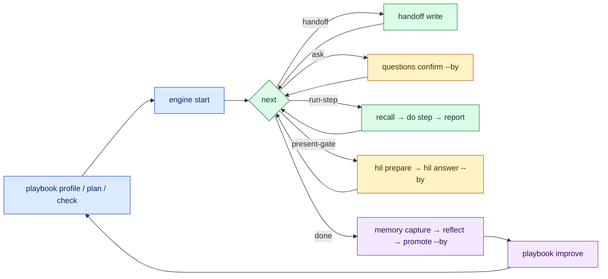
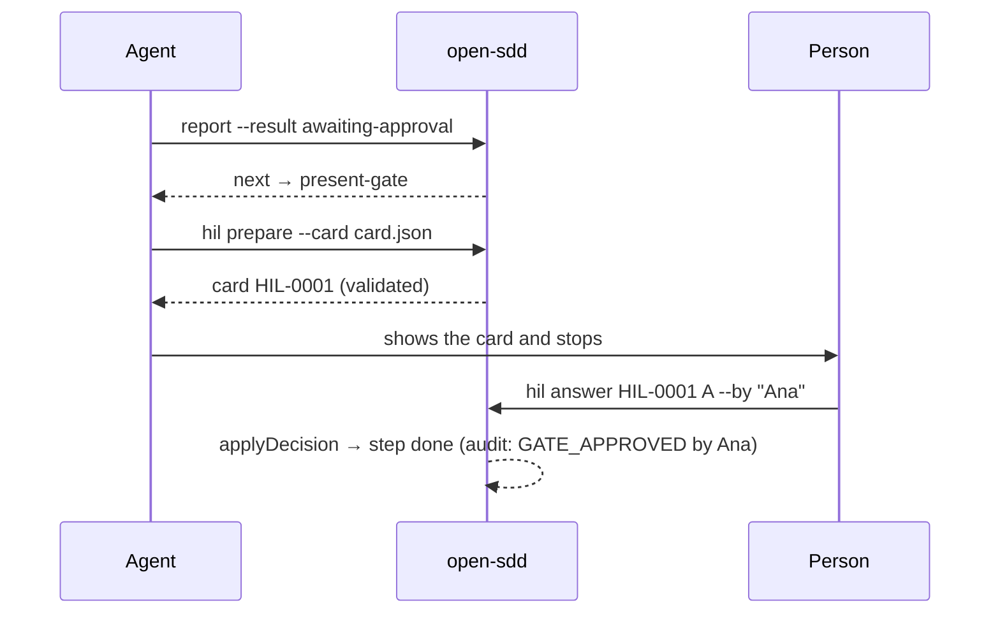

# Playbooks: plan → run → check → decide → learn → improve (v3.7.0)

A **playbook** is the process for one case (a bug, a brownfield extension, a multi-unit change, a spike…).
open-sdd plans it, checks it, and then drives the agent one step at a time through a host-agnostic
contract: `next` says what to do, `report` says what happened. Approvals come only from a named person.

Sources of method: AWS AI-DLC (stages, units of work) and Google Harness² (propose‑probe‑compose,
reflection with confounders). Neither runtime is required.

## The cycle



## Who decides what

```mermaid
flowchart TB
  classDef cli fill:#dbeafe,stroke:#1d4ed8,color:#0b2559
  classDef agent fill:#dcfce7,stroke:#15803d,color:#0b3a1c
  classDef human fill:#fef3c7,stroke:#b45309,color:#4a2a00
  CLI[open-sdd: which step, gate verdicts, staleness, admission of lessons]:::cli
  AG[Agent: does the step, restates the goal, prepares cards]:::agent
  HU[Named person: answers cards, confirms questions, promotes lessons, reviews artifacts]:::human
  CLI -- directive --> AG
  AG -- report --> CLI
  AG -- card --> HU
  HU -- hil answer --by --> CLI
```

## Commands

| Command | What it does |
|---|---|
| `open-sdd playbook profile` | Detected signals (terrain, tests, IaC, governance, AI-DLC…) and project type |
| `open-sdd playbook plan "<intent>" [--save name]` | Model-free plan: uncertainty bands, steps kept/skipped with reasons, nearest library playbook. The composite score is **uncalibrated** |
| `open-sdd playbook check <name\|file>` | Unknown keys, unknown step types, bad `when`, starved steps (`STARVED_STEP`) → exit 1 |
| `open-sdd playbook build <name> --target <host\|prompt\|mcp\|aidlc> [--write]` | Render the playbook for a host; plan only without `--write` |
| `open-sdd playbook improve <name> [--k n]` | Propose‑probe‑compose over recorded runs; `KEEP_BASE` when nothing improves |
| `open-sdd engine start <feature> --playbook <name> [--autonomous]` | Start a run (only a playbook that passes the checker) |
| `open-sdd next <feature> --json` | One directive: `run-step`, `ask`, `present-gate`, `handoff`, `parked`, `done`, `error` |
| `open-sdd report <feature> --step <id> --result <r>` | `started`, `awaiting-approval`, `completed`, `rejected`, `revised`, `skipped`, `park`, `unpark`. `approved` is always refused |
| `open-sdd handoff write\|recall\|check <feature> <step>` | Bounded context pack, recall check, stale inputs |
| `open-sdd questions check\|confirm <feature> <step>` | Complete answers, named confirmation |
| `open-sdd hil prepare\|answer\|list\|stats <feature>` | Decision cards; the default may only park or reject |
| `open-sdd memory capture\|reflect\|promote\|withdraw\|list` | Lessons with provenance; confounded-only evidence is quarantined |
| `open-sdd review record <feature> <step> --by <name> --artifact <p>` / `review freeze-check <files>` | Review receipts; the pre-commit hook refuses a reviewed file that changed after review |
| `open-sdd waves <feature> --baseline <n> --protect <p>` / `--verify <n> --check "<cmd>"` | Wave referee: merge refused on a failed unit or a tampered protected file |

MCP: `open_sdd_next` and `open_sdd_report` expose the same contract to any MCP host.

## The HIL gate



## v3.7.0 — trust, scale and visibility

| Area | What changed |
|---|---|
| Human in the loop | `hil answer` records the git identity; `.sdd/settings/approvers.json` restricts who may answer; from an agent session (no TTY, `CLAUDECODE=1`, `OPEN_SDD_AGENT=1`) an approval needs `--confirm <card-id>` typed by the person. Overdue cards take their default (park/reject) on the next `next` (`DEADLINE_APPLIED`); `hil list --overdue`; `hil review --html` writes one offline review page. |
| Continuous improvement | `playbook improve` counts the rejections a removed step caught as `unobservedRisk` and never keeps a candidate that removes a human or security control. Refused reports and edits of reviewed files reach the memory inbox automatically. |
| Efficiency | `report --tokens --model --duration`; `engine status` shows time and tokens per step. |
| Planning | The planner reads scale ("3 microservices", "across api and web repos", feature lists) and risk (payments, auth, PII, migration, infra, data) from the intent: `multi-unit`/`multi-feature` when it fits, and a human `risk-review` after design when a risk is named. |
| Multi-unit | `engine start --units api,web:api` (or sibling repos) computes waves; one writer per feature (lock). |
| Experience | `next` speaks in sentences; `next --auto-handoff`; `engine list`; `engine status --mermaid`. |
| Authoring | `playbook.schema.json` for editors; `playbook new --from <base> --add phase:use[:human] --skip id`; `playbook diff a b`; recipes `poc-to-feature` and `brownfield-aidlc-inception`. |

### Which playbook for which case

| Case | Start with |
|---|---|
| PoC / spike | `spike`, or `poc-to-feature` when a positive verdict should become a feature |
| One feature, existing code with tests | `brownfield-extension` |
| Small greenfield project | `greenfield` |
| Several features | `multi-feature` (the planner picks it for ≥3 listed features) |
| Several services or repositories, end to end | `multi-unit` (AI-DLC stages + waves) |
| Legacy without tests | `legacy-untested` |
| AI-DLC inception on existing code | `brownfield-aidlc-inception` |
| Tune any of them from evidence | `playbook improve` (Harness² propose‑probe‑compose; reductions of control always go to a person) |

## What is not verified

- AI-DLC plugin (`templates/integrations/aidlc-plugin/opensdd/`): its schema has not been run through
  the AI-DLC validator (AC-10 not run).
- The planner composite score and the improvement metrics are not calibrated against real outcomes.
